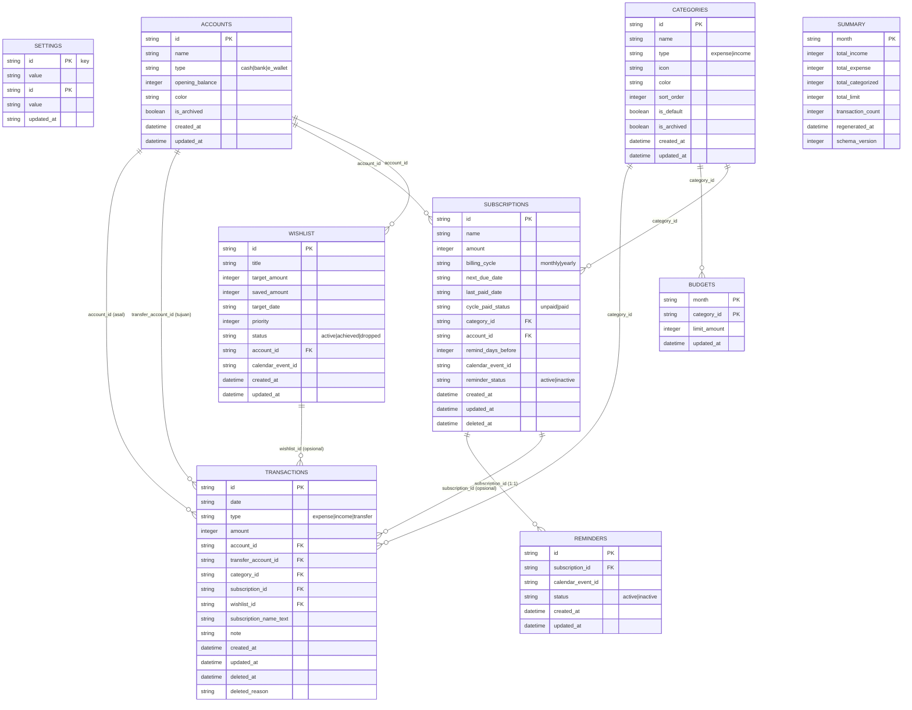

# Skema Database (Google Sheets) — BudgetKu

> Satu spreadsheet per pengguna. Tanpa server DB. Rujukan: PRD §8, §10; IA §6, FL-01, FL-03.
> Konvensi ID: **DS-xx** (keputusan), **IC-xx** (integritas), **PA-xx** (pola akses), **MI-xx** (migrasi), **PR-xx** (proteksi), **LIM-xx** (batas), **AS-xx** (asumsi), **T-xx** (pertanyaan).

---

## 0. Ringkasan & Penyimpangan dari PRD §10

### 0.1 Prinsip

| ID | Prinsip |
| --- | --- |
| DS-01 | Baris 1 = header. Kolom A = `id` (teks UUID). Tidak ada nomor baris sebagai kunci. |
| DS-02 | Semua nilai uang = integer rupiah. Kolom Rupiah diformat `#,##0` tapi disimpan sebagai angka. |
| DS-03 | Semua tanggal = string `YYYY-MM-DD` (kolom teks), waktu = string ISO-8601 UTC dengan `Z`. |
| DS-04 | Enum = teks berbahasa Indonesia bila tampil ke pengguna (IA §7), ASCII bila dipakai mesin. Pilihan di §2.2. |
| DS-05 | Nama tab & header **tidak boleh** memakai prefiks reserved Google Sheets (`A1`, `R1C1`, `Z$1`) |
| DS-06 | Nama tab berupa satu kata tanpa spasi: `Accounts`, `Categories`, `Transactions`, `Budgets`, `Subscriptions`, `Wishlist`, `Reminders`, `Summary`, `Settings`, `Transactions_2026`. |
| DS-07 | Semua tulis layanan = satu `values.batchUpdate` (BT-02); append hanya untuk tambah 1 baris (BT-04). |
| DS-08 | Semua operasi idempoten: upsert berbasis kunci, `append` dengan `id` dari server (PRD CF-08, NFR-30). |

### 0.2 Pemetaan rancangan awal ↔ PRD §10

| Rancangan awal | Keputusan dokumen ini | Alasan |
| --- | --- | --- |
| `Settings` | **Dipertahankan** sebagai tab ke-9, isi digabung: preferensi + `schema_version` + `onboarding_done` | PRD §10.9 `Meta` sudah mencampur preferensi & versi; satu tab cukup (DS-09). |
| `Accounts.initial_balance` | **Dipertahankan**, tapi diubah nama → `opening_balance`, default 0, hanya boleh diubah sekali per akun | PRD `Akun` melarang saldo tersimpan (BR-11) tetapi pengguna baru butuh baseline; lihat DS-10 + T-02. |
| `Accounts.type` = `cash|bank|ewallet|credit_card` | **Hapus `credit_card`, ganti `ewallet` → `e_wallet`** (nilai ASCII). | IA A-24: hanya Tunai/Bank/E-wallet. Enum ASCII agar filter & validasi sel konsisten. |
| `Categories` tanpa `isi` | **Tambah `is_default`** dan `sort_order` dipertahankan | Kategori bawaan A-27 perlu dikenali saat migrasi; `sort_order` dipakai UI. |
| `Transactions.deleted_at` | **Dipertahankan** (soft delete) + tambah `deleted_reason` | FR-12 "hapus" tetap harus bisa diaudit; baris soft-deleted tidak dihitung di semua total (BR-31). |
| `Transactions` tanpa `is_transfer_peer` | **Dipertahankan sebagai satu baris** dengan `transfer_account_id` | IA §6: transfer tampil 1 baris ⇄, bukan 2. |
| `Budgets.id` | **Hapus kolom `id`**, ganti kunci gabungan `month` + `category_id` di kolom A/B | Baris harus upsert, bukan append (FR-25). Lihat DS-11. |
| `Budgets.rollover` | **Hapus dari MVP** | BR-05: tanpa rollover; FR-69 v1.1. Tambah kolom = migrasi (MI-02). |
| `Subscriptions.billing_cycle` = `weekly|monthly|yearly` | **Hapus `weekly`** | IA A-19: hanya Bulanan & Tahunan. |
| `Subscriptions.billing_day` | **Hapus**, ganti `next_due_date` saja (sudah ada) | Diturunkan dari `next_due_date`; dua sumber = konflik (DS-12). |
| `Subscriptions.status` = `active\|paused\|cancelled` | **Dihapus**; status pengingat & status lunas dipisah | PRD §10.5: `status_lunas_siklus` + `status_pengingat`. Tidak ada konsep paused. |
| `Subscriptions.remind_days_before` | **Dipertahankan** (default 3) | A-29: reminder 3 hari + hari-H; nilai dipakai untuk override Calendar. |
| `Wishlist.target_amount`/`saved_amount` | **Ganti nama** → `target_amount`, `saved_amount` tetap; status diturunkan | PRD §10.6 memakai `status`; lihat DS-13 (status turunan, tidak disimpan ulang bila bisa dihitung). |
| `Reminders` (generic, `linked_type`/`linked_id`/`rrule`) | **Dipersempit**: 1 baris per langganan, tanpa `rrule`/`remind_minutes` | RRULE = milik Calendar, bukan Sheets (A-06). Lihat DS-14. |
| tanpa tab arsip | **Tambah** `Transactions_YYYY` | LIM-03. |
| `Summary` tidak ada di rancangan awal | **Tambah** | A-07, NFR-01. |

### 0.3 Asumsi dokumen ini

| ID | Asumsi | Alasan |
| --- | --- | --- |
| AS-01 | Tetap 9 tab aktif MVP (`Settings` = tab ke-9, menggantikan `Meta` PRD §10.9). | Q-PRD-01 belum dijawab; satu tab lebih hemat (DS-09). |
| AS-02 | Zona waktu penyimpanan waktu = UTC; tampilan = zona perangkat. | Menghindari ambiguitas; BR-14 (jam server). |
| AS-03 | Zona kalender Google pengguna dipakai untuk tanggal event (CR-04). | PRD §7.4. |
| AS-04 | Tidak ada `credit_card` pada MVP; akun kartu kredit dimodelkan sebagai akun `bank` biasa. | IA A-24. |
| AS-05 | Pengguna boleh mengedit sel manual; aplikasi tidak boleh menimpa kolom yang diedit kecuali baris itu ditulis aplikasi. | PRD CF-03. |
| AS-06 | Pengguna diasumsikan < 3.000 transaksi/tahun. | Pasangan LIM-03. |

---

## 1. Diagram ER



### 1.1 Catatan diagram

| ID | Catatan |
| --- | --- |
| DS-15 | Sheets tidak menegakkan relasi. Garis = relasi logis yang divalidasi kode (§3). |
| DS-16 | `TRANSACTIONS.transfer_account_id` hanya terisi bila `type='transfer'`; `category_id` harus kosong saat transfer (FR-08). |
| DS-17 | `REMINDERS` selalu 1:0..1 terhadap `SUBSCRIPTIONS`: unik `subscription_id` (IC-08). |
| DS-18 | `SUMMARY` tidak berelasi FK; kuncinya `month` dan nilainya turunan dari `TRANSACTIONS` + `BUDGETS` (BR-13). |
| DS-19 | Tab arsip `Transactions_YYYY` punya skema **identik** dengan `Transactions` (LIM-03). |

---

## 2. Konvensi Nilai

### 2.1 Tipe kolom

| Tipe Sheets | Penulisan | Pembacaan |
| --- | --- | --- |
| Teks | `setNumberFormat('@')` sebelum tulis | selalu `string` |
| Angka uang | number format `#,##0`; tulis angka mentah (`1250000`) | parse dengan `Number()`, tolak bila bukan integer |
| Tanggal | teks `YYYY-MM-DD` (bukan date type) | parse regex `^\d{4}-\d{2}-\d{2}$` |
| Waktu | teks ISO-8601 UTC `2026-08-14T03:21:00.000Z` | `new Date(s)` |
| Boolean | teks `TRUE`/`FALSE` (huruf besar) | `s === 'TRUE'` |
| Enum | teks ASCII huruf kecil (§2.2) | bandingkan eksak |

Alasan tanggal sebagai teks: nilai date asli Sheets berubah حسب locale spreadsheet dan zona waktu, sementara BR-22 memakai tanggal perangkat.

### 2.2 Enum kanonik

| Domain | Nilai kanonik (disimpan) | Label UI (IA §7) |
| --- | --- | --- |
| `Accounts.type` | `cash`, `bank`, `e_wallet` | Tunai, Bank, E-wallet |
| `Categories.type` | `expense`, `income` | Pengeluaran, Pemasukan |
| `Transactions.type` | `expense`, `income`, `transfer` | Pengeluaran, Pemasukan, Transfer |
| `Subscriptions.billing_cycle` | `monthly`, `yearly` | Bulanan, Tahunan |
| `Subscriptions.cycle_paid_status` | `unpaid`, `paid` | Belum, Lunas |
| `*.reminder_status` / `Reminders.status` | `active`, `inactive` | Pengingat aktif / tidak aktif |
| `Wishlist.status` | `active`, `achieved`, `dropped` | Berjalan, Tercapai, Dibatalkan |
| `Transactions.deleted_reason` | `user_delete`, `manual_sheet_edit`, `migration` | — |

### 2.3 Nilai default & sentinel

| ID | Aturan |
| --- | --- |
| DS-20 | Kolom opsional kosong = string kosong `""`, **bukan** `"-"` atau `"null"`. |
| DS-21 | Angka 0 pada kolom uang opsional berarti 0 nyata; tidak ada sentinel negatif. |
| DS-22 | `deleted_at` kosong = baris aktif. Terisi = baris diabaikan di semua pembacaan (BR-31). |
| DS-23 | Tidak ada baris header ganda; tidak ada baris total di dalam tab data (total = turunan, §4). |

---

## 3. Kamus Data

Notasi: **Wajib** = harus terisi; **O** = opsional (boleh `""`). Urutan kolom = urutan header (kolom A dst). Menambah kolom **hanya di akhir** (MI-01).

### 3.1 `Settings` (A–C)

Key-value. Baris = 1 setelan.

| # | Kolom | Tipe | Wajib | Default | Validasi | Contoh |
| --- | --- | --- | --- | --- | --- | --- |
| A | `id` | teks (key) | Wajib | — | unik, `^[a-z0-9_]+$`, ≤ 40 | `currency` |
| B | `value` | teks | Wajib (boleh "") | — | sesuai kunci (§3.1.1) | `IDR` |
| C | `updated_at` | ISO-8601 UTC | Wajib | waktu tulis | regex ISO + `Z` | `2026-08-14T03:21:00.000Z` |

**Kunci wajib** (dibuat saat bootstrap; hilang = dibuat ulang dengan default):

| `id` | Tipe nilai | Default | Dipakai |
| --- | --- | --- | --- |
| `schema_version` | integer teks | `1` | MI-01 |
| `currency` | enum teks | `IDR` | A-08 |
| `locale` | teks BCP-47 | `id-ID` | format angka |
| `timezone` | teks IANA | `Asia/Jakarta` | BR-22 |
| `first_day_of_week` | `1`..`7` | `1` (Senin) | FR-29 |
| `calendar_id` | teks | `primary` | CR-04 |
| `onboarding_done` | `TRUE`/`FALSE` | `FALSE` | FR-63..FR-65 |
| `last_used_account_id` | UUID atau "" | `""` | FR-21 |
| `summary_dirty` | `TRUE`/`FALSE` | `TRUE` | A-07 regenerasi |
| `archive_before` | `YYYY-MM-DD` atau "" | `""` | LIM-03 |
| `apps_script_installed` | `TRUE`/`FALSE` | `FALSE` | A-40 |

**Kunci opsional** (boleh tidak ada): `default_account_id`, `last_backup_at`, `app_version_seen`.

### 3.2 `Accounts` (A–H)

| # | Kolom | Tipe | Wajib | Default | Validasi | Contoh |
| --- | --- | --- | --- | --- | --- | --- |
| A | `id` | UUID v4 teks | Wajib | dibuat server | `^[0-9a-f]{8}-...{12}$`; unik | `6f1c…9a2b` |
| B | `name` | teks | Wajib | — | trim, 1–40, unik antar akun `is_archived=FALSE` (case-insensitive) | `BCA` |
| C | `type` | enum | Wajib | `cash` | `cash`\|`bank`\|`e_wallet` | `e_wallet` |
| D | `opening_balance` | integer | Wajib | `0` | integer, ≥ 0, ≤ 999.999.999.999; **tidak boleh diubah setelah ada transaksi** (BR-32) | `250000` |
| E | `color` | teks hex | Wajib | `#7C6AF0` | `^#[0-9A-F]{6}$`, dari palet DS | `#0EA5A0` |
| F | `is_archived` | boolean | Wajib | `FALSE` | `TRUE`/`FALSE` | `FALSE` |
| G | `created_at` | ISO-8601 UTC | Wajib | waktu server | regex ISO | `2026-08-01T09:00:00.000Z` |
| H | `updated_at` | ISO-8601 UTC | Wajib | waktu server | ≥ `created_at` | `2026-08-14T03:21:00.000Z` |

Catatan: `opening_balance` adalah **satu-satunya** angka saldo yang disimpan (DS-10). Saldo berjalan tetap turunan (§4.1).

### 3.3 `Categories` (A–J)

| # | Kolom | Tipe | Wajib | Default | Validasi | Contoh |
| --- | --- | --- | --- | --- | --- | --- |
| A | `id` | UUID v4 teks | Wajib | server | unik | `a1b2…` |
| B | `name` | teks | Wajib | — | trim, 1–40; unik per `type` di antara yang `is_archived=FALSE` | `Makan` |
| C | `type` | enum | Wajib | `expense` | `expense`\|`income` | `expense` |
| D | `icon` | teks | O | nama ikon lucide (`utensils`) | `^[a-z0-9-]{1,32}$` | `utensils` |
| E | `color` | teks hex | Wajib | `#8B8FA3` | `^#[0-9A-F]{6}$`, palet DS | `#F59E0B` |
| F | `sort_order` | integer | Wajib | `100` | 0–9999 | `10` |
| G | `is_default` | boolean | Wajib | `FALSE` | `TRUE` untuk 6 kategori bawaan A-27 | `TRUE` |
| H | `is_archived` | boolean | Wajib | `FALSE` | `TRUE`/`FALSE` | `FALSE` |
| I | `created_at` | ISO-8601 UTC | Wajib | server | regex ISO | `2026-08-01T09:00:05.000Z` |
| J | `updated_at` | ISO-8601 UTC | Wajib | server | ≥ `created_at` | `2026-08-12T10:00:00.000Z` |

### 3.4 `Transactions` (A–P)

| # | Kolom | Tipe | Wajib | Default | Validasi | Contoh |
| --- | --- | --- | --- | --- | --- | --- |
| A | `id` | UUID v4 | Wajib | server | unik | `b7…` |
| B | `date` | `YYYY-MM-DD` | Wajib | hari ini (perangkat) | regex; bukan masa depan > 1 hari; tidak sebelum `1900-01-01` | `2026-08-14` |
| C | `type` | enum | Wajib | `expense` | `expense`\|`income`\|`transfer` | `expense` |
| D | `amount` | integer | Wajib | — | > 0, ≤ 999.999.999.999 | `45000` |
| E | `account_id` | FK `Accounts.id` | Wajib | akun terakhir | harus ada & `is_archived=FALSE` saat menulis baru | `6f1c…` |
| F | `transfer_account_id` | FK atau "" | O | `""` | wajib bila `type=transfer`; harus ≠ `account_id`; kosong untuk jenis lain | `""` |
| G | `category_id` | FK atau "" | O | `""` | bila terisi harus ada; **wajib ""** bila `type=transfer`; jenis kategori harus cocok `type` transaksi | `c9d0…` |
| H | `subscription_id` | FK atau "" | O | `""` | bila terisi, `type` harus `expense` | `s4…` |
| I | `wishlist_id` | FK atau "" | O | `""` | bila terisi, `type` harus `transfer` | `w1…` |
| J | `subscription_name_text` | teks | O | `""` | ≤ 60; snapshot nama langganan | `Netflix` |
| K | `note` | teks | O | `""` | ≤ 140, tanpa baris baru | `Kopi pagi` |
| L | `created_at` | ISO-8601 UTC | Wajib | server | regex ISO | `2026-08-14T02:11:09.000Z` |
| M | `updated_at` | ISO-8601 UTC | Wajib | server | ≥ `created_at` | `2026-08-14T02:11:09.000Z` |
| N | `deleted_at` | ISO-8601 UTC atau "" | O | `""` | regex ISO bila terisi | `""` |
| O | `deleted_reason` | enum atau "" | O | `""` | `user_delete`\|`manual_sheet_edit`\|`migration`; terisi iff `deleted_at` terisi | `""` |

> Catatan: nomor kolom §0 rancangan awal memakai `deleted_at`; dokumen ini menambah `deleted_reason` (kolom O) dan `wishlist_id` (kolom I). Header final = **15 kolom** (A–O), bukan 16 (P tidak dipakai). **DS-24**: hitungan kolom `Transaksi` PRD SH-09 (12 kolom) harus diperbarui menjadi 15.

### 3.5 `Budgets` (A–D)

| # | Kolom | Tipe | Wajib | Default | Validasi | Contoh |
| --- | --- | --- | --- | --- | --- | --- |
| A | `month` | `YYYY-MM` | Wajib (PK 1/2) | bulan berjalan | regex `^\d{4}-(0[1-9]\|1[0-2])$` | `2026-09` |
| B | `category_id` | FK `Categories.id` | Wajib (PK 2/2) | — | harus ada (boleh `is_archived=TRUE`); kategori `type` = `expense` | `c9d0…` |
| C | `limit_amount` | integer | Wajib | — | > 0, ≤ 999.999.999.999 | `1200000` |
| D | `updated_at` | ISO-8601 UTC | Wajib | server | regex ISO | `2026-09-01T01:00:00.000Z` |

Kunci unik = `month` + `category_id` (DS-11). Upsert, bukan append (FR-25).

### 3.6 `Subscriptions` (A–N)

| # | Kolom | Tipe | Wajib | Default | Validasi | Contoh |
| --- | --- | --- | --- | --- | --- | --- |
| A | `id` | UUID v4 | Wajib | server | unik | `s4…` |
| B | `name` | teks | Wajib | — | trim 1–60, unik antar `deleted_at=""` | `Netflix` |
| C | `amount` | integer | Wajib | — | > 0, ≤ 999.999.999.999 | `54000` |
| D | `billing_cycle` | enum | Wajib | `monthly` | `monthly`\|`yearly` | `monthly` |
| E | `next_due_date` | `YYYY-MM-DD` | Wajib | tanggal tagih pertama | regex; boleh lampau (BR-20) | `2026-09-25` |
| F | `last_paid_date` | `YYYY-MM-DD` atau "" | O | `""` | ≤ `next_due_date` − 1 siklus bila ada | `2026-08-25` |
| G | `cycle_paid_status` | enum | Wajib | `unpaid` | `unpaid`\|`paid`; `paid` iff `last_paid_date` = siklus berjalan | `paid` |
| H | `category_id` | FK atau "" | O | kategori "Langganan" | bila terisi harus ada; `type=expense` | `c9d1…` |
| I | `account_id` | FK `Accounts.id` | Wajib | akun default | harus ada; boleh diarsip (IC-05) | `6f1c…` |
| J | `remind_days_before` | integer | Wajib | `3` | 0–30 | `3` |
| K | `calendar_event_id` | teks | O | `""` | kosong iff `reminder_status=inactive` (IC-09) | `abc123@google.com` |
| L | `reminder_status` | enum | Wajib | `inactive` | `active`\|`inactive`; `active` hanya setelah verifikasi event (GE-U04) | `active` |
| M | `created_at` | ISO-8601 UTC | Wajib | server | regex ISO | `2026-08-02T04:00:00.000Z` |
| N | `updated_at` | ISO-8601 UTC | Wajib | server | regex ISO | `2026-08-25T05:00:00.000Z` |
| O | `deleted_at` | ISO-8601 UTC atau "" | O | `""` | regex ISO bila terisi | `""` |

`billing_day` **dihapus** (DS-12): tanggal tagih dibaca dari `next_due_date`. `status` (active/paused/cancelled) **dihapus** (DS-13): langganan aktif = `deleted_at=""`.

### 3.7 `Wishlist` (A–K)

| # | Kolom | Tipe | Wajib | Default | Validasi | Contoh |
| --- | --- | --- | --- | --- | --- | --- |
| A | `id` | UUID v4 | Wajib | server | unik | `w1…` |
| B | `title` | teks | Wajib | — | trim 1–60 | `Laptop baru` |
| C | `target_amount` | integer | Wajib | — | > 0 | `15000000` |
| D | `saved_amount` | integer | Wajib | `0` | ≥ 0; boleh > `target_amount` (BR-25) | `4500000` |
| E | `target_date` | `YYYY-MM-DD` atau "" | O | `""` | ≥ hari ini saat dibuat (FR-41) | `2027-03-01` |
| F | `priority` | integer | Wajib | `3` | 1–5, 1 = tertinggi | `2` |
| G | `status` | enum | Wajib | `active` | `active`\|`achieved`\|`dropped`; `achieved` wajib bila `saved_amount ≥ target_amount` (IC-11) | `active` |
| H | `account_id` | FK `Accounts.id` | Wajib | akun default | harus ada saat menyisihkan dana | `6f1c…` |
| I | `calendar_event_id` | teks | O | `""` | opsional (target date) | `""` |
| J | `created_at` | ISO-8601 UTC | Wajib | server | regex ISO | `2026-08-05T06:00:00.000Z` |
| K | `updated_at` | ISO-8601 UTC | Wajib | server | regex ISO | `2026-08-20T07:00:00.000Z` |

### 3.8 `Reminders` (A–F)

| # | Kolom | Tipe | Wajib | Default | Validasi | Contoh |
| --- | --- | --- | --- | --- | --- | --- |
| A | `id` | UUID v4 | Wajib | server | unik | `r1…` |
| B | `subscription_id` | FK `Subscriptions.id` | Wajib | — | harus ada; **unik** (satu baris per langganan) | `s4…` |
| C | `calendar_event_id` | teks | Wajib | — | sama dengan `Subscriptions.calendar_event_id` (IC-09) | `abc123@google.com` |
| D | `status` | enum | Wajib | `active` | `active`\|`inactive` | `active` |
| E | `created_at` | ISO-8601 UTC | Wajib | server | regex ISO | `2026-08-02T04:00:10.000Z` |
| F | `updated_at` | ISO-8601 UTC | Wajib | server | regex ISO | `2026-08-25T05:00:00.000Z` |

Kolom `rrule`, `remind_minutes`, `title`, `due_date`, `is_done`, `linked_type`, `linked_id` **dihapus** (DS-14): semua itu milik Calendar (`recurrence`, `overrides`) atau turunan dari `Subscriptions` (`title` ← `name`, `due_date` ← `next_due_date`).

### 3.9 `Summary` (A–H)

| # | Kolom | Tipe | Wajib | Default | Validasi | Contoh |
| --- | --- | --- | --- | --- | --- | --- |
| A | `month` | `YYYY-MM` | Wajib (PK) | — | regex; unik | `2026-08` |
| B | `total_income` | integer | Wajib | `0` | ≥ 0 | `8500000` |
| C | `total_expense` | integer | Wajib | `0` | ≥ 0 | `5120000` |
| D | `total_categorized` | integer | Wajib | `0` | ≥ 0; ≤ `total_expense` | `4600000` |
| E | `total_limit` | integer | Wajib | `0` | ≥ 0 | `5000000` |
| F | `transaction_count` | integer | Wajib | `0` | ≥ 0 | `42` |
| G | `regenerated_at` | ISO-8601 UTC | Wajib | server/Apps Script | regex ISO | `2026-08-14T01:00:00.000Z` |
| H | `schema_version` | integer | Wajib | `1` | 1–99 | `1` |

`Summary` = cache (BR-13). Tidak akurat = diregenerasi dari `Transactions` + `Budgets`.

### 3.10 Header siap-tempel (baris 1)

```
Settings!A1:C1      id | value | updated_at
Accounts!A1:H1      id | name | type | opening_balance | color | is_archived | created_at | updated_at
Categories!A1:J1    id | name | type | icon | color | sort_order | is_default | is_archived | created_at | updated_at
Transactions!A1:O1  id | date | type | amount | account_id | transfer_account_id | category_id | subscription_id | wishlist_id | subscription_name_text | note | created_at | updated_at | deleted_at | deleted_reason
Budgets!A1:D1       month | category_id | limit_amount | updated_at
Subscriptions!A1:O1 id | name | amount | billing_cycle | next_due_date | last_paid_date | cycle_paid_status | category_id | account_id | remind_days_before | calendar_event_id | reminder_status | created_at | updated_at | deleted_at
Wishlist!A1:K1      id | title | target_amount | saved_amount | target_date | priority | status | account_id | calendar_event_id | created_at | updated_at
Reminders!A1:F1     id | subscription_id | calendar_event_id | status | created_at | updated_at
Summary!A1:H1       month | total_income | total_expense | total_categorized | total_limit | transaction_count | regenerated_at | schema_version
```

**DS-25**: header dibandingkan eksak (urutan + nama) saat bootstrap dan saat baca pertama setiap sesi. Beda = status "struktur berubah" (PR-08), bukan galat teknis.

---

## 4. Rumus Turunan yang TIDAK Disimpan

Sheets hanya menyimpan 1 angka saldo (`opening_balance`) dan 1 cache (`Summary`). Semua di bawah dihitung di `lib/domain/**` (AR-11).

### 4.1 Saldo akun (BR-01)

```
balance(acc) = opening_balance(acc)
             + Σ amount where type='income'   and account_id=acc
             + Σ amount where type='transfer' and transfer_account_id=acc
             - Σ amount where type='expense'  and account_id=acc
             - Σ amount where type='transfer' and account_id=acc
             (semua baris: deleted_at = "")
```

### 4.2 Sisa uang bulan ini (BR-03)

```
net(month) = Σ income(month) - Σ expense(month)      # transfer dikecualikan
```

### 4.3 Sisa budget bulan ini (BR-04)

```
remaining_budget(month) = Σ limit_amount(month) - Σ expense where category_id<>"" and month(date)=month
```

`Tanpa kategori` (category_id="") tidak mengurangi budget (BR-28), hanya mengurangi sisa uang.

### 4.4 Terpakai & status per kategori (BR-08)

```
spent(month, cat)  = Σ expense where category_id=cat and month(date)=month
ratio              = spent / limit_amount  # limit 0 → status "Belum diatur", tanpa bilah
status             = hijau ratio<0.75 | kuning 0.75..0.99 | merah >=1
```

### 4.5 Sisa budget harian (BR-06)

```
daily_left = remaining_budget(month) ÷ max(1, days_left_in_month)
```

### 4.6 Total bulanan langganan (FR-31)

```
monthly_total = Σ amount where billing_cycle='monthly'
              + Σ round(amount / 12) where billing_cycle='yearly'   # BR-09, tanda "dibulatkan"
```

### 4.7 Tagihan berikutnya (BR-15..BR-18)

```
next_due(d) = add_months(d, 1) bila monthly, add_years(d, 1) bila yearly
              clamp ke hari terakhir bulan/tahun tujuan
```

### 4.8 Progres wishlist (FR-40, BR-25)

```
pct        = min(100, saved_amount / target_amount * 100)
status     = achieved bila saved_amount >= target_amount, kecuali dropped eksplisit
```

### 4.9 Ringkasan bulanan (isi `Summary`)

Diisi Apps Script / server: `total_income`, `total_expense`, `total_categorized`, `total_limit`, `transaction_count` untuk 1 bulan. Bukan sumber kebenaran (BR-13).

### 4.10 Aturan derivasi

| ID | Aturan |
| --- | --- |
| DS-26 | Dilarang menulis kolom turunan ke tab mana pun selain `Summary`. |
| DS-27 | `saved_amount` adalah **satu-satunya** pengecualian: disimpan karena dijumlahkan dari transaksi bertaut dan butuh tulis-cepat; rekonsiliasi = FR-72 (v1.1), manual = aksi "Sinkronkan" (T-05). |
| DS-28 | `cycle_paid_status` disimpan (bukan turunan murni) karena perbandingan siklus butuh tanggal asli; validasi IC-22. |

---

## 5. Aturan Integritas (Code-Enforced)

Sheets tidak punya FK, kunci unik, atau trigger. Semua aturan di bawah dijalankan di `lib/sheets/repositories` + `lib/domain` sebelum dan sesudah tulis.

### 5.1 Pemeriksaan referensi

| ID | Aturan | Titik pemeriksaan |
| --- | --- | --- |
| IC-01 | Setiap FK yang terisi harus menunjuk `id` yang ada di tab tujuan, kecuali disebut lain di IC-05..IC-07. | sebelum tulis; saat baca, baris dengan FK yatim ditandai `orphan` (bukan gagal satu halaman) |
| IC-02 | `Transactions.account_id` harus ada **dan** `Accounts.is_archived=FALSE` saat membuat transaksi baru; edit baris lama boleh memakai akun terarsip. | FR-06/FR-11 |
| IC-03 | `Transactions.transfer_account_id` wajib bila `type=transfer`, harus ≠ `account_id`, keduanya harus ada. | FR-08 |
| IC-04 | `Transactions.category_id` bila terisi harus ada; jenis kategori harus cocok `type` transaksi; wajib `""` saat `transfer`. | FR-08, FR-11 |
| IC-05 | `Subscriptions.account_id` & `Wishlist.account_id` boleh menunjuk akun terarsip (riwayat); UI memaksa pilih akun aktif saat membuat sisihan/pelunasan baru. | FR-45 edge |
| IC-06 | `Transactions.subscription_id` bila terisi harus ada **atau** `subscription_name_text` terisi (snapshot). Langganan dihapus tidak membuat transaksi galat. | FR-12, FR-36 |
| IC-07 | `Transactions.wishlist_id` bila terisi harus ada; wishlist dihapus tidak menghapus transaksi (FR-44). | FR-44 |
| IC-08 | `Reminders.subscription_id` **unik**: 1 baris per langganan; upsert, bukan append. | FR-32/FR-37/FR-38 |
| IC-09 | Konsistensi pengingat: `active` ⇒ `calendar_event_id` terisi dan sama di `Subscriptions` & `Reminders`; `inactive` ⇒ `Subscriptions.calendar_event_id=""`; baris `Reminders` boleh tetap ada dengan `status=inactive`. | NFR-33 |

### 5.2 Larangan hapus (arsip saja)

| ID | Aturan |
| --- | --- |
| IC-10 | Kategori yang punya ≥ 1 baris `Transactions` atau `Budgets` **tidak boleh dihapus**. Aksi **Hapus** hanya bila 0 referensi; selain itu hanya **Arsipkan** (FR-17, A-25, BR-27). |
| IC-11 | Akun yang punya ≥ 1 baris `Transactions` (termasuk di tab arsip), `Subscriptions`, atau `Wishlist` tidak boleh dihapus; hanya **Arsipkan** (FR-22). |
| IC-12 | Cek referensi membaca kolom FK saja (`Transactions!E:E`, `!F:F`, `!G:G`, `!I:I`, `Budgets!B:B`), bukan seluruh baris (BT-03). |
| IC-13 | Kategori/akun `is_default=TRUE` boleh diarsipkan, tidak boleh dihapus. |

### 5.3 Perilaku saat akun diarsipkan

| ID | Langkah |
| --- | --- |
| IC-14 | Set `Accounts.is_archived=TRUE` + `updated_at`. |
| IC-15 | Bila akun = `Settings.default_account_id` atau `last_used_account_id`: kosongkan, lalu set ke akun aktif pertama (urut `created_at`). FR-21 edge: default baru otomatis. |
| IC-16 | Bila akun itu satu-satunya akun aktif: pengarsipan tetap diizinkan, `last_used_account_id` dibiarkan `""`, dan sheet transaksi menawarkan **Buat akun "Tunai"** (FR-23). |
| IC-17 | `Transactions`, `Subscriptions`, `Wishlist` tidak berubah. Saldo akun terarsip tetap dihitung (BR-01) dan tampil dengan penanda "Diarsipkan". |
| IC-18 | Akun terarsip tidak muncul di pemilih akun baru, kecuali wishlist yang akun sumbernya sudah diarsip → paksa pilih akun aktif (FR-45 edge). |

### 5.4 Aturan unik & konsistensi lain

| ID | Aturan | Pelanggaran |
| --- | --- | --- |
| IC-19 | `Accounts.name` unik antar `is_archived=FALSE` (trim, case-insensitive). | 422 `DUPLICATE_NAME` |
| IC-20 | `Categories.name` unik per `type` antar `is_archived=FALSE`. | 422 `DUPLICATE_NAME` |
| IC-21 | `Budgets` unik `(month, category_id)`. | upsert, bukan galat (FR-25) |
| IC-22 | `Wishlist.status='achieved'` wajib bila `saved_amount ≥ target_amount`; transisi balik ke `active` hanya lewat **Ubah target** (FR-43). | dikoreksi otomatis saat tulis |
| IC-23 | `subscription_id` hanya untuk `expense`; `wishlist_id` hanya untuk `transfer`. | 422 `INVALID_LINK` |
| IC-24 | `opening_balance` hanya boleh berubah bila akun belum punya transaksi (BR-32). | 409 `ACCOUNT_IN_USE` |
| IC-25 | Baris ber-`deleted_at` tidak boleh di-*un-delete* lewat API; pemulihan hanya manual di Sheets. | 409 `ROW_DELETED` |

---

## 6. Pola Akses

### 6.1 Baca: satu tab penuh, lalu cache

| ID | Aturan |
| --- | --- |
| PA-01 | Satu `values.batchGet` per permintaan halaman untuk tab yang dibutuhkan (BT-01); range sempit, mis. `Transactions!A2:O51` (BT-03). |
| PA-02 | Tab referensi (`Accounts`, `Categories`, `Settings`, `Subscriptions`, `Wishlist`) dibaca penuh (ratusan baris) lalu di-cache per sesi TTL 300 s (CA-01). |
| PA-03 | `Transactions` tanpa cache (CA-04); `Summary` di-cache 300 s (CA-02). |
| PA-04 | `Reminders` selalu dibaca bersama `Subscriptions` dalam satu `batchGet`. |
| PA-05 | Bila `Settings.archive_before` terisi, tab `Transactions_YYYY` ikut dibaca hanya untuk halaman yang menampilkan bulan lampau. |

### 6.2 Tulis

| ID | Operasi | Panggilan | Rujukan |
| --- | --- | --- | --- |
| PA-06 | Tambah 1 transaksi | `values.append` ke `Transactions!A1:O1`, `INSERT_ROWS`, `RAW` | BT-04, FR-06 |
| PA-07 | Tambah/ubah banyak baris (salin budget, seed, aktivasi massal) | satu `values.batchUpdate` berisi beberapa `ValueRange` | BT-02 |
| PA-08 | Upsert `Budgets` | baris ada → `values.update` rentang baris itu; belum ada → `append` | BT-05, FR-25 |
| PA-09 | Hapus baris | `Transactions` & `Subscriptions`: soft delete (`deleted_at`). `Budgets` & `Wishlist`: hard delete baris | FR-12, FR-26, FR-36, FR-44 |
| PA-10 | Tulis `Summary` | satu `values.update` per bulan (`Summary!A2:H2`) | BT-07 |
| PA-11 | Dua tahap langganan | tahap 1 tulis `Subscriptions` (`inactive`); tahap 2 tulis `calendar_event_id` + `reminder_status` + baris `Reminders` | A-21, AR-04 |

### 6.3 Menemukan baris dari `id`

| ID | Aturan |
| --- | --- |
| PA-12 | Indeks `id → nomor baris` dibangun dari kolom A (A+B untuk `Budgets`), cache TTL 60 s (CA-03), kunci `sub:spreadsheetId:sheet`. |
| PA-13 | Setelah tulis oleh sesi ini, indeks diperbarui lokal; untuk `append`, posisi diambil dari `updatedRange` respons. |
| PA-14 | `id` tidak ada di indeks → baca ulang kolom A sekali; tetap tidak ada → 404 `NOT_FOUND` (CF-05). |
| PA-15 | Kunci per tab: `id` untuk `Accounts`/`Categories`/`Subscriptions`/`Wishlist`/`Reminders`; `month|category_id` untuk `Budgets`; `id` (=kunci) untuk `Settings`; `month` untuk `Summary`. |
| PA-16 | Dilarang `values.get` per baris di dalam loop (BT-06). |

### 6.4 Keamanan tulis

| ID | Aturan |
| --- | --- |
| PA-17 | Antrean serial per sesi: maksimal 1 operasi tulis in-flight (NFR-14). |
| PA-18 | `append` selalu membawa `id` dari server → retry tidak menduplikasi (NFR-30, GE-R03). |
| PA-19 | Semua tulis `valueInputOption=RAW` agar Sheets tidak menafsirkan `45000` sebagai tanggal atau `1-2` sebagai pecahan. |
| PA-20 | `includeValuesInResponse=false`, kecuali upsert `Budgets` yang butuh baca-balik (CF-02). |

---

## 7. Strategi Migrasi (`schema_version`)

### 7.1 Aturan umum

| ID | Aturan |
| --- | --- |
| MI-01 | `Settings.schema_version` = integer, naik 1 per migrasi. Kolom baru **hanya** di akhir header tab (R-12). |
| MI-02 | Migrasi idempoten: aman dijalankan dua kali; tiap langkah memeriksa keadaan sebelum menulis. |
| MI-03 | Dijalankan pada sesi pertama setelah deploy: baca `schema_version` → bila < `TARGET` jalankan langkah berurutan → tulis versi baru di akhir. |
| MI-04 | Migrasi tidak menghapus data pengguna; kolom yang dibuang dipindah ke tab `_Legacy_<nama>`. |
| MI-05 | Gagal di tengah: `schema_version` tidak dinaikkan; UI "Penyiapan data belum selesai." + **Coba lagi** (FR-02 edge). |
| MI-06 | Aplikasi lebih lama dari skema (> `TARGET`): mode baca saja + "Perbarui aplikasi" (cegah tulis dengan skema tak dikenal). |
| MI-07 | Migrasi hanya dijalankan server, tidak pernah dari klien (NFR-13). |

### 7.2 Riwayat versi

| Versi | Perubahan | Rilis |
| --- | --- | --- |
| 1 | Skema awal: 9 tab, header §3.10. | MVP |
| 2 | Tambah `Budgets.rollover` (BOOLEAN, `FALSE`) kolom E — FR-69. | v1.1 |
| 3 | Tambah `Transactions.attachment_url` kolom P — FR-75. | v2 |
| 4 | Tambah `Accounts.currency` kolom I, default `IDR` — FR-74. | v2 |

### 7.3 Contoh migrasi v1 → v2 (idempoten)

```ts
// lib/sheets/migrate.ts
import "server-only";
import type { sheets_v4 } from "googleapis";

export async function migrateTo2(
  sheets: sheets_v4.Sheets,
  spreadsheetId: string,
): Promise<void> {
  const head = await sheets.spreadsheets.values.get({
    spreadsheetId, range: "Budgets!A1:E1",
  });
  const header = (head.data.values?.[0] ?? []) as string[];
  if (header.includes("rollover")) return; // sudah dimigrasi

  await sheets.spreadsheets.values.update({
    spreadsheetId, range: "Budgets!E1", valueInputOption: "RAW",
    requestBody: { values: [["rollover"]] },
  });

  const rows = await sheets.spreadsheets.values.get({
    spreadsheetId, range: "Budgets!A2:A",
  });
  const n = rows.data.values?.length ?? 0;
  if (n > 0) {
    await sheets.spreadsheets.values.update({
      spreadsheetId, range: `Budgets!E2:E${n + 1}`, valueInputOption: "RAW",
      requestBody: { values: Array.from({ length: n }, () => ["FALSE"]) },
    });
  }

  await sheets.spreadsheets.values.update({
    spreadsheetId, range: "Settings!B2", valueInputOption: "RAW",
    requestBody: { values: [["2"]] },   // baris 2 = schema_version (§7.4)
  });
}
```

Pola yang ditegakkan contoh ini: cek header dulu (MI-02), 2 panggilan tulis untuk N baris (BT-02), versi ditulis **terakhir** (MI-05).

### 7.4 Urutan baris wajib `Settings`

| Baris | `id` |
| --- | --- |
| 2 | `schema_version` |
| 3 | `currency` |
| 4 | `locale` |
| 5 | `timezone` |
| 6 | `first_day_of_week` |
| 7 | `calendar_id` |
| 8.. | kunci lain (urutan bebas) |

Baris tetap ini membuat migrasi bisa menulis `Settings!B2` tanpa pencarian (DS-29).

### 7.5 Uji migrasi

| ID | Uji |
| --- | --- |
| MI-08 | Fixture spreadsheet v1 (header tanpa `rollover`) → setelah migrasi: header 5 kolom, semua baris `FALSE`, `schema_version=2`. |
| MI-09 | Jalankan `migrateTo2` dua kali → 0 perubahan pada run kedua (idempoten). |
| MI-10 | Fixture dengan `schema_version=99` → mode baca saja aktif; tidak ada panggilan tulis. |

---

## 8. Perlindungan Spreadsheet

### 8.1 Lapisan proteksi

| ID | Objek | Mekanisme | Pelanggaran ditangani oleh |
| --- | --- | --- | --- |
| PR-01 | Baris header (row 1) tiap tab | `batchUpdate` → `updateSheetProperties(gridProperties.frozenRowCount=1)` + `addProtectedRange` (warningOnly=false, `editors=[owner]`) | Sheets menolak edit; aplikasi tidak pernah menulis baris 1 kecuali bootstrap | 
| PR-02 | Baris `Settings!A2:A7` (kunci wajib) | `addProtectedRange` pada `A2:A7` seluruh baris (tidak bisa dihapus tanpa membuka proteksi) | Sheets; jika dihapus manual → bootstrap membuat ulang dengan default (T-03) |
| PR-03 | Kolom `Bulletin`/turunan | Tidak ada kolom turunan di tab data (§4) → tidak perlu proteksi kolom | DS-26 |
| PR-04 | Tab `Summary` | Proteksi seluruh tab (warningOnly) agar pengguna tidak mengedit angka cache | Edit manual = `Summary` dianggap basi (BR-13) |
| PR-05 | Tab `_Legacy_*` | Sembunyikan (`hidden=true`) | — |
| PR-06 | Tab arsip `Transactions_YYYY` | Tidak diproteksi; hanya dibaca aplikasi | LIM-05 |

Catatan: proteksi berbasis *warningOnly=true* memungkinkan pengguna tetap mengedit dengan peringatan; untuk MVP pilih `warningOnly=false` pada header dan `Settings!A2:A7` karena keduanya merusak aplikasi bila berubah.

### 8.2 Format kolom (saat bootstrap, satu `batchUpdate`)

| Tab | Kolom | Format | Alasan |
| --- | --- | --- | --- |
| `Settings` | A, B, C | `@` (teks) | nilai bisa `"TRUE"`, `"1"` |
| `Accounts` | A, B, C, E, G, H | `@` | id, enum, hex, ISO |
| `Accounts` | D `opening_balance` | `#,##0` | uang |
| `Categories` | A, B, C, D, E, I, J | `@` | id, enum, hex, ISO |
| `Categories` | F `sort_order` | `0` | integer biasa |
| `Transactions` | A, B, C, E, F, G, H, I, J, L..O | `@` | id, tanggal teks, enum, ISO |
| `Transactions` | D `amount` | `#,##0` | uang |
| `Transactions` | K `note` | `@` | teks bebas |
| `Budgets` | A, B, D | `@` | bulan, id, ISO |
| `Budgets` | C `limit_amount` | `#,##0` | uang |
| `Subscriptions` | A, B, D, E, F, G, H, I, K, L, M..O | `@` | teks & enum |
| `Subscriptions` | C `amount`, J `remind_days_before` | `#,##0`, `0` | angka |
| `Wishlist` | A, B, E, G, H, I, J, K | `@` | teks & tanggal |
| `Wishlist` | C, D, F | `#,##0`, `#,##0`, `0` | uang & prioritas |
| `Reminders` | semua | `@` | teks |
| `Summary` | A, G | `@` | bulan & ISO |
| `Summary` | B..F, H | `#,##0` / `0` | angka |

**PR-07**: format `@` pada kolom uang **dilarang** — angka jadi teks dan `SUM` di spreadsheet pengguna rusak. Uang selalu `#,##0`.

### 8.3 Validasi data sel enum (`setDataValidation`)

| Tab | Rentang | Kriteria | Tindakan |
| --- | --- | --- | --- |
| `Accounts` | `C2:C` | `ONE_OF_LIST` = `cash`, `bank`, `e_wallet` | Tolak input |
| `Accounts` | `F2:F` | `ONE_OF_LIST` = `TRUE`, `FALSE` | Tolak input |
| `Categories` | `C2:C` | `ONE_OF_LIST` = `expense`, `income` | Tolak input |
| `Categories` | `H2:H` | `TRUE`, `FALSE` | Tolak input |
| `Transactions` | `C2:C` | `ONE_OF_LIST` = `expense`, `income`, `transfer` | Tolak + pesan bantuan "Pilih salah satu." |
| `Transactions` | `D2:D` | `NUMBER_BETWEEN` 1 .. 999999999999 | Tolak |
| `Transactions` | `B2:B` | `CUSTOM_FORMULA` = `=AND(ISNUMBER(DATEVALUE(B2)),REGEXMATCH(B2,"^\d{4}-\d{2}-\d{2}$"))` | Peringatan |
| `Subscriptions` | `D2:D` | `ONE_OF_LIST` = `monthly`, `yearly` | Tolak |
| `Subscriptions` | `G2:G` | `ONE_OF_LIST` = `unpaid`, `paid` | Tolak |
| `Subscriptions` | `L2:L` | `ONE_OF_LIST` = `active`, `inactive` | Tolak |
| `Reminders` | `D2:D` | `ONE_OF_LIST` = `active`, `inactive` | Tolak |
| `Wishlist` | `G2:G` | `ONE_OF_LIST` = `active`, `achieved`, `dropped` | Tolak |
| `Budgets` | `C2:C` | `NUMBER_GREATER` 0 | Tolak |

Butuh bantuan list: `ONE_OF_LIST` (bukan `ONE_OF_RANGE`) agar tidak butuh tab referensi tambahan (T-04).

### 8.4 Yang tidak diproteksi

| ID | Item | Alasan |
| --- | --- | --- |
| PR-08 | Baris data pengguna | Pengguna berhak memperbaiki/menghapus baris manual (CF-03/CF-05); aplikasi memvalidasi ulang saat baca. |
| PR-09 | Tab arsip | Dipakai pengguna untuk menyimpan salinan manual. |
| PR-10 | Kolom `created_at`/`updated_at` | Nilainya bisa dikoreksi manual; aplikasi menimpa saat baris ditulis (CF-01). |

---

## 9. Estimasi Batas & Rencana Arsip

### 9.1 Ukuran baris

| Tab | Kolom | Rata-rata karakter/baris | Estimasi KB/1.000 baris |
| --- | --- | --- | --- |
| `Transactions` | 15 | ± 240 | ± 240 KB |
| `Subscriptions` | 15 | ± 260 | ± 260 KB |
| `Accounts` | 8 | ± 120 | ± 120 KB |
| `Categories` | 10 | ± 130 | ± 130 KB |
| `Budgets` | 4 | ± 80 | ± 80 KB |
| `Wishlist` | 11 | ± 140 | ± 140 KB |
| `Reminders` | 6 | ± 150 | ± 150 KB |
| `Summary` | 8 | ± 120 | ± 120 KB |

### 9.2 Batas nyaman

| ID | Ukuran | Status | Konsekuensi |
| --- | --- | --- | --- |
| LIM-01 | ≤ 3.000 baris `Transactions` total | **nyaman** | 1 `batchGet` 3.000×15 ≈ 45.000 sel; baca < 1 s; spreadsheet < 1 MB |
| LIM-02 | 3.001 – 8.000 baris | **boleh, lambat** | filter bulanan wajib; halaman `Transactions` penuh dilarang; rekomendasi arsip muncul |
| LIM-03 | > 8.000 baris | **wajib arsip** | 8.000×15 = 120.000 sel (masih < 10.000.000 SH-04, tetapi latensi baca & payload naik) |
| LIM-04 | ≤ 60.000 sel total seluruh tab | aman | jauh di bawah 10.000.000 sel (SH-04) dan 100 MB (SH-06) |
| LIM-05 | ≤ 200 tab (SH-05) | cap teoretis | 1 `Transactions` aktif + 1 arsip/tahun → 200 tahun; bukan risiko nyata |

**Rumus cek:** `rows_aktif = jumlah baris Transactions + Σ baris Transactions_YYYY`. Bila > 3.000 → tampilkan banner arsip di `/pengaturan/data`. Bila > 8.000 → blokir tambah transaksi baru sampai arsip dijalankan (mencegah lambat). Angka ini tidak boleh memblokir pengguna tanpa jalan keluar, jadi selalu sediakan tombol **Arsipkan sekarang**.

### 9.3 Rencana arsip per tahun

| ID | Aturan |
| --- | --- |
| LIM-06 | Tab arsip bernama `Transactions_YYYY` (mis. `Transactions_2025`), skema identik `Transactions` (DS-19). |
| LIM-07 | Aksi **Arsipkan tahun Y** memindahkan semua baris `Transactions` dengan `date` tahun Y ke `Transactions_Y`: satu `values.get` (range tahun), satu `values.append` ke tab arsip, lalu baris asal diberi `deleted_at`+`deleted_reason=migration` (PA-09). Tidak ada `deleteDimension`. |
| LIM-08 | Setelah arsip: `Settings.archive_before = YYYY-01-01` untuk tahun **terakhir yang masih aktif**; `Summary` tahun itu diregenerasi. |
| LIM-09 | Tab arsip dibuat sekali; arsip tahun berjalan tidak diizinkan (cegah baris aktif hilang). |
| LIM-10 | Laporan/analisis tetap membaca tab arsip bila rentang bulan yang diminta ada di tahun arsip (PA-05). |
| LIM-11 | Arsip berjalan idempoten: baris yang sudah ber-`deleted_at` tidak dipindah dua kali. |
| LIM-12 | Alternatif lebih murah: **arsip hanya `deleted_at`**, tanpa pemindahan tab (baris tetap di `Transactions` tetapi tersaring). Dipakai bila pengguna < 3.000 baris (T-06). |

### 9.4 Contoh kerja arsip (algoritme ringkas)

```
archiveYear(Y):
  1. rows = values.get("Transactions!A2:O")  → filter date.year == Y and deleted_at == ""
  2. pastikan sheet "Transactions_Y" ada, header identik (§3.10)
  3. values.append("Transactions_Y!A1:O1", rows)          # batch, PA-07
  4. values.batchUpdate: untuk tiap baris → deleted_at=now, deleted_reason=migration
     (dilakukan dengan 1 batchUpdate berisi N ValueRange pada kolom N,O)
  5. Settings.archive_before = "Y+1-01-01"
  6. Summary: regenerasi baris bulan-bulan di tahun Y
```
Langkah 4 tidak boleh memakai `deleteDimension` karena akan menggeser nomor baris dan merusak indeks cache (PA-12).

---

## 10. Skrip Apps Script — Email Ringkasan Jatuh Tempo

Terpasang di spreadsheet pengguna (A-07, A-40). Berbasis `Subscriptions`; membaca `Settings!B5` (timezone) dan baris `cycle_paid_status`. Di luar lingkup MVP (FR-71 v1.1) tetapi disertakan agar skema punya konsumen yang jelas.

```javascript
// apps-script/EmailRingkasan.gs
const SHEET_ID = SpreadsheetApp.getActive().getId();

function getSetting_(key) {
  const ss = SpreadsheetApp.getActive();
  const rows = ss.getSheetByName('Settings').getDataRange().getValues();
  for (const r of rows) if (r[0] === key) return r[1];
  return '';
}

/** Kirim email tagihan jatuh tempo ≤ 7 hari. Idempoten per hari. */
function kirimRingkasanJatuhTempo() {
  const tz = getSetting_('timezone') || 'Asia/Jakarta';
  const today = Utilities.formatDate(new Date(), tz, 'yyyy-MM-dd');
  const dueLimit = Utilities.formatDate(
    new Date(new Date().getTime() + 7 * 86400000), tz, 'yyyy-MM-dd');

  const ss = SpreadsheetApp.getActive();
  const rows = ss.getSheetByName('Subscriptions').getDataRange().getValues();
  const head = rows.shift();
  const idx = {};
  head.forEach((h, i) => { idx[h] = i; });

  const items = [];
  let total = 0;
  for (const r of rows) {
    if (!r[idx.id]) continue;                                    // baris kosong
    if (r[idx.deleted_at]) continue;                              // langganan dihapus
    const due = String(r[idx.next_due_date]);
    if (!due || due > dueLimit) continue;                         // > 7 hari
    if (due < today && String(r[idx.cycle_paid_status]) === 'paid') continue; // siklus sudah lunas
    const amount = Number(r[idx.amount]) || 0;
    total += amount;
    const kind = due < today ? 'Terlewat' : (due === today ? 'Jatuh tempo hari ini' : 'Akan jatuh tempo');
    items.push(`${kind}: ${r[idx.name]} — Rp${amount.toLocaleString('id-ID')} (${due})`);
  }

  if (!items.length) return;                                      // tidak ada email kosong

  const body = [
    'Halo,',
    '',
    'Tagihan langganan dalam 7 hari ke depan:',
    '',
    ...items.map(s => '- ' + s),
    '',
    `Total: Rp${total.toLocaleString('id-ID')}`,
    '',
    'Buka aplikasi BudgetKu untuk menandai lunas atau mengubah pengingat.',
    '',
    '— BudgetKu (pesan otomatis, jangan dibalas)',
  ].join('\n');

  const user = Session.getActiveUser().getEmail();
  MailApp.sendEmail({
    to: user,
    subject: `BudgetKu · ${items.length} tagihan mendekat`,
    body,
  });

  // penanda idempoten harian
  const meta = ss.getSheetByName('Settings');
  const data = meta.getDataRange().getValues();
  for (let i = 0; i < data.length; i++) {
    if (data[i][0] === 'email_ringkasan_terakhir') {
      meta.getRange(i + 1, 2).setValue(today);
      return;
    }
  }
  meta.appendRow(['email_ringkasan_terakhir', today, new Date().toISOString()]);
}

/** Pasang trigger harian 07.00 zona pengguna. */
function pasangTrigger() {
  ScriptApp.getProjectTriggers()
    .filter(t => t.getHandlerFunction() === 'kirimRingkasanJatuhTempo')
    .forEach(t => ScriptApp.deleteTrigger(t));
  ScriptApp.newTrigger('kirimRingkasanJatuhTempo')
    .timeBased().atHour(7).everyDays(1)
    .inTimezone(getSetting_('timezone') || 'Asia/Jakarta')
    .create();
}
```

### 10.1 Catatan skrip

| ID | Catatan |
| --- | --- |
| AS-07 | Skrip **tidak** menulis `Subscriptions`; hanya membaca. Satu-satunya tulis = baris `email_ringkasan_terakhir` di `Settings` (idempoten). |
| AS-08 | `MailApp` memakai kuota pengguna (kuota harian akun konsumen); 1 email/hari aman. Alamat pengirim = akun pemilik spreadsheet. |
| AS-09 | Skrip harus toleran header baru: memetakan nama kolom (`head.forEach`) bukan indeks tetap, sehingga migrasi masa depan tidak merusak skrip. |
| AS-10 | Skrip hanya jalan bila pengguna memasang trigger (`pasangTrigger`); bila tidak, fitur diam tanpa galat (A-40). |
| AS-11 | Email tidak memuat data kategori/akun rinci (NFR-18 analog): hanya nama langganan, nominal, tanggal. |
| AS-12 | Skrip berbeda dari `Ringkasan.gs` (agregasi) dan `Rekonsiliasi.gs` (NFR-32); ketiganya berbagi `getSetting_()` (T-07). |

---

## 11. Data Seed (10 Baris per Tab)

Gunakan UUID statis agar dapat dipakai fixture uji. `Settings` berisi 11 kunci wajib (§3.1); di bawah ditampilkan inti.

### 11.1 `Settings`

| id | value |
| --- | --- |
| `schema_version` | `1` |
| `currency` | `IDR` |
| `locale` | `id-ID` |
| `timezone` | `Asia/Jakarta` |
| `first_day_of_week` | `1` |
| `calendar_id` | `primary` |
| `onboarding_done` | `TRUE` |
| `last_used_account_id` | `acc-0001-...-a1` |
| `summary_dirty` | `FALSE` |
| `archive_before` | `` (kosong) |
| `apps_script_installed` | `FALSE` |

### 11.2 `Accounts`

| id | name | type | opening_balance | color | is_archived | created_at | updated_at |
| --- | --- | --- | --- | --- | --- | --- | --- |
| `acc-0001` | Tunai | cash | 150000 | #7C6AF0 | FALSE | 2026-08-01T09:00:00Z | 2026-08-01T09:00:00Z |
| `acc-0002` | BCA | bank | 4200000 | #0EA5A0 | FALSE | 2026-08-01T09:00:00Z | 2026-08-01T09:00:00Z |
| `acc-0003` | GoPay | e_wallet | 320000 | #22C55E | FALSE | 2026-08-01T09:00:00Z | 2026-08-01T09:00:00Z |
| `acc-0004` | OVO | e_wallet | 95000 | #6366F1 | FALSE | 2026-08-01T09:00:00Z | 2026-08-01T09:00:00Z |
| `acc-0005` | Dana | e_wallet | 0 | #F59E0B | TRUE | 2026-08-01T09:00:00Z | 2026-08-10T02:00:00Z |
| `acc-0006` | Mandiri | bank | 1250000 | #EF4444 | FALSE | 2026-08-02T01:00:00Z | 2026-08-02T01:00:00Z |
| `acc-0007` | ShopeePay | e_wallet | 60000 | #A855F7 | FALSE | 2026-08-02T01:05:00Z | 2026-08-02T01:05:00Z |
| `acc-0008` | Dompet Istri | cash | 80000 | #14B8A6 | FALSE | 2026-08-03T03:00:00Z | 2026-08-03T03:00:00Z |
| `acc-0009` | BRI | bank | 3100000 | #3B82F6 | FALSE | 2026-08-03T03:10:00Z | 2026-08-03T03:10:00Z |
| `acc-0010` | Kas Kos | cash | 200000 | #8B5CF6 | FALSE | 2026-08-03T03:20:00Z | 2026-08-03T03:20:00Z |

### 11.3 `Categories`

| id | name | type | icon | color | sort_order | is_default | is_archived | created_at | updated_at |
| --- | --- | --- | --- | --- | --- | --- | --- | --- | --- |
| `cat-0001` | Makan | expense | utensils | #F59E0B | 10 | TRUE | FALSE | 2026-08-01T09:00:05Z | 2026-08-01T09:00:05Z |
| `cat-0002` | Transportasi | expense | bus | #3B82F6 | 20 | TRUE | FALSE | 2026-08-01T09:00:05Z | 2026-08-01T09:00:05Z |
| `cat-0003` | Tagihan | expense | receipt | #EF4444 | 30 | TRUE | FALSE | 2026-08-01T09:00:05Z | 2026-08-01T09:00:05Z |
| `cat-0004` | Belanja | expense | shopping-bag | #A855F7 | 40 | TRUE | FALSE | 2026-08-01T09:00:05Z | 2026-08-01T09:00:05Z |
| `cat-0005` | Langganan | expense | repeat | #6366F1 | 50 | TRUE | FALSE | 2026-08-01T09:00:05Z | 2026-08-01T09:00:05Z |
| `cat-0006` | Gaji | income | wallet | #22C55E | 10 | TRUE | FALSE | 2026-08-01T09:00:05Z | 2026-08-01T09:00:05Z |
| `cat-0007` | Freelance | income | laptop | #14B8A6 | 20 | FALSE | FALSE | 2026-08-05T02:00:00Z | 2026-08-05T02:00:00Z |
| `cat-0008` | Hadiah | income | gift | #F43F5E | 30 | FALSE | FALSE | 2026-08-05T02:00:00Z | 2026-08-05T02:00:00Z |
| `cat-0009` | Hadiah | expense | gift | #F43F5E | 60 | FALSE | FALSE | 2026-08-05T02:00:00Z | 2026-08-05T02:00:00Z |
| `cat-0010` | Hiburan | expense | gamepad-2 | #0EA5A0 | 70 | FALSE | TRUE | 2026-08-05T02:05:00Z | 2026-08-09T08:00:00Z |

`cat-0008` vs `cat-0009`: nama sama, jenis beda → sah (FR-16 edge).

### 11.4 `Transactions`

| id | date | type | amount | account_id | transfer_account_id | category_id | subscription_id | wishlist_id | subscription_name_text | note | created_at | updated_at | deleted_at | deleted_reason |
| --- | --- | --- | --- | --- | --- | --- | --- | --- | --- | --- | --- | --- | --- | --- |
| `trx-0001` | 2026-08-01 | income | 7200000 | acc-0002 |  | cat-0006 |  |  |  | Gaji Agustus | 2026-08-01T01:00:00Z | 2026-08-01T01:00:00Z |  |  |
| `trx-0002` | 2026-08-01 | expense | 45000 | acc-0001 |  | cat-0001 |  |  |  | Makan siang | 2026-08-01T05:10:00Z | 2026-08-01T05:10:00Z |  |  |
| `trx-0003` | 2026-08-02 | expense | 21000 | acc-0003 |  | cat-0002 |  |  |  | Ojek ke kantor | 2026-08-02T00:40:00Z | 2026-08-02T00:40:00Z |  |  |
| `trx-0004` | 2026-08-03 | transfer | 500000 | acc-0002 | acc-0003 |  |  |  |  | Isi saldo GoPay | 2026-08-03T02:00:00Z | 2026-08-03T02:00:00Z |  |  |
| `trx-0005` | 2026-08-04 | expense | 320000 | acc-0004 |  | cat-0004 |  |  |  | Belanja bulanan | 2026-08-04T09:30:00Z | 2026-08-04T09:30:00Z |  |  |
| `trx-0006` | 2026-08-05 | income | 1500000 | acc-0006 |  | cat-0007 |  |  |  | Proyek desain | 2026-08-05T11:00:00Z | 2026-08-05T11:00:00Z |  |  |
| `trx-0007` | 2026-08-06 | expense | 54000 | acc-0002 |  | cat-0005 | sub-0001 |  | Netflix | Pelunasan Netflix | 2026-08-06T03:15:00Z | 2026-08-06T03:15:00Z |  |  |
| `trx-0008` | 2026-08-07 | expense | 18500 | acc-0001 |  |  |  |  |  | Parkir (tanpa kategori) | 2026-08-07T04:20:00Z | 2026-08-07T04:20:00Z |  |  |
| `trx-0009` | 2026-08-08 | transfer | 1000000 | acc-0002 | acc-0009 |  |  | wsh-0001 |  | Sisihkan dana laptop | 2026-08-08T06:00:00Z | 2026-08-08T06:00:00Z |  |  |
| `trx-0010` | 2026-08-09 | expense | 75000 | acc-0007 |  | cat-0010 |  |  |  | Top up game (kategori arsip) | 2026-08-09T08:30:00Z | 2026-08-09T08:30:00Z | 2026-08-10T01:00:00Z | user_delete |

### 11.5 `Budgets`

| month | category_id | limit_amount | updated_at |
| --- | --- | --- | --- |
| 2026-08 | cat-0001 | 1500000 | 2026-08-01T09:10:00Z |
| 2026-08 | cat-0002 | 500000 | 2026-08-01T09:10:00Z |
| 2026-08 | cat-0003 | 900000 | 2026-08-01T09:10:00Z |
| 2026-08 | cat-0004 | 2000000 | 2026-08-01T09:10:00Z |
| 2026-08 | cat-0005 | 500000 | 2026-08-01T09:10:00Z |
| 2026-08 | cat-0009 | 300000 | 2026-08-05T03:00:00Z |
| 2026-08 | cat-0010 | 150000 | 2026-08-05T03:00:00Z |
| 2026-09 | cat-0001 | 1500000 | 2026-08-28T01:00:00Z |
| 2026-09 | cat-0002 | 600000 | 2026-08-28T01:00:00Z |
| 2026-09 | cat-0003 | 900000 | 2026-08-28T01:00:00Z |

### 11.6 `Subscriptions`

| id | name | amount | billing_cycle | next_due_date | last_paid_date | cycle_paid_status | category_id | account_id | remind_days_before | calendar_event_id | reminder_status | created_at | updated_at | deleted_at |
| --- | --- | --- | --- | --- | --- | --- | --- | --- | --- | --- | --- | --- | --- | --- |
| `sub-0001` | Netflix | 54000 | monthly | 2026-09-25 | 2026-08-25 | paid | cat-0005 | acc-0002 | 3 | `evt-netflix@google.com` | active | 2026-08-02T04:00:00Z | 2026-08-25T05:00:00Z |  |
| `sub-0002` | Spotify | 49990 | monthly | 2026-08-20 |  | unpaid | cat-0005 | acc-0003 | 3 | `evt-spotify@google.com` | active | 2026-08-02T04:05:00Z | 2026-08-02T04:05:00Z |  |
| `sub-0003` | Google One | 269000 | yearly | 2027-01-10 |  | unpaid | cat-0005 | acc-0002 | 7 | `evt-gone@google.com` | active | 2026-08-02T04:10:00Z | 2026-08-02T04:10:00Z |  |
| `sub-0004` | iCloud | 169000 | yearly | 2026-11-02 |  | unpaid | cat-0005 | acc-0006 | 3 |  | inactive | 2026-08-02T04:15:00Z | 2026-08-02T04:15:00Z |  |
| `sub-0005` | IndiHome | 385000 | monthly | 2026-08-15 |  | unpaid | cat-0003 | acc-0002 | 3 | `evt-indi@google.com` | active | 2026-08-02T04:20:00Z | 2026-08-02T04:20:00Z |  |
| `sub-0006` | Youtube Premium | 59000 | monthly | 2026-08-12 |  | unpaid | cat-0005 | acc-0004 | 1 | `evt-yt@google.com` | active | 2026-08-02T04:25:00Z | 2026-08-02T04:25:00Z |  |
| `sub-0007` | Canva Pro | 1300000 | yearly | 2027-02-01 |  | unpaid | cat-0005 | acc-0009 | 7 | `evt-canva@google.com` | active | 2026-08-02T04:30:00Z | 2026-08-02T04:30:00Z |  |
| `sub-0008` | Gym | 350000 | monthly | 2026-08-01 | 2026-08-01 | paid | cat-0003 | acc-0001 | 3 |  | inactive | 2026-08-02T04:35:00Z | 2026-08-01T23:00:00Z |  |
| `sub-0009` | Domain .id | 250000 | yearly | 2027-05-20 |  | unpaid | cat-0003 | acc-0006 | 14 | `evt-domain@google.com` | active | 2026-08-02T04:40:00Z | 2026-08-02T04:40:00Z |  |
| `sub-0010` | Aplikasi lama | 25000 | monthly | 2026-07-05 |  | unpaid | cat-0005 | acc-0007 | 3 |  | inactive | 2026-07-01T00:00:00Z | 2026-07-20T00:00:00Z | 2026-07-20T00:00:00Z |

`sub-0003` / `evt-gone@google.com` = contoh event sudah dihapus manual; rekonsiliasi akan menandai `inactive` (§7.5 PRD).

### 11.7 `Wishlist`

| id | title | target_amount | saved_amount | target_date | priority | status | account_id | calendar_event_id | created_at | updated_at |
| --- | --- | --- | --- | --- | --- | --- | --- | --- | --- | --- |
| `wsh-0001` | Laptop baru | 15000000 | 1000000 | 2027-03-01 | 1 | active | acc-0002 |  | 2026-08-05T06:00:00Z | 2026-08-08T06:00:00Z |
| `wsh-0002` | Dana darurat | 10000000 | 2500000 | 2026-12-31 | 1 | active | acc-0009 | `evt-wish2@google.com` | 2026-08-05T06:05:00Z | 2026-08-06T06:00:00Z |
| `wsh-0003` | Sepeda | 4000000 | 4000000 | 2026-10-01 | 2 | achieved | acc-0002 |  | 2026-08-05T06:10:00Z | 2026-08-07T06:00:00Z |
| `wsh-0004` | HP baru | 8000000 | 1200000 |  | 2 | active | acc-0006 |  | 2026-08-05T06:15:00Z | 2026-08-05T06:15:00Z |
| `wsh-0005` | Liburan Bali | 6000000 | 900000 | 2027-06-01 | 3 | active | acc-0009 |  | 2026-08-05T06:20:00Z | 2026-08-05T06:20:00Z |
| `wsh-0006` | Kamera | 7500000 | 500000 | 2027-01-15 | 3 | active | acc-0002 |  | 2026-08-05T06:25:00Z | 2026-08-05T06:25:00Z |
| `wsh-0007` | Kursi ergonomis | 3000000 | 0 |  | 4 | active | acc-0002 |  | 2026-08-05T06:30:00Z | 2026-08-05T06:30:00Z |
| `wsh-0008` | Kursus bahasa | 2500000 | 2500000 | 2026-09-01 | 4 | achieved | acc-0001 |  | 2026-08-05T06:35:00Z | 2026-08-09T06:00:00Z |
| `wsh-0009` | Motor listrik | 25000000 | 3000000 | 2027-12-31 | 5 | active | acc-0009 |  | 2026-08-05T06:40:00Z | 2026-08-05T06:40:00Z |
| `wsh-0010` | Konser | 1500000 | 200000 | 2026-09-20 | 5 | active | acc-0003 |  | 2026-08-05T06:45:00Z | 2026-08-05T06:45:00Z |

### 11.8 `Reminders`

| id | subscription_id | calendar_event_id | status | created_at | updated_at |
| --- | --- | --- | --- | --- | --- |
| `rem-0001` | sub-0001 | `evt-netflix@google.com` | active | 2026-08-02T04:00:10Z | 2026-08-25T05:00:10Z |
| `rem-0002` | sub-0002 | `evt-spotify@google.com` | active | 2026-08-02T04:05:10Z | 2026-08-02T04:05:10Z |
| `rem-0003` | sub-0003 | `evt-gone@google.com` | inactive | 2026-08-02T04:10:10Z | 2026-08-13T01:00:00Z |
| `rem-0004` | sub-0005 | `evt-indi@google.com` | active | 2026-08-02T04:20:10Z | 2026-08-02T04:20:10Z |
| `rem-0005` | sub-0006 | `evt-yt@google.com` | active | 2026-08-02T04:25:10Z | 2026-08-02T04:25:10Z |
| `rem-0006` | sub-0007 | `evt-canva@google.com` | active | 2026-08-02T04:30:10Z | 2026-08-02T04:30:10Z |
| `rem-0007` | sub-0009 | `evt-domain@google.com` | active | 2026-08-02T04:40:10Z | 2026-08-02T04:40:10Z |
| `rem-0008` | sub-0004 |  | inactive | 2026-08-02T04:15:10Z | 2026-08-02T04:15:10Z |
| `rem-0009` | sub-0008 |  | inactive | 2026-08-02T04:35:10Z | 2026-08-01T23:00:00Z |
| `rem-0010` | sub-0010 |  | inactive | 2026-07-01T00:00:10Z | 2026-07-20T00:00:00Z |

`rem-0008`/`rem-0009`/`rem-0010` punya `calendar_event_id` kosong: baris cermin tetap ada dengan `status=inactive` (IC-09).

### 11.9 `Summary`

| month | total_income | total_expense | total_categorized | total_limit | transaction_count | regenerated_at | schema_version |
| --- | --- | --- | --- | --- | --- | --- | --- |
| 2026-04 | 7200000 | 4800000 | 4500000 | 5500000 | 38 | 2026-08-14T01:00:00Z | 1 |
| 2026-05 | 7200000 | 5100000 | 4900000 | 5500000 | 41 | 2026-08-14T01:00:00Z | 1 |
| 2026-06 | 8500000 | 6200000 | 5800000 | 5500000 | 45 | 2026-08-14T01:00:00Z | 1 |
| 2026-07 | 8700000 | 4980000 | 4700000 | 5500000 | 40 | 2026-08-14T01:00:00Z | 1 |
| 2026-08 | 8700000 | 668500 | 593500 | 5850000 | 9 | 2026-08-14T01:00:00Z | 1 |
| 2026-09 | 0 | 0 | 0 | 3000000 | 0 | 2026-08-28T01:00:00Z | 1 |
| 2026-10 | 0 | 0 | 0 | 0 | 0 | 2026-08-14T01:00:00Z | 1 |
| 2026-11 | 0 | 0 | 0 | 0 | 0 | 2026-08-14T01:00:00Z | 1 |
| 2026-12 | 0 | 0 | 0 | 0 | 0 | 2026-08-14T01:00:00Z | 1 |
| 2027-01 | 0 | 0 | 0 | 0 | 0 | 2026-08-14T01:00:00Z | 1 |

### 11.10 Verifikasi seed (dipakai fixture uji)

| ID | Cek | Nilai yang diharapkan |
| --- | --- | --- |
| VD-01 | Saldo `acc-0002` (BCA) | 4.200.000 + 7.200.000 (trx-0001) + 500.000 (trx-0004 masuk) − 54.000 (trx-0007) − 500.000 (trx-0004 keluar) − 1.000.000 (trx-0009) = **10.346.000** |
| VD-02 | Sisa uang 2026-08 | 8.700.000 − 593.500 = **8.106.500** (transfer trx-0004 & trx-0009 dikecualikan; trx-0010 terhapus) |
| VD-03 | Total batas 2026-08 | 1.500.000+500.000+900.000+2.000.000+500.000+300.000+150.000 = **5.850.000** |
| VD-04 | Sisa budget 2026-08 | 5.850.000 − 593.500 = **5.256.500** |
| VD-05 | `wsh-0003` status | `saved_amount` = `target_amount` → `achieved` (IC-22) ✓ |
| VD-06 | `trx-0007` | `subscription_id` terisi + `type=expense` → sah (IC-23) ✓ |
| VD-07 | `trx-0009` | `type=transfer` + `wishlist_id` + `category_id=""` → sah ✓ |
| VD-08 | `trx-0008` | `category_id=""` → **Tanpa kategori**, tidak mengurangi budget ✓ |
| VD-09 | `sub-0010` | `deleted_at` terisi → tidak masuk total bulanan maupun email ✓ |
| VD-10 | `rem` unik per langganan | 10 baris, 10 `subscription_id` berbeda ✓ |
