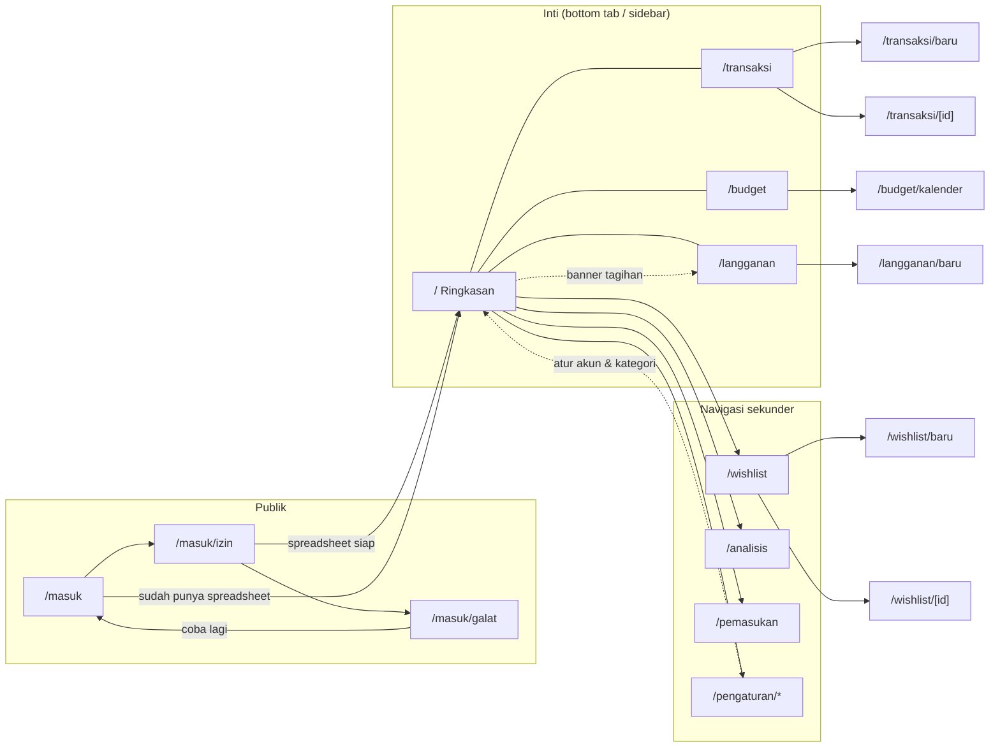
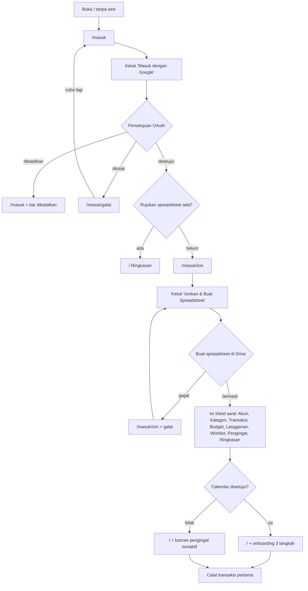
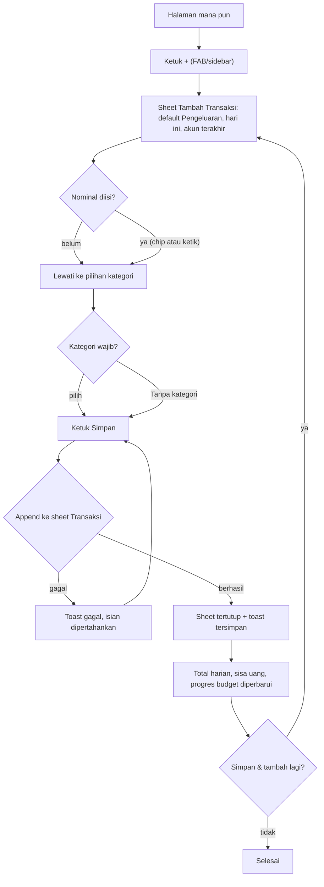
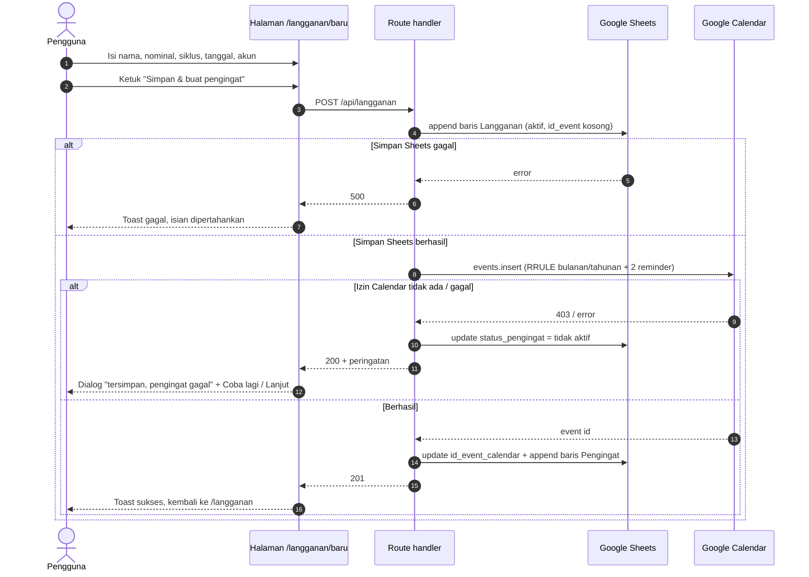
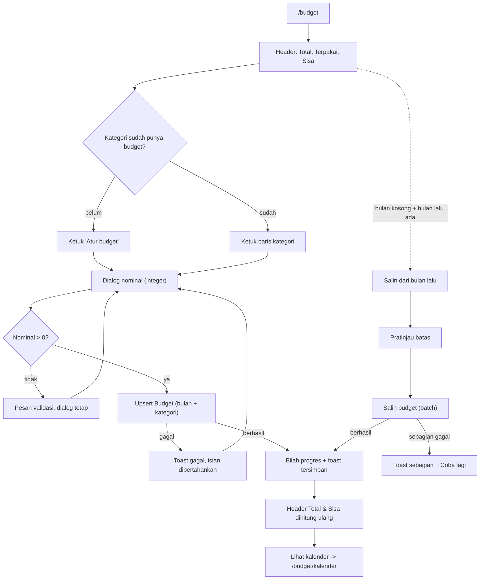
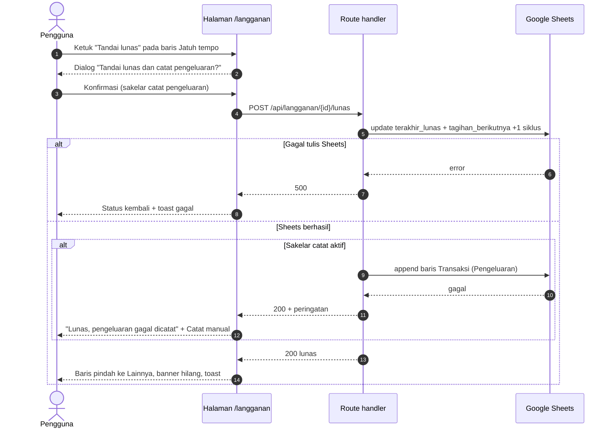
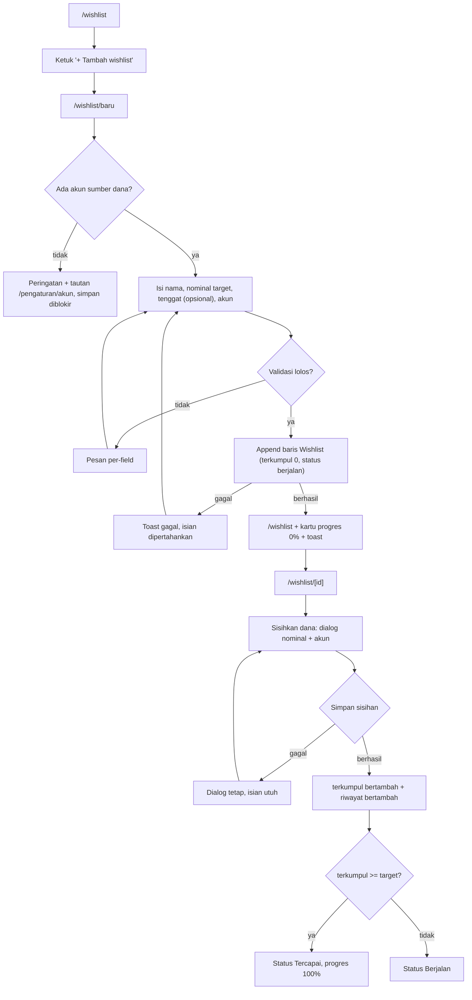
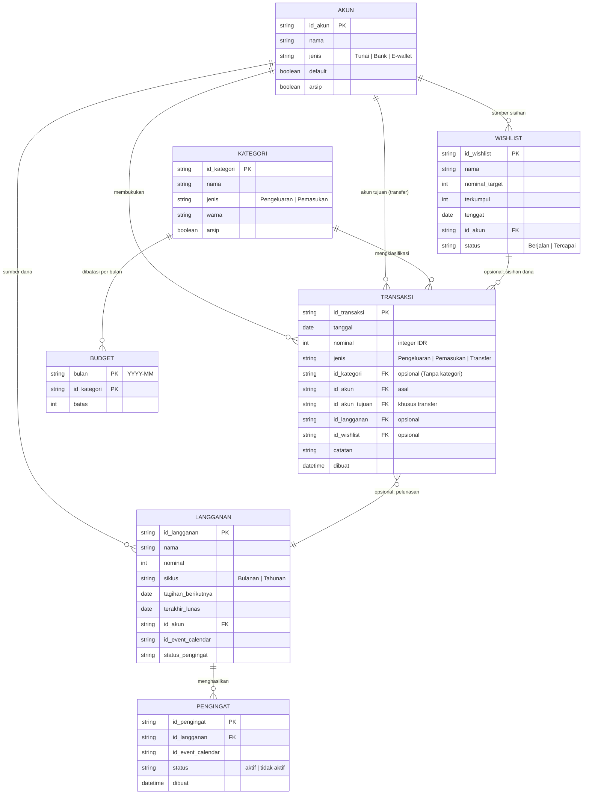

# Dokumen Information Architecture (IA) — BudgetKu

> Aplikasi web perencana anggaran pribadi, mobile-first, bahasa Indonesia, mata uang IDR.
> Versi dokumen: 1.0 · Status: draf untuk reviu · Lingkup: MVP (lihat §0)

---

## 0. Ruang Lingkup & Konvensi Dokumen

### 0.1 Prinsip yang mengikat dokumen ini

| Prinsip | Konsekuensi IA |
| --- | --- |
| Satu pengguna = satu spreadsheet di Google Drive-nya (`drive.file`) | Tidak ada konsep "rumah tangga"/"organisasi". Semua halaman ber-scope tunggal per pengguna. |
| Backend hanya route handler tipis | Tidak ada halaman admin, tidak ada konsol internal, tidak ada antrean pekerjaan. Semua status yang tampil bersumber langsung dari Sheets / Calendar. |
| Mobile-first, input transaksi ≤ 3 ketukan | Aksi tambah transaksi wajib global dan persisten (FAB), bukan tersembunyi di dalam halaman. |
| Dashboard < 2 detik | Dashboard membaca agregat yang sudah dipra-komputasi (ASUMSI A-07), bukan menjumlah ribuan baris di klien. |
| Nominal bilangan bulat | Tidak ada input desimal/koma di seluruh form; pemisah ribuan hanya untuk tampilan. |
| Bahasa Indonesia, satu istilah per konsep | Glosarium istilah mengikat (§7). Istilah di glosarium tidak boleh diparafrasekan di UI lain. |

### 0.2 Fitur yang **tidak** dibahas di dokumen ini (non-MVP)

Lampiran struk, impor CSV, multi mata uang, berbagi budget dengan pasangan, email ringkasan, Web Push.

Dokumen ini **tidak** menyediakan route, menu, halaman, atau empty state untuk fitur tersebut. Bila kebutuhan muncul, dicatat di §9 (pertanyaan terbuka), bukan diimplementasikan.

### 0.3 Notasi

- **ASUMSI** — keputusan yang diambil penulis IA karena tidak dinyatakan eksplisit di konteks proyek. Wajib dikonfirmasi sebelum implementasi.
- **TBD** — ditanyakan di §9.
- ⚠️ — risiko teknis yang mempengaruhi IA.

### 0.4 Ringkasan asumsi penting

| ID | Asumsi |
| --- | --- |
| A-01 | Login hanya lewat Google OAuth; tidak ada pendaftaran email/password dan tidak ada halaman "lupa sandi". |
| A-02 | Satu spreadsheet per akun Google. Login ulang memakai spreadsheet yang sama (rujukan disimpan), tidak membuat duplikat. |
| A-03 | "Akun" (dompet) adalah rekening/kas milik pengguna: Tunai, Bank, e-wallet. Saldo dihitung dari transaksi, bukan saldo awal bank. |
| A-04 | Budget bersifat **bulanan per kategori**; budget berjalan diwarisi ke bulan berikutnya kecuali diubah. |
| A-05 | Tanggal mengikuti zona waktu perangkat pengguna (`Asia/Jakarta` sebagai default regional). |
| A-06 | Pengingat langganan: sumber kebenaran tunggal adalah Google Calendar (event berulang + reminder). Banner in-app **hanya membaca** keadaan Calendar, tidak menyimpan status sendiri. |
| A-07 | Spreadsheet memiliki sheet pra-komputasi (`Ringkasan`) yang diperbarui Apps Script terpasang, agar dashboard tetap < 2 detik. |
| A-08 | Nominal `integer` rupiah. Format tampilan `Rp1.250.000` (titik ribuan, tanpa desimal). |
| A-09 | Bahasa UI tunggal: Indonesia. Tidak ada pemilih bahasa. |
| A-10 | Tidak ada mode gelap pada MVP (TBD §9 Q-08). |
| A-11 | Pengguna diasumsikan memakai satu perangkat utama (mobile); multi-perangkat sinkron lewat Sheets saja. |
| A-12 | Setiap pengguna hanya mengakses data miliknya; tidak ada route dengan parameter pengguna lain. |

---

## 1. Persona

Tiga persona berikut menjadi dasar prioritas navigasi dan keputusan konten.

### P1 — Rani, 26, karyawan swasta (persona utama)

| Aspek | Keterangan |
| --- | --- |
| Konteks | Gajian tanggal 25; memakai 2 e-wallet, 1 rekening bank, dan uang tunai. Mencatat transaksi sambil berdiri di kasir. |
| Tujuan utama | **Mengetahui sisa uang bulan ini dalam < 5 detik setelah membuka aplikasi**, dan mencatat pengeluaran tanpa memperlambat antrean. |
| Rasa sakit | Lupa mencatat; tidak tahu kategori mana yang sudah bocor; langganan terpotong tanpa terasa. |
| Perilaku kunci | Hampir selalu memakai HP dengan satu tangan. Tidak pernah membuka halaman Pengaturan. |
| Implikasi IA | Dashboard = halaman pertama; FAB selalu terjangkau ibu jari; bottom tab maksimal 5 item. |

### P2 — Dimas, 33, desainer freelance (pendapatan tidak tetap)

| Aspek | Keterangan |
| --- | --- |
| Konteks | Pemasukan datang dari beberapa klien dengan nominal tidak tetap per bulan. Ingin memastikan bisa menabung untuk target tertentu. |
| Tujuan utama | **Membandingkan pemasukan bulan berjalan terhadap pengeluaran**, dan memastikan target wishlist tetap tercapai. |
| Rasa sakit | Bulan ramai berbeda jauh dengan bulan sepi; tidak ada "gaji tetap" sebagai acuan budget. |
| Perilaku kunci | Sering membuka **Analisis** dan **Pemasukan**; memakai desktop saat rekap akhir bulan. |
| Implikasi IA | Analisis dan Pemasukan harus punya tata letak desktop lebih padat (sidebar + tabel), bukan mobile yang dilebarkan. |

### P3 — Sari, 41, pengguna baru (belum pernah pakai aplikasi keuangan)

| Aspek | Keterangan |
| --- | --- |
| Konteks | Belum pernah memakai aplikasi pencatat keuangan. Takut salah menekan. Baru pertama kali login. |
| Tujuan utama | **Menyelesaikan pencatatan transaksi pertama dengan percaya diri**, lalu melihat budget pertamanya terbentuk. |
| Rasa sakit | Istilah teknis ("transfer", "saldo") membingungkan; layar kosong membuat ragu apakah aplikasi berfungsi. |
| Perilaku kunci | Membaca label dengan teliti; butuh empty state yang menjelaskan langkah berikutnya. |
| Implikasi IA | Setiap empty state = satu kalimat penjelas + satu tombol aksi utama. Onboarding 3 langkah ringan setelah pembuatan spreadsheet (lihat FL-01). |

---

## 2. Sitemap

### 2.1 Pohon sitemap (maksimal 3 level)

Legenda akses: **P** = pengguna terautentikasi (pemilik spreadsheet) · **–** = publik/tanpa login.

```
BudgetKu (/)
├── 1. Masuk & Autentikasi                                    [akses: –]
│   ├── /masuk                 Masuk dengan Google
│   ├── /masuk/izin            Penjelasan izin + pembuatan spreadsheet
│   └── /masuk/galat           Galat masuk / izin ditolak
├── 2. Ringkasan                                              [akses: P]
│   └── /                      Ringkasan bulan berjalan (dashboard)
├── 3. Transaksi                                              [akses: P]
│   ├── /transaksi             Daftar transaksi + filter
│   ├── /transaksi/baru        Tambah transaksi
│   └── /transaksi/[id]        Rincian / ubah / hapus transaksi
├── 4. Budget                                                 [akses: P]
│   ├── /budget                Budget bulanan per kategori
│   └── /budget/kalender       Kalender budget
├── 5. Langganan                                              [akses: P]
│   ├── /langganan             Daftar langganan + status tagihan
│   └── /langganan/baru        Tambah langganan
├── 6. Wishlist                                               [akses: P]
│   ├── /wishlist              Daftar target tabungan
│   ├── /wishlist/baru         Tambah wishlist
│   └── /wishlist/[id]         Rincian + riwayat sisihan dana
├── 7. Analisis                                               [akses: P]
│   └── /analisis              Grafik & ringkasan per kategori
├── 8. Pemasukan                                              [akses: P]
│   └── /pemasukan             Pelacak pemasukan
└── 9. Pengaturan                                             [akses: P]
    ├── /pengaturan/akun       Daftar akun (dompet)
    ├── /pengaturan/kategori   Daftar kategori
    └── /pengaturan/data       Koneksi spreadsheet & Calendar
```

### 2.2 Tabel sitemap: nama halaman, route, tujuan, akses

| # | Halaman | Route | Tujuan halaman | Akses |
| --- | --- | --- | --- | --- |
| 1.1 | Masuk | `/masuk` | Memulai OAuth Google, lalu lanjut ke `/masuk/izin` | Publik |
| 1.2 | Izin & Persiapan | `/masuk/izin` | Menjelaskan izin sebelum disetujui dan memicu pembuatan spreadsheet pertama | Publik (belum ada data) |
| 1.3 | Masuk Gagal | `/masuk/galat` | Menjelaskan kegagalan masuk atau izin ditolak beserta langkah perbaikan | Publik |
| 2.1 | Ringkasan | `/` | Menjawab "sisa uang bulan ini berapa?" dalam sekali lihat | Pengguna |
| 3.1 | Transaksi | `/transaksi` | Menelusuri, memfilter, dan mengoreksi catatan transaksi | Pengguna |
| 3.2 | Tambah Transaksi | `/transaksi/baru` | Mencatat pengeluaran/pemasukan/transfer ≤ 3 ketukan (dibuka sebagai sheet, §3.5) | Pengguna |
| 3.3 | Rincian Transaksi | `/transaksi/[id]` | Melihat rincian, mengubah, atau menghapus satu transaksi | Pengguna (pemilik data) |
| 4.1 | Budget Bulanan | `/budget` | Menetapkan dan memantau batas pengeluaran per kategori | Pengguna |
| 4.2 | Kalender Budget | `/budget/kalender` | Melihat sebaran budget harian dan sisa per hari dalam satu bulan | Pengguna |
| 5.1 | Langganan | `/langganan` | Memantau langganan aktif, jadwal tagihan, dan status lunas | Pengguna |
| 5.2 | Tambah Langganan | `/langganan/baru` | Menambah langganan baru + sinkron ke Google Calendar | Pengguna |
| 6.1 | Wishlist | `/wishlist` | Melihat progres semua target tabungan | Pengguna |
| 6.2 | Tambah Wishlist | `/wishlist/baru` | Membuat target baru (nama, nominal, tenggat) | Pengguna |
| 6.3 | Rincian Wishlist | `/wishlist/[id]` | Melihat rincian target dan menyisihkan dana | Pengguna (pemilik data) |
| 7.1 | Analisis | `/analisis` | Menganalisis pengeluaran per kategori dan tren antar-bulan | Pengguna |
| 8.1 | Pemasukan | `/pemasukan` | Melacak pemasukan bulan berjalan dan sumbernya | Pengguna |
| 9.1 | Akun | `/pengaturan/akun` | Mengelola akun (dompet) tempat transaksi dibukukan | Pengguna |
| 9.2 | Kategori | `/pengaturan/kategori` | Mengelola kategori pengeluaran dan pemasukan | Pengguna |
| 9.3 | Data & Koneksi | `/pengaturan/data` | Status spreadsheet, status Calendar, tautan buka spreadsheet | Pengguna |

### 2.3 Catatan sitemap

- Pengaturan **tidak** memuat preferensi bahasa, mata uang, atau tema — di luar MVP.
- Tidak ada halaman detail langganan: ubah/hapus dilakukan lewat sheet di `/langganan` (§3.5), agar kedalaman route tetap ≤ 3 level.
- Tidak ada halaman "profil" atau "berbagi": hanya satu pengguna per spreadsheet (A-12).
- **TBD**: apakah `/transaksi/baru` perlu route tersendiri bila selalu tampil sebagai sheet — §9 Q-03.

---

## 3. Navigasi

### 3.1 Navigasi utama

#### Mobile (< 768 px) — bottom tab, 5 item

Urutan tab ditentukan oleh frekuensi & urgensi: Ringkasan (buka harian), Transaksi (paling sering ditambah), Budget (mingguan), **+ (aksi cepat)**, Langganan (bulanan).

| Posisi | Label tab | Ikon (semantik) | Route tujuan | Keterangan |
| --- | --- | --- | --- | --- |
| 1 | Ringkasan | rumah | `/` | Tab aktif saat membuka root |
| 2 | Transaksi | daftar | `/transaksi` | |
| 3 | **+** | tambah (tombol bulat besar) | membuka sheet Tambah Transaksi | Bukan tab tujuan; lihat §3.3 |
| 4 | Budget | target | `/budget` | |
| 5 | Langganan | kartu/ulang | `/langganan` | |

Tiga halaman sisanya (**Wishlist**, **Analisis**, **Pemasukan**) berada di navigasi sekunder karena tidak perlu dibuka setiap hari.

> **ASUMSI A-13**: karena bottom tab maksimal 5 item, Analisis/Wishlist/Pemasukan tidak mendapat tab tersendiri. Alternatif (menggabungkan Analisis & Pemasukan dalam satu tab "Laporan") dicatat di §9 Q-02.

#### Desktop (≥ 768 px) — sidebar kiri, lebar tetap 240 px

```
┌───────────────────────────┐
│ BudgetKu                  │
│ [ + Tambah Transaksi ]    │  ← aksi utama penuh lebar, di atas semua grup
│                           │
│ UTAMA                     │
│  ⌂ Ringkasan              │
│  ⇄ Transaksi              │
│  ◎ Budget                 │
│  ↻ Langganan              │
│                           │
│ LAINNYA                   │
│  ★ Wishlist               │
│  ▤ Analisis               │
│  ↑ Pemasukan              │
│                           │
│ ─────────────────────────  │
│  ⚙ Pengaturan            │  ← pin di dasar sidebar
└───────────────────────────┘
```

- Grup label "UTAMA" dan "LAINNYA" memakai label glosarium (§7), bukan istilah Inggris.
- pada tablet (768–1023 px) sidebar bisa dilipat menjadi ikon saja; **ASUMSI A-14**: pola lipat ikon dianggap cukup, tanpa drawer terpisah.

### 3.2 Navigasi sekunder

| Lokasi | Komponen | Isi | Muncul di |
| --- | --- | --- | --- |
| Atas Dashboard | Banner tagihan mendatang | Langganan yang jatuh tempo ≤ 7 hari, maksimal 3 baris + "Lihat semua" → `/langganan` | Semua halaman mobile & desktop, dapat ditutup per hari (A-06) |
| Atas Dashboard | Pemilih bulan | "‹ Agustus 2026 ›" | Ringkasan, Budget, Analisis, Pemasukan |
| Di dalam Budget | Sub-tab halaman | "Budget Bulanan" \| "Kalender" → `/budget`, `/budget/kalender` | Halaman Budget |
| Di dalam Transaksi | Segmen filter | Semua \| Pengeluaran \| Pemasukan \| Transfer | Halaman Transaksi |
| Di dalam Pengaturan | Daftar pengaturan | Akun \| Kategori \| Data & Koneksi | Halaman Pengaturan |
| Bawah halaman setting | Tautan | "Buka spreadsheet di Google Sheets" (target: tab baru) | `/pengaturan/data` |
| Layer detail | Tombol kembali | "‹ Kembali" | `/transaksi/[id]`, `/wishlist/[id]`, form baru |

**Aturan konsistensi**: sub-tab hanya dipakai di halaman yang benar-benar punya dua mode setara (Budget); halaman lain memakai segmen filter atau daftar, tidak mencampur keduanya.

### 3.3 Aksi cepat: tombol tambah transaksi

Batas input ≤ 3 ketukan menjadi batasan perancangan keras untuk alur ini.

| Langkah ketukan | Yang terjadi | Alternatif input |
| --- | --- | --- |
| 1 | Ketuk **+** (FAB mobile / tombol sidebar desktop) atau ketuk nilai di Dashboard | `N` (desktop) membuka sheet |
| 2 | Ketuk **nominal cepat** yang sudah terisi otomatis paling sering dipakai (A-15) atau ketik nominal | Papan angka *in-sheet*, bukan keyboard sistem, agar tetap 1 ketukan fokus |
| 3 | Ketuk **Simpan** | `Ctrl`+`Enter` (desktop) |

- **ASUMSI A-15**: sheet Tambah Transaksi terisi otomatis: tanggal = hari ini, akun = akun terakhir dipakai, jenis = Pengeluaran, kategori = kosong. Nominal adalah field pertama yang fokus sehingga 3 ketukan tercapai untuk kasus "nominal → Simpan".
- FAB tidak ditampilkan di halaman `/transaksi/baru`, `/masuk*`, dan saat sheet sudah terbuka (menghindari FAB ganda).

### 3.4 Peta navigasi antar halaman



---

## 4. Inventaris Konten per Halaman

Format tiap halaman: **Data yang ditampilkan** · **Aksi** · **Empty state** · **Loading state** · **Error state**.
State global (berlaku semua halaman terautentikasi) didefinisikan di §4.0 agar tidak diulang.

### 4.0 State global

| State | Perilaku |
| --- | --- |
| Loading awal (navigasi halaman) | Kerangka halaman (skeleton) ringan: kartu abu-abu tanpa teks. Tidak memakai spinner layar penuh agar tidak terlihat "hang" di koneksi lambat. |
| Loading data Sheets di dalam halaman | Skeleton pada area yang berubah; tombol simpan berstatus "Menyimpan…" dan dinonaktifkan sampai selesai. |
| Error 401 / sesi kedaluwarsa | Bar di atas: "Sesi berakhir. Masuk lagi untuk melanjutkan." + **Masuk dengan Google**. Data yang sudah tampil tetap terbaca; semua aksi tulis dinonaktifkan. |
| Error 403 / izin dicabut | Bar peringatan: "Izin Google Drive dibutuhkan. Beri izin lagi." → `/masuk/izin`. |
| Error jaringan / Sheets gagal dibaca | Kartu tengah: "Gagal memuat data. Periksa koneksi lalu coba lagi." + **Coba lagi**. Tidak menampilkan angka nol sebagai pengganti agar tidak menyesatkan. |
| Error tulis (append/update gagal) | Toast "Gagal menyimpan. Coba lagi." + form tetap terbuka, isian tidak hilang. |
| Rate limit Sheets | Toast "Terlalu banyak permintaan. Tunggu sebentar." + **Coba lagi** yang aktif setelah jeda. |

### 4.1 `/masuk` — Masuk

| Aspek | Isi |
| --- | --- |
| Data ditampilkan | Nama produk sementara, satu kalimat nilai ("Catat pengeluaran, atur budget, ingat tagihan."), tiga poin privasi (data di Drive Anda; tanpa server kami; bisa dibuka di Sheets), tombol **Masuk dengan Google**. |
| Aksi | Masuk dengan Google (OAuth); tautan "Lihat izin yang diminta" → `/masuk/izin`. |
| Empty state | Tidak berlaku (halaman statis). |
| Loading state | Tombol berubah "Menghubungkan…" setelah diklik; halaman tetap. |
| Error state | OAuth dibatalkan: kembali ke sini dengan bar "Masuk dibatalkan. Tidak ada data yang diubah." Provider error: "Google tidak dapat dijangkau. Coba lagi." |

### 4.2 `/masuk/izin` — Izin & Persiapan

| Aspek | Isi |
| --- | --- |
| Data ditampilkan | Daftar izin dalam bahasa manusia: (1) membuat dan mengubah satu spreadsheet di Drive Anda; (2) membuat event dan pengingat di Calendar untuk langganan; (3) hanya file yang dibuat aplikasi ini, bukan seluruh Drive. Pratinjau tiga langkah onboarding: Tetapkan akun → Catat transaksi → Atur budget (FL-01). |
| Aksi | **Izinkan & Buat Spreadsheet** · **Kembali** ke `/masuk` · tautan "Atur izin Calendar nanti" → `/pengaturan/data`. |
| Empty state | Tidak berlaku. |
| Loading state | Progres berlabel bertahap: "Membuat spreadsheet…" → "Menyiapkan sheet Akun, Kategori, Transaksi, Budget…" → "Menyiapkan ringkasan bulan berjalan…". Tiap langkah berganti centang; < 10 detik dianggap wajar. |
| Error state | Gagal membuat file: "Spreadsheet tidak dapat dibuat. Beri izin Drive lalu coba lagi." + **Coba lagi**. Izin Calendar ditolak tetapi Drive disetujui: lanjut ke dashboard dengan banner "Pengingat langganan nonaktif. Aktifkan di Data & Koneksi." ⚠️ Spreadsheet sudah ada dari sesi lain: langsung arahkan ke `/` tanpa membuat baru (A-02). |
### 4.3 `/` — Ringkasan

| Aspek | Isi |
| --- | --- |
| Data ditampilkan | Kartu utama: **Sisa uang bulan ini** (pemasukan − pengeluaran, integer). Kartu sekunder: **Pemasukan bulan ini**, **Pengeluaran bulan ini**, **Sisa budget** (total budget − pengeluaran terkategori). Daftar kategori dengan bilah progres terpakai/batas. 5 transaksi terakhir. Banner tagihan ≤ 7 hari (maks. 3). Pemilih bulan. |
| Aksi | Ketuk kartu angka → `/transaksi` terfilter; ketuk kategori → `/budget`; ketuk banner → `/langganan`; **+** (FAB/toolbar); "Lihat analisis" → `/analisis`. |
| Empty state | Tanpa transaksi bulan ini: "Belum ada catatan bulan ini. Mulai dari pengeluaran pertama Anda." + **Catat transaksi**. Tanpa budget: "Budget belum diatur. Tetapkan batas per kategori." + **Atur budget**. |
| Loading state | Skeleton 4 kartu + 1 daftar. Angka tidak pernah dirender `0` sebelum data siap. |
| Error state | Gagal memuat ringkasan: banner "Ringkasan bulan ini gagal dimuat." + **Coba lagi**, sambil tetap menampilkan 5 transaksi terakhir bila tersedia. ⚠️ Untuk menjaga < 2 detik, kartu ringkasan dimuat lebih dulu dan daftar menyusul; tidak menahan seluruh halaman. |

### 4.4 `/transaksi` — Daftar Transaksi

| Aspek | Isi |
| --- | --- |
| Data ditampilkan | Total masuk/keluar untuk periode & filter aktif. Segmen jenis: Semua · Pengeluaran · Pemasukan · Transfer. Filter: bulan, akun, kategori, pencarian catatan. Baris: tanggal, kategori + catatan, akun, nominal bertanda (−/+/⇄). Dikelompokkan per tanggal dengan subtotal harian. Kategori tampil sebagai keping huruf awal berwarna, bukan logo merek. |
| Aksi | **+** tambah; ketuk baris → `/transaksi/[id]`; ubah filter; **Hapus filter**. |
| Empty state | Tanpa transaksi sama sekali: "Belum ada transaksi. Catat yang pertama dengan tombol +." Filter tanpa hasil: "Tidak ada transaksi dengan filter ini." + **Hapus filter**. |
| Loading state | Skeleton 6 baris; kontrol filter tetap dapat dipakai. (**ASUMSI A-16**: 50 baris per halaman + **Muat lebih banyak**.) |
| Error state | "Transaksi gagal dimuat." + **Coba lagi**. Gagal hapus: baris tetap ada + toast "Gagal menghapus. Coba lagi." |

### 4.5 `/transaksi/baru` — Tambah Transaksi (sheet)

| Aspek | Isi |
| --- | --- |
| Data ditampilkan | Sakelar jenis: Pengeluaran · Pemasukan · Transfer. Papan angka nominal (integer, tanpa desimal). Keping kategori pengeluaran berurutan sesuai frekuensi pemakaian. Pemilih akun (default akun terakhir dipakai). Untuk Transfer: pemilih akun asal dan akun tujuan. Tanggal (default hari ini). Catatan opsional satu baris. |
| Aksi | **Simpan** · **Batal** · **Simpan & tambah lagi** (desktop). |
| Empty state | Bila belum ada kategori: keping "Buat kategori baru" → `/pengaturan/kategori` dengan keterangan "Kategori diperlukan sebelum menyimpan". Bila belum ada akun (**ASUMSI A-17** — seharusnya dibuat saat onboarding): tombol **Buat akun "Tunai"**. |
| Loading state | Tombol "Menyimpan…"; sheet tidak dapat ditutup selama proses. |
| Error state | Nominal kosong/0 → "Isi nominal lebih dari 0." Tanpa kategori → "Pilih kategori." Akun asal = tujuan → "Akun asal dan tujuan harus berbeda." Gagal simpan: sheet tetap terbuka, isian dipertahankan, tombol aktif kembali. |

### 4.6 `/transaksi/[id]` — Rincian Transaksi

| Aspek | Isi |
| --- | --- |
| Data ditampilkan | Nominal besar, jenis, kategori, akun, tanggal, catatan, waktu pencatatan. Untuk transfer: akun asal → akun tujuan. |
| Aksi | **Ubah** (mengaktifkan form inline yang sama dengan sheet tambah) · **Simpan perubahan** · **Hapus transaksi** (konfirmasi dua langkah) · **‹ Kembali**. |
| Empty state | Tidak berlaku. |
| Loading state | Skeleton 1 kartu. |
| Error state | ID tidak ditemukan (transaksi sudah dihapus di Sheets): "Transaksi ini tidak ditemukan." + **Kembali ke daftar**. Gagal simpan: isian dipertahankan. |

### 4.7 `/budget` — Budget Bulanan

| Aspek | Isi |
| --- | --- |
| Data ditampilkan | Header: bulan aktif, **Total budget**, **Terpakai**, **Sisa budget**. Per kategori: batas, terpakai, sisa, bilah progres (hijau < 75%, kuning 75–99%, merah ≥ 100%). Baris kategori tanpa budget ditandai "Belum diatur". Tombol "Salin dari bulan lalu" bila bulan aktif belum punya budget dan bulan sebelumnya punya. |
| Aksi | Ketuk kategori → ubah batas (dialog nominal) · **Atur budget** untuk kategori kosong · **Salin dari bulan lalu** · pindah bulan (‹ ›) · **Lihat kalender** → `/budget/kalender`. |
| Empty state | Belum ada kategori: "Belum ada kategori. Buat kategori dulu untuk mengatur budget." + **Buat kategori**. Ada kategori tetapi budget kosong: "Tetapkan batas per kategori untuk bulan ini." + **Atur budget**. |
| Loading state | Skeleton baris kategori; header memakai skeleton angka. |
| Error state | "Budget gagal dimuat." + **Coba lagi**. Gagal simpan batas: dialog tetap terbuka + toast "Gagal menyimpan batas. Coba lagi." |

### 4.8 `/budget/kalender` — Kalender Budget

| Aspek | Isi |
| --- | --- |
| Data ditampilkan | Grid bulan (Senin–Minggu). Tiap hari menampilkan pengeluaran harian dan sisa budget harian (sisa budget bulan ÷ sisa hari — **ASUMSI A-18**), dengan warna status. Ringkasan bawah: hari dengan pengeluaran tertinggi, rata-rata harian, proyeksi sisa akhir bulan. |
| Aksi | Ketuk tanggal → `/transaksi` terfilter tanggal tersebut · pindah bulan · kembali ke **Budget Bulanan**. |
| Empty state | Bulan tanpa transaksi: grid tetap tampil dengan teks "Belum ada pengeluaran bulan ini." |
| Loading state | Skeleton grid. |
| Error state | Grid gagal dimuat: "Kalender gagal dimuat." + **Coba lagi**; tombol kembali tetap aktif. |

### 4.9 `/langganan` — Langganan

| Aspek | Isi |
| --- | --- |
| Data ditampilkan | Ringkasan: total biaya langganan per bulan dan jumlah langganan aktif. Dua kelompok: **Jatuh tempo** (≤ 7 hari) dan **Lainnya**. Per baris: nama langganan, nominal, siklus (Bulanan/Tahunan — **ASUMSI A-19**: hanya dua siklus), tanggal tagihan berikutnya, akun sumber dana, status pengingat Calendar ("Pengingat aktif" / "Pengingat tidak aktif"). |
| Aksi | **+ Tambah langganan**; ketuk baris → sheet ubah (nama, nominal, siklus, tanggal, akun) · **Tandai lunas** · **Hentikan pengingat** / **Aktifkan pengingat** · **Hapus langganan** (konfirmasi). |
| Empty state | "Belum ada langganan. Tambahkan agar tagihan tidak terlewat." + **Tambah langganan**. |
| Loading state | Skeleton 4 baris + 2 kartu ringkasan. |
| Error state | Gagal baca Sheets: "Langganan gagal dimuat." + **Coba lagi**. Gagal sinkron Calendar: baris ditandai "Pengingat tidak aktif" + bar "Sebagian pengingat gagal dibuat." + **Coba lagi**. Gagal tanda lunas: status kembali seperti semula + toast. |

### 4.10 `/langganan/baru` — Tambah Langganan

| Aspek | Isi |
| --- | --- |
| Data ditampilkan | Isian: nama langganan, nominal, siklus (Bulanan/Tahunan), tanggal tagihan berikutnya, akun sumber dana, sakelar **Buat pengingat di Google Calendar** (default aktif). Pratinjau kalimat: "Pengingat tiap tanggal 25, 3 hari sebelum dan pada hari-H." |
| Aksi | **Simpan & buat pengingat** · **Simpan tanpa pengingat** · **Batal**. |
| Empty state | Bila belum ada akun: peringatan "Belum ada akun. Tambahkan akun dulu." + tautan `/pengaturan/akun`; penyimpanan diblokir. |
| Loading state | "Menyimpan langganan…" lalu "Membuat pengingat…"; tombol nonaktif hingga keduanya selesai. |
| Error state | Validasi per-field: nama kosong, nominal 0, tanggal kosong. Gagal Sheets: tidak ada event dibuat. Gagal Calendar **setelah** Sheets berhasil (**ASUMSI A-21**: urutan Sheets dulu): tersimpan sebagai "Pengingat tidak aktif" + dialog "Langganan tersimpan, tetapi pengingat gagal dibuat." + **Coba lagi** / **Lanjut tanpa pengingat**. |

### 4.11 `/wishlist` — Wishlist

| Aspek | Isi |
| --- | --- |
| Data ditampilkan | Kartu per target: nama, keping ikon, nominal target, terkumpul, bilah progres + persentase, sisa, tenggat (bila diisi), status (Berjalan / Tercapai). Urut: belum tercapai (tenggat terdekat dulu), lalu tercapai. |
| Aksi | **+ Tambah wishlist**; ketuk kartu → `/wishlist/[id]`. |
| Empty state | "Belum ada wishlist. Tetapkan target agar lebih mudah menabung." + **Tambah wishlist**. |
| Loading state | Skeleton 3 kartu. |
| Error state | "Wishlist gagal dimuat." + **Coba lagi**. |

### 4.12 `/wishlist/baru` — Tambah Wishlist

| Aspek | Isi |
| --- | --- |
| Data ditampilkan | Isian: nama target, nominal target, tenggat (opsional), akun sumber dana sisihan (**ASUMSI A-22**: dana disisihkan sebagai transfer dari akun ini). Bantuan hitung: "Perlu disisihkan Rp… /bulan agar tercapai tanggal …" (tampilan saja, tidak disimpan). |
| Aksi | **Simpan** · **Batal**. |
| Empty state | Bila belum ada akun: "Belum ada akun. Tambahkan akun dulu." + tautan. |
| Loading state | "Menyimpan…". |
| Error state | Nama kosong → "Beri nama target." Nominal 0 → "Isi nominal target lebih dari 0." Tenggat lampau → "Pilih tanggal setelah hari ini." Gagal simpan: isian dipertahankan. |

### 4.13 `/wishlist/[id]` — Rincian Wishlist

| Aspek | Isi |
| --- | --- |
| Data ditampilkan | Progres besar (terkumpul/target), sisa, tenggat, riwayat sisihan dana (tanggal, nominal, akun). |
| Aksi | **Sisihkan dana** (dialog nominal + akun; memperbarui terkumpul dan menambah riwayat) · **Ubah target** · **Tandai Tercapai** · **Hapus wishlist** (konfirmasi) · **‹ Kembali**. |
| Empty state | Belum ada sisihan: "Belum ada dana yang disisihkan. Mulai dengan sisihan pertama Anda." + **Sisihkan dana**. |
| Loading state | Skeleton kartu + daftar riwayat. |
| Error state | Target tidak ditemukan: "Wishlist ini tidak ditemukan." + **Kembali**. Gagal simpan sisihan: dialog tetap terbuka, isian tetap. |

### 4.14 `/analisis` — Analisis

| Aspek | Isi |
| --- | --- |
| Data ditampilkan | Pemilih bulan + perbandingan dengan bulan sebelumnya. Grafik donat pengeluaran per kategori; daftar kategori terurut nominal + persentase; grafik batang 6 bulan terakhir; rata-rata pengeluaran harian; kategori dengan kenaikan tertinggi. |
| Aksi | Ketuk kategori → `/transaksi` terfilter kategori tersebut; ganti bulan; ganti rentang 6 bulan. |
| Empty state | Tanpa pengeluaran: "Belum ada pengeluaran untuk dianalisis. Catat transaksi dulu." + **Catat transaksi**. |
| Loading state | Skeleton grafik (kotak abu-abu), bukan animasi tanpa akhir. |
| Error state | "Analisis gagal dimuat." + **Coba lagi**. Bila kategori sudah dihapus, transaksinya tetap dihitung dan diberi label "Kategori dihapus" (**ASUMSI A-23**), tidak disembunyikan. |

### 4.15 `/pemasukan` — Pemasukan

| Aspek | Isi |
| --- | --- |
| Data ditampilkan | Total pemasukan bulan berjalan, jumlah pemasukan, daftar pemasukan (tanggal, akun, kategori pemasukan, nominal), rata-rata per pemasukan, perbandingan dengan bulan sebelumnya. |
| Aksi | **+ Catat pemasukan** (membuka sheet tambah dengan jenis Pemasukan terpilih); ketuk baris → `/transaksi/[id]`. |
| Empty state | "Belum ada pemasukan tercatat bulan ini." + **Catat pemasukan**. |
| Loading state | Skeleton 2 kartu + 5 baris. |
| Error state | "Pemasukan gagal dimuat." + **Coba lagi**. |

### 4.16 `/pengaturan/akun` — Akun

| Aspek | Isi |
| --- | --- |
| Data ditampilkan | Daftar akun: nama, jenis (Tunai/Bank/E-wallet — **ASUMSI A-24**), saldo terhitung, penanda akun default. |
| Aksi | **+ Tambah akun** (dialog nama + jenis) · **Ubah** · **Jadikan default** · **Arsipkan** (tidak dihapus agar transaksi lama tetap utuh). |
| Empty state | "Belum ada akun." + **Tambah akun**. |
| Loading state | Skeleton 3 baris. |
| Error state | "Akun gagal dimuat." + **Coba lagi**. Nama duplikat → "Nama akun sudah dipakai." |

### 4.17 `/pengaturan/kategori` — Kategori

| Aspek | Isi |
| --- | --- |
| Data ditampilkan | Dua bagian: **Kategori Pengeluaran** dan **Kategori Pemasukan**. Tiap baris: nama, keping warna, jumlah transaksi terkait. |
| Aksi | **+ Tambah kategori** (nama + jenis + warna dari palet tetap) · **Ubah nama** · **Atur warna** · **Arsipkan** (kategori yang sudah dipakai tidak dapat dihapus permanen — **ASUMSI A-25**). |
| Empty state | "Belum ada kategori. Tambahkan kategori agar transaksi bisa dicatat." + **Tambah kategori**. |
| Loading state | Skeleton dua daftar. |
| Error state | Nama duplikat dalam jenis yang sama → "Kategori ini sudah ada." Gagal simpan → toast "Gagal menyimpan. Coba lagi." |

### 4.18 `/pengaturan/data` — Data & Koneksi

| Aspek | Isi |
| --- | --- |
| Data ditampilkan | Nama spreadsheet + waktu modifikasi terakhir; status Spreadsheet (Terhubung / Bermasalah); status Calendar (Aktif / Tidak aktif) + jumlah pengingat terpasang; akun Google yang sedang dipakai (nama + email). |
| Aksi | **Buka spreadsheet di Google Sheets** (tab baru) · **Aktifkan izin Calendar** · **Hubungkan ulang** · **Keluar** (**ASUMSI A-26**: keluar sesi saja, tidak menghapus data). |
| Empty state | Tidak berlaku. |
| Loading state | Skeleton 4 baris status. |
| Error state | Spreadsheet terhapus/dipindah: "Spreadsheet tidak ditemukan. Hubungkan ulang atau buat baru." + **Hubungkan ulang** / **Buat spreadsheet baru** (⚠️ tidak menghapus apa pun; data lama tidak terbaca). Izin Calendar dicabut: status "Tidak aktif" + **Aktifkan izin Calendar**. |

---

## 5. User Flow

Setiap flow ditulis sebagai langkah bernomor (sumber kebenaran perilaku) dan diagram Mermaid (ringkasan visual). Konvensi: langkah bernomor berlaku juga untuk cabang galat; Mermaid memuat jalur utama + jalur gagal penting.

### FL-01 — Login pertama + pembuatan spreadsheet otomatis

**Aktor**: P3 Sari (pengguna baru) · **Prasyarat**: belum punya spreadsheet BudgetKu · **Hasil**: spreadsheet baru di Drive, sesi aktif, akun & kategori awal tersedia.

1. Pengguna membuka `/` dalam keadaan belum login → dialihkan ke `/masuk`.
2. Pengguna mengetuk **Masuk dengan Google**; aplikasi membuka persetujuan OAuth Google (Drive `drive.file` + Calendar).
3. Pengguna memilih akun dan menyetujui izin → Google mengembalikan kode; route handler menukarnya menjadi sesi.
4. Aplikasi memeriksa apakah pengguna sudah punya rujukan spreadsheet (A-02).
   - Ada → langsung ke langkah 9 (dashboard).
   - Tidak ada → lanjut ke langkah 5.
5. Aplikasi menampilkan `/masuk/izin`: daftar izin dalam bahasa manusia + pratinjau tiga langkah onboarding.
6. Pengguna mengetuk **Izinkan & Buat Spreadsheet**.
7. Route handler memanggil Google Drive untuk membuat satu spreadsheet bernama `BudgetKu — Data Saya`.
8. Route handler membuat sheet: `Akun`, `Kategori`, `Transaksi`, `Budget`, `Langganan`, `Wishlist`, `Pengingat`, `Ringkasan`; mengisi baris awal `Akun` = "Tunai" dan `Kategori` bawaan (lihat ASUMSI A-27); menyimpan rujukan spreadsheet ke profil pengguna.
9. Aplikasi membuka `/` dengan kartu **onboarding 3 langkah**: (1) Akun siap — "Tunai" (bisa diubah), (2) Catat transaksi pertama, (3) Atur budget bulan ini.
10. Pengguna menutup onboarding kapan saja; status "onboarding selesai" disimpan agar tidak muncul lagi.

**Cabang gagal**

- 2a. Pengguna membatalkan di layar Google → kembali ke `/masuk` + bar "Masuk dibatalkan."
- 3a. Pengguna menolak izin Drive → `/masuk/galat` + penjelasan dan tombol **Coba lagi**.
- 3b. Pengguna menyetujui Drive tetapi menolak Calendar → lanjut ke langkah 4; setelah dashboard muncul banner "Pengingat langganan nonaktif. Aktifkan di Data & Koneksi."
- 7a. Pembuatan spreadsheet gagal (kuota/Akses) → `/masuk/izin` menampilkan galat + **Coba lagi**; tidak ada file setengah jadi yang dipakai.
- 8a. Sebagian sheet gagal dibuat → tampilkan "Penyiapan data belum selesai." + **Coba lagi**; jangan arahkan ke dashboard sampai `Transaksi` dan `Akun` ada.



### FL-02 — Tambah transaksi (≤ 3 ketukan)

**Aktor**: P1 Rani · **Prasyarat**: sudah login, minimal ada 1 akun & 1 kategori · **Hasil**: baris baru di sheet `Transaksi`, ringkasan & budget diperbarui.

1. Pengguna mengetuk **+** (FAB mobile / tombol sidebar desktop) dari halaman mana pun.
2. Sheet Tambah Transaksi terbuka dengan nilai default: jenis **Pengeluaran**, tanggal hari ini, akun terakhir dipakai; fokus otomatis di papan angka (A-15).
3. Pengguna mengetuk nominal (mis. chip "25.000") atau mengetik angka penuh di papan angka.
4. Pengguna memilih kategori hanya bila perlu: keping kategori yang paling sering dipakai berada di urutan depan.
5. Pengguna mengetuk **Simpan** → tombol "Menyimpan…" → baris di-append ke sheet `Transaksi`.
6. Sheet tertutup; halaman asal menampilkan data terbaru (total harian, sisa uang, progres budget) + toast "Transaksi tersimpan."
7. Bila pengguna memilih **Simpan & tambah lagi** (desktop) → form direset ke default dan sheet tetap terbuka.

**Kontrol 3 ketukan**: untuk kasus "chip nominal → Simpan" jalurnya 3 ketukan (ketuk **+** → chip nominal → **Simpan**); kategori kosong diperbolehkan pada ASUMSI A-28 — transaksi tanpa kategori masuk ke **Tanpa kategori** dan tidak mengurangi budget kategori mana pun, tetapi tetap mengurangi sisa uang.

**Cabang gagal**

- 3a. Nominal 0/kosong lalu Simpan → pesan "Isi nominal lebih dari 0.", sheet tetap terbuka.
- 4a. Belum ada kategori sama sekali → keping "Buat kategori baru" → `/pengaturan/kategori`; kembali ke sheet dengan kategori baru terpilih.
- 5a. Append gagal (jaringan/kuota) → toast "Gagal menyimpan. Coba lagi.", isian utuh.
- 5b. Jenis **Transfer** dengan akun asal = tujuan → pesan "Akun asal dan tujuan harus berbeda."



### FL-03 — Tambah langganan + sinkron Google Calendar

**Aktor**: P1 Rani · **Prasyarat**: login, izin Calendar aktif, minimal 1 akun · **Hasil**: baris `Langganan` + baris `Pengingat` + event berulang di Calendar dengan reminder.

1. Pengguna membuka `/langganan` lalu mengetuk **+ Tambah langganan** → `/langganan/baru`.
2. Pengguna mengisi nama langganan (mis. "Langganan film"), nominal integer, siklus **Bulanan**/**Tahunan**, tanggal tagihan berikutnya, dan akun sumber dana.
3. Sakelar **Buat pengingat di Google Calendar** aktif secara default; pratinjau kalimat pengingat tampil ("Pengingat tiap tanggal 25, 3 hari sebelum dan pada hari-H").
4. Pengguna mengetuk **Simpan & buat pengingat**.
5. Route handler menulis baris ke `Langganan` (status `aktif`, `id_pengingat` kosong) — **ASUMSI A-21**: Sheets disimpan lebih dulu.
6. Route handler memanggil Calendar `events.insert` dengan event berulang:
   - judul `Tagihan: <nama langganan>`
   - `RRULE:FREQ=MONTHLY;BYMONTHDAY=<tanggal tagihan>` (atau `FREQ=YEARLY` untuk siklus Tahunan)
   - `reminders.useDefault = false`, `overrides = [{minutes: 4320 (3 hari)}, {minutes: 0 (hari-H)}]` (**ASUMSI A-29**)
7. Route handler menyimpan `id_event_calendar` kembali ke baris `Langganan` dan menambah baris `Pengingat`.
8. Kembali ke `/langganan` + toast "Langganan ditambahkan. Pengingat dibuat di Google Calendar." Baris muncul di kelompok **Jatuh tempo** bila ≤ 7 hari.

**Cabang gagal**

- 4a. Validasi gagal (nama kosong, nominal 0, tanggal kosong) → pesan per-field, tidak ada panggilan API.
- 6a. Izin Calendar tidak ada / dicabut → baris tetap tersimpan dengan "Pengingat tidak aktif" + dialog **Aktifkan izin Calendar** / **Lanjut tanpa pengingat**.
- 6b. Calendar menolak (mis. event duplikat / kuota) → status "Pengingat tidak aktif" + dialog "Langganan tersimpan, tetapi pengingat gagal dibuat." + **Coba lagi** (idempoten: pakai `id_event_calendar` bila sudah ada, jangan buat event kedua — **ASUMSI A-30**).
- 5a. Gagal menulis Sheets → tidak ada panggilan Calendar sama sekali; isian dipertahankan.



**Catatan keandalan pengingat** (non-fungsional "keandalan pengingat")
- Sumber kebenaran pengingat = Calendar (A-06). Status lunas disimpan terpisah di Sheets dan tidak mengubah event.
- Bila pengguna mengubah tanggal tagihan, event lama di-`patch` (bukan dibuat baru) agar tidak ada pengingat ganda.
- Bila Calendar tidak dapat dijangkau, pengguna tetap mendapat banner in-app berdasarkan data `Langganan` di Sheets (cadangan yang disebut di konteks proyek, bukan fitur baru).

### FL-04 — Atur budget bulanan

**Aktor**: P1 Rani · **Prasyarat**: login, minimal 1 kategori pengeluaran · **Hasil**: batas per kategori tersimpan untuk bulan aktif di sheet `Budget`; kartu **Sisa budget** di Ringkasan berubah.

1. Pengguna membuka `/budget` (tab **Budget** atau ketuk kartu kategori di Ringkasan).
2. Halaman menampilkan bulan aktif (default bulan berjalan) + header **Total budget**, **Terpakai**, **Sisa budget**.
3. Pengguna mengetuk **Atur budget** pada sebuah kategori (atau **Ubah** pada kategori berjalan) → dialog nominal dengan papan angka integer (tanpa desimal).
4. Pengguna mengisi batas lalu mengetuk **Simpan**.
5. Route handler menulis/memperbarui baris `Budget` dengan kunci `bulan + id_kategori` (upsert, bukan append ganda).
6. Dialog tertutup; baris kategori menampilkan batas, terpakai, sisa, dan bilah progres (hijau < 75%, kuning 75–99%, merah ≥ 100%) + toast "Budget tersimpan."
7. Header **Total budget** & **Sisa budget** dihitung ulang dari semua kategori bulan aktif.
8. Bila bulan aktif belum punya budget sama sekali dan bulan sebelumnya punya → tombol **Salin dari bulan lalu** tersedia; mengetuknya membuka pratinjau daftar batas lalu **Salin budget** menulis semua baris sekaligus (A-04, inherit bulanan).
9. Pengguna mengetuk **Lihat kalender** → `/budget/kalender` untuk melihat sisa budget harian (A-18).

**Cabang gagal**

- 4a. Nominal 0/kosong → pesan "Isi batas lebih dari 0.", dialog tetap terbuka.
- 4b. **ASUMSI A-31**: batas lebih kecil dari pengeluaran bulan aktif yang sudah tercatat tetap diizinkan (menandai kategori terlampaui), hanya diberi baris peringatan "Batas di bawah pengeluaran saat ini." — bukan galat.
- 5a. Upsert gagal (jaringan/kuota) → dialog tetap terbuka, isian utuh, toast "Gagal menyimpan batas. Coba lagi."
- 8a. Bulan sebelumnya tanpa budget → tombol **Salin dari bulan lalu** tidak ditampilkan (bukan dinonaktifkan), agar tidak ada aksi mati.
- 8b. Sebagian baris gagal disalin → baris yang berhasil tetap tersimpan; toast "Sebagian budget gagal disalin." + **Coba lagi** untuk sisanya (upsert idempoten).



### FL-05 — Tandai tagihan lunas

**Aktor**: P1 Rani · **Prasyarat**: login, minimal 1 langganan aktif dengan `id_event_calendar` · **Hasil**: baris `Langganan` mencatat status lunas untuk siklus tersebut, tanggal tagihan berikutnya maju satu siklus, banner tagihan menghilang.

1. Pengguna membuka `/langganan` lewat tab **Langganan** atau banner tagihan ≤ 7 hari di Ringkasan.
2. Pengguna menemukan baris langganan di kelompok **Jatuh tempo**.
3. Pengguna mengetuk **Tandai lunas**.
4. **ASUMSI A-32**: aplikasi tidak otomatis menulis transaksi. Dialog ringkas muncul: "Tandai lunas dan catat pengeluaran?" dengan pilihan **Catat juga sebagai pengeluaran** (sakelar, default aktif) dan akun sumber dana terisi dari langganan.
5. Pengguna mengetuk **Tandai lunas** di dialog.
6. Route handler memperbarui baris `Langganan`: `terakhir_lunas = <tanggal tagihan>`, `tagihan_berikutnya = +1 siklus`, `status_lunas_siklus = lunas`.
7. Bila sakelar aktif → route handler menambahkan transaksi **Pengeluaran** (nominal = nominal langganan, kategori = kategori langganan/**ASUMSI A-33: kategori "Langganan" bawaan**, akun = akun sumber dana, tanggal = hari ini) lewat jalur yang sama dengan FL-02.
8. **ASUMSI A-34**: event Calendar tidak diubah, dibiarkan berulang (A-06). Hanya data Sheets yang berubah.
9. Baris berpindah ke kelompok **Lainnya** dengan label "Lunas · berikutnya <tanggal>"; banner di Ringkasan hilang bila tidak ada tagihan ≤ 7 hari tersisa; toast "Tagihan ditandai lunas."

**Cabang gagal**

- 5a. Pengguna menutup dialog → tidak ada perubahan apa pun.
- 6a. Gagal menulis Sheets → status baris kembali seperti semula + toast "Gagal menandai lunas. Coba lagi." Tidak ada transaksi yang dibuat (urutan Sheets dulu, A-21).
- 7a. Transaksi gagal dibuat setelah Sheets berhasil → status lunas **tetap** tersimpan; bar "Langganan lunas, tetapi pengeluaran gagal dicatat." + **Catat manual** → sheet Tambah Transaksi terisi otomatis.
- 3a. Langganan tanpa `id_event_calendar` (pengingat tidak aktif) → tombol **Tandai lunas** tetap tersedia; perilaku sama, hanya langkah 8 dilewati.
- 6b. Tanggal tagihan jatuh pada 31 dan siklus berikutnya tidak punya tanggal itu → **ASUMSI A-35**: mundur ke hari terakhir bulan tersebut (31 Jan → 28/29 Feb).



### FL-06 — Tambah wishlist

**Aktor**: P2 Dimas · **Prasyarat**: login, minimal 1 akun sumber dana · **Hasil**: baris baru di sheet `Wishlist` dengan progres 0; target tampil di `/wishlist`.

1. Pengguna membuka `/wishlist` dari navigasi sekunder (sidebar **LAINNYA** / menu mobile; A-13).
2. Pengguna mengetuk **+ Tambah wishlist** → `/wishlist/baru`.
3. Pengguna mengisi nama target (mis. "Dana darurat laptop"), nominal target (integer), tenggat (opsional), dan akun sumber dana sisihan (default akun default — A-22).
4. Bila tenggat diisi, aplikasi menampilkan bantuan hitung "Perlu disisihkan Rp… /bulan agar tercapai tanggal …" — dihitung di klien, tidak disimpan.
5. Pengguna mengetuk **Simpan**.
6. Route handler meng-append baris `Wishlist`: `nama`, `nominal_target`, `terkumpul = 0`, `tenggat` (kosong bila tidak diisi), `id_akun_sumber`, `status = berjalan`.
7. Pengguna kembali ke `/wishlist` + toast "Wishlist ditambahkan." Kartu baru tampil dengan progres 0% dan bilah kosong (bukan negatif).
8. Pengguna dapat langsung membuka `/wishlist/[id]` untuk **Sisihkan dana** pertama (dialog nominal + akun; menambah riwayat dan memperbarui `terkumpul`).

**Cabang gagal**

- 3a. Nama kosong → "Beri nama target." Nominal 0 → "Isi nominal target lebih dari 0." Tenggat lampau → "Pilih tanggal setelah hari ini." Tidak ada panggilan API.
- 3b. Belum ada akun → peringatan "Belum ada akun. Tambahkan akun dulu." + tautan `/pengaturan/akun`; penyimpanan diblokir (sama seperti `/langganan/baru`).
- 6a. Append gagal (jaringan/kuota) → isian dipertahankan, tombol aktif kembali + toast "Gagal menyimpan. Coba lagi."
- 8a. Sisihan melebihi target → **ASUMSI A-36**: diizinkan; progres mentok 100% dan status berubah menjadi **Tercapai** otomatis, tanpa galat.
- 8b. Gagal menyimpan sisihan → dialog tetap terbuka, isian utuh.



---

## 6. Model Relasi Objek

Tujuh objek inti memetakan 1:1 ke sheet (A-07, FL-01 langkah 8). Semua relasi berada dalam satu spreadsheet; tidak ada relasi lintas pengguna (A-12).



**Aturan relasi yang mengikat IA**

| Aturan | Konsekuensi tampilan |
| --- | --- |
| `BUDGET` berkunci gabungan `bulan + id_kategori` (A-04) | Satu baris per kategori per bulan; upsert, bukan append (FL-04). |
| `TRANSAKSI.id_kategori` boleh kosong (A-28) | Dashboard & Analisis menampilkan kelompok **Tanpa kategori**; kategori kind tidak bisa dihapus (A-25). |
| `TRANSAKSI.id_langganan` & `id_wishlist` opsional (A-32, A-22) | Pelunasan dan sisihan tetap berupa transaksi biasa; hapus wishlist tidak menghapus transaksi. |
| Relasi `AKUN`→`TRANSAKSI` ganda (asal & tujuan) | Transfer tampil satu baris dengan tanda ⇄, bukan dua baris. |
| `PENGINGAT` hanya cermin Calendar (A-06) | Status di UI dibaca dari `status_pengingat`, bukan dari objek Calendar saat render. |

---

## 7. Glosarium Label UI

### 7.1 Istilah resmi (satu istilah per konsep)

| Konsep | Label UI resmi | Catatan pemakaian |
| --- | --- | --- |
| Halaman awal | **Ringkasan** | Bukan "Dashboard", "Beranda", "Home". |
| Rekening/kas milik pengguna | **Akun** | Dipecah jenis: Tunai, Bank, E-wallet (A-24). |
| Uang keluar masuk | **Transaksi** | Jenis: **Pengeluaran**, **Pemasukan**, **Transfer**. |
| Batas belanja bulanan | **Budget** | Selalu diikuti keterangan bulan: "Budget Agustus 2026". |
| Batas yang ditetapkan pengguna | **Batas** | Bukan "limit", "plafon", "anggaran". |
| Nilai terpakai dari budget | **Terpakai** | Bukan "pemakaian", "spent". |
| Biaya berulang | **Langganan** | Siklus hanya **Bulanan** / **Tahunan** (A-19). |
| Tagihan yang sudah dibayar | **Lunas** | Status baris: "Lunas · berikutnya <tanggal>". |
| Target tabungan | **Wishlist** | Item di dalamnya = **target**. |
| Dana yang dipindahkan ke target | **Sisihkan dana** | Hasilnya = **sisihan**; bukan "nabung", "top up". |
| Target yang sudah terpenuhi | **Tercapai** | Pasangan dari **Berjalan**. |
| Kategori tanpa klasifikasi | **Tanpa kategori** | Nama kelompok bawaan, tidak dapat diubah (A-28). |
| Event Google Calendar | **Pengingat** | Status: **Pengingat aktif** / **Pengingat tidak aktif**. |
| Aksi membuka form transaksi | **Tambah transaksi** | FAB/tombol sidebar (FL-02). |
| Sisa uang bulan berjalan | **Sisa uang bulan ini** | Angka = pemasukan − pengeluaran. |
| Sisa budget | **Sisa budget** | Angka = total budget − pengeluaran terkategori. |
| Satuan uang | **Rupiah (Rp)** | Format `Rp1.250.000`, integer (A-08). |

### 7.2 Istilah yang dilarang dipakai

| Dilarang | Gunakan |
| --- | --- |
| Dashboard, Beranda, Home | Ringkasan |
| Wallet, Dompet (sebagai label), Rekening (untuk e-wallet) | Akun + jenisnya |
| Limit, Plafon, Anggaran | Batas / Budget |
| Spending, Expense, Income | Pengeluaran / Pemasukan |
| Subscription, Billing | Langganan / Tagihan |
| Goal, Target tabungan (sebagai label fitur) | Wishlist / target |
| Saving, Nabung, Top up | Sisihkan dana / sisihan |
| Reminder | Pengingat |
| Saldo (untuk angka di Ringkasan) | Sisa uang bulan ini |
| Uncategorized, Lain-lain | Tanpa kategori |

**Aturan penulisan**: label tombol = kata kerja ("Simpan", "Tandai lunas", "Sisihkan dana"); label status = kata sifat/benda ("Lunas", "Tercapai"). Jangan memakai istilah Inggris pada tombol, tab, atau judul kartu (§0.1).

---

## 8. Rekap Asumsi (A-01 – A-31)

| ID | Asumsi | Rujukan |
| --- | --- | --- |
| A-01 | Login hanya lewat Google OAuth; tanpa email/password & tanpa "lupa sandi". | §0.4, FL-01 |
| A-02 | Satu spreadsheet per akun Google; login ulang memakai rujukan yang sama. | §0.4, FL-01 |
| A-03 | "Akun" = dompet (Tunai/Bank/E-wallet); saldo dihitung dari transaksi. | §0.4, §6 |
| A-04 | Budget bulanan per kategori; diwarisi ke bulan berikutnya kecuali diubah. | §4.7, FL-04 |
| A-05 | Tanggal mengikuti zona waktu perangkat (`Asia/Jakarta` default). | §0.4 |
| A-06 | Calendar = sumber kebenaran pengingat; banner in-app hanya membaca. | §4.9, FL-03, FL-05 |
| A-07 | Sheet `Ringkasan` pra-komputasi oleh Apps Script agar dashboard < 2 detik. | §0.1, §6 |
| A-08 | Nominal integer rupiah, format `Rp1.250.000`. | §0.1, §7 |
| A-09 | Bahasa UI tunggal: Indonesia. | §0.4 |
| A-10 | Tidak ada mode gelap di MVP. | §0.4, Q-08 |
| A-11 | Satu perangkat utama; sinkron multi-perangkat lewat Sheets saja. | §0.4 |
| A-12 | Tanpa route lintas pengguna; isolasi data per pemilik spreadsheet. | §0.4, §2.3 |
| A-13 | Bottom tab maksimal 5 item; Wishlist/Analisis/Pemasukan di navigasi sekunder. | §3.1, Q-02 |
| A-14 | Tablet: sidebar dilipat jadi ikon, tanpa drawer terpisah. | §3.1 |
| A-15 | Default sheet tambah transaksi: hari ini, akun terakhir dipakai, Pengeluaran, kategori kosong. | §3.3, FL-02 |
| A-16 | Daftar transaksi 50 baris per halaman + **Muat lebih banyak**. | §4.4 |
| A-17 | Akun "Tunai" dibuat saat onboarding; bila tidak ada, tawarkan buat cepat. | §4.5, FL-01 |
| A-18 | Sisa budget harian = sisa budget bulan ÷ sisa hari. | §4.8, FL-04 |
| A-19 | Siklus langganan hanya Bulanan dan Tahunan. | §4.9, FL-03 |
| A-20 | Nomor urut asumsi bersifat tetap dan tidak dipakai ulang meski asumsi berubah atau dicabut; perubahan dicatat sebagai asumsi baru (A-31 ke atas) agar rujukan lama di dokumen tetap valid. | §0.3, §9 |
| A-21 | Urutan simpan: Sheets dulu, Calendar kemudian; kegagalan Calendar tidak membatalkan baris Sheets. | §4.10, FL-03, FL-05 |
| A-22 | Dana wishlist disisihkan sebagai transfer dari akun sumber dana yang dipilih. | §4.12, §6 |
| A-23 | Kategori terarsip: transaksinya tetap dihitung dan diberi label "Kategori dihapus". | §4.14, A-25 |
| A-24 | Jenis akun hanya Tunai, Bank, E-wallet. | §4.16, §7 |
| A-25 | Kategori/akun yang sudah dipakai tidak dapat dihapus permanen, hanya diarsipkan. | §4.17, §6 |
| A-26 | **Keluar** hanya mengakhiri sesi; tidak menghapus spreadsheet atau data. | §4.18 |
| A-27 | Kategori bawaan dibuat saat onboarding (mis. Makan, Transportasi, Tagihan, Belanja; Pemasukan: Gaji). | FL-01 |
| A-28 | Transaksi boleh tanpa kategori → kelompok **Tanpa kategori**; tidak mengurangi budget kategori. | FL-02, §6 |
| A-29 | Reminder Calendar: 3 hari sebelum (4320 menit) + hari-H (0 menit). | FL-03 |
| A-30 | Sinkron Calendar idempoten: ubah/gagal-ulang memakai `id_event_calendar`, tidak membuat event ganda. | FL-03 |
| A-31 | Batas budget boleh lebih kecil dari pengeluaran berjalan; hanya diberi peringatan, bukan galat. | FL-04 |

> **Catatan**: A-32 (tandai lunas tanpa transaksi otomatis, sakelar default aktif), A-33 (kategori "Langganan" bawaan), A-34 (event Calendar tidak diubah saat lunas), A-35 (tanggal 31 mundur ke hari terakhir bulan), A-36 (sisihan melebihi target diizinkan) diperkenalkan di FL-05/FL-06 dan menunggu konfirmasi — lihat Q-09.

---

## 9. Pertanyaan Terbuka

| ID | Pertanyaan | Terkait | Dampak bila tak terjawab |
| --- | --- | --- | --- |
| Q-01 | Apakah pengguna boleh mencatat transaksi bertanggal lampau tanpa batas (mis. tahun lalu)? Perlu batas rentang? | FL-02, §4.5 | Aturan validasi tanggal & filter bulan. |
| Q-02 | Perlukah Analisis dan Pemasukan digabung menjadi satu tab "Laporan" agar Wishlist mendapat slot tab? | A-13, §3.1 | Struktur navigasi mobile (5 item). |
| Q-03 | Apakah `/transaksi/baru` tetap perlu route tersendiri bila selalu dibuka sebagai sheet? | §2.2, §3.3 | Kedalaman route & deep link dari banner/notifikasi. |
| Q-04 | Bila terjemahan master spreadsheet berubah (mis. kolom baru), bagaimana migrasi data pengguna lama? | §6, FL-01 | Versioning skema sheet. |
| Q-05 | Apakah "Tanpa kategori" ikut tampil di Analisis sebagai kategori tersendiri? | A-28, §4.14 | Konsistensi total di donat vs tabel. |
| Q-06 | Kapan aplikasi menghapus baris `Pengingat` — saat langganan dihapus atau saat event Calendar dihapus lebih dulu? | FL-03, §6 | Sampah data di sheet `Pengingat`. |
| Q-07 | Apakah banner tagihan boleh ditutup permanen per siklus, atau hanya per hari (A-06)? | §3.2, §4.9 | Risiko tagihan terlewat. |
| Q-08 | Apakah mode gelap masuk MVP berikutnya? Bila ya, apakah memakai `prefers-color-scheme` atau sakelar di Pengaturan? | A-10 | Token warna & jumlah state visual. |
| Q-09 | Konfirmasi A-32 – A-36 (tandai lunas, kategori bawaan "Langganan", event Calendar tetap, tanggal 31, sisihan melebihi target). | FL-05, FL-06 | Perilaku tandai lunas & wishlist. |
| Q-10 | Apakah budget perlu dukungan "budget per akun" atau cukup per kategori? | A-04, §4.7 | Model `BUDGET` (§6). |
| Q-11 | Berapa ambang "spreadsheet bermasalah" di `/pengaturan/data` — cukup galat baca, atau juga cek waktu modifikasi? | §4.18 | Definisi status koneksi. |
| Q-12 | Apakah `Ringkasan` boleh diregenerasi manual oleh pengguna bila angkanya terasa salah? | A-07 | Kebutuhan aksi "Hitung ulang". |

