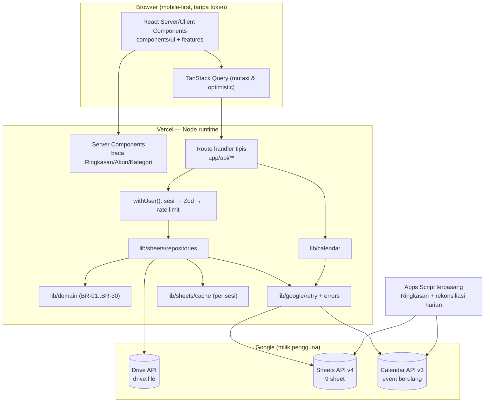
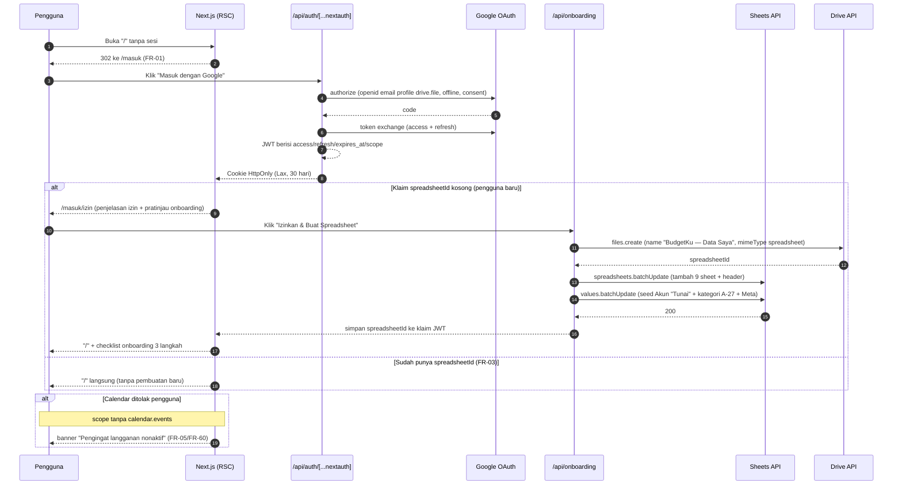
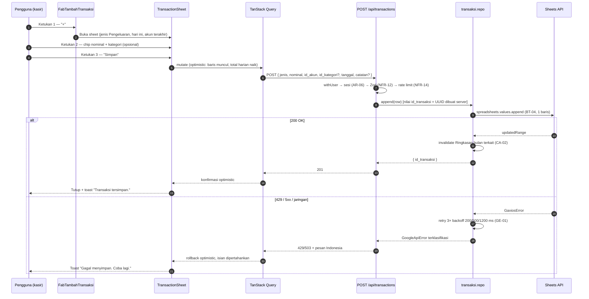

# Dokumen Tech Stack & Struktur Folder — BudgetKu

> Aplikasi web perencana anggaran pribadi, mobile-first, bahasa Indonesia, mata uang IDR.
> Versi dokumen: 1.0 · Status: draf untuk reviu · Lingkup: MVP (selaras PRD §1–§13, IA §0–§9)
> Rujukan: **PRD** (`docs/prd.md`), **IA** (`docs/information-architecture.md`), **DS** (`docs/design-system.md`).
> Konvensi ID dokumen ini: **TS-xx** (keputusan stack), **AR-xx** (aturan arsitektur), **EN-xx** (env var), **GE-xx** (penanganan galat Google), **OAU-xx** (langkah verifikasi OAuth), **DEP-xx** (deployment), **OB-xx** (observabilitas), **T-xx** (pertanyaan terbuka).

---

## 0. Ruang Lingkup & Konvensi

### 0.1 Asumsi dokumen ini (ASUMSI)

| ID | Asumsi | Alasan |
| --- | --- | --- |
| TS-A01 | Tim kecil (1–2 developer), satu lingkungan produksi + satu preview per PR. | Konteks proyek: tanpa server DB, backend tipis. |
| TS-A02 | Repositori tunggal, satu aplikasi Next.js; tidak ada paket terpisah. | Tidak ada kebutuhan pemisahan domain; CI tunggal. |
| TS-A03 | Runtime produksi **Node.js** (bukan Edge) untuk seluruh route handler yang memanggil Google API. | `googleapis` + kripto token butuh Node runtime (TS-04). |
| TS-A04 | Semua panggilan Google API dilakukan **server-side**; klien tidak pernah memegang access token (NFR-10). | Privasi & keamanan. |
| TS-A05 | Tidak ada database; satu-satunya penyimpanan pihak BudgetKu adalah **cookie sesi JWT** (NFR-20, NFR-22). | Konteks proyek + PRD §5.3. |
| TS-A06 | Zona waktu aplikasi = `Asia/Jakarta` sebagai default regional; tanggal transaksi mengikuti perangkat (A-05, BR-22). | PRD §6.2, IA §4.5. |
| TS-A07 | Apps Script terpasang di spreadsheet pengguna untuk regenerasi `Ringkasan` (A-07) dan rekonsiliasi harian pengingat (NFR-32). | PRD A-40, §8.1. |
| TS-A08 | Seluruh UI berbahasa Indonesia; tidak ada i18n runtime (A-09). | IA §0.1. |
| TS-A09 | Belum ada anggaran untuk APM berbayar; observabilitas memakai log platform + RUM Web Vitals. | Biaya. |
| TS-A10 | Sheet `Meta` ada pada MVP meski PRD §10.9 mencatatnya sebagai tambahan terhadap 8 sheet IA FL-01. | PRD Q-PRD-01. |

### 0.2 Keputusan yang mengikat implementasi

| ID | Keputusan | Sumber |
| --- | --- | --- |
| AR-01 | Data keuangan hanya di Google Drive pengguna; server tidak menyimpan salinan (NFR-20). | PRD §5.3 |
| AR-02 | Route handler tipis: validasi → panggil repository Sheets/Calendar → respons. Tidak ada logika bisnis di route (Domain terpisah). | IA §0.1 |
| AR-03 | Semua tulis ke Sheets **idempoten** (NFR-30): upsert berbasis kunci, bukan append buta. | PRD CF-08 |
| AR-04 | Urutan tulis terkunci: **Sheets dulu, Calendar kemudian** (A-21). Kegagalan Calendar tidak membatalkan baris Sheets. | PRD NFR-34 |
| AR-05 | Dashboard membaca sheet `Ringkasan` pra-komputasi (A-07), bukan menjumlah `Transaksi` di klien. | IA §0.1 |
| AR-06 | Tidak ada endpoint yang menerima `spreadsheetId` dari klien (NFR-13); rujukan selalu dari sesi server. | PRD §5.2 |
| AR-07 | Cache berlingkup per sesi/pengguna; dilarang cache bersama antar pengguna (CA-06). | PRD §8.3 |
| AR-08 | Log tidak memuat nominal, nama kategori, nama akun, atau isi catatan (NFR-18). | PRD §5.2 |
| AR-09 | Aksesibilitas WCAG 2.1 AA adalah syarat rilis, bukan polish (NFR-35..NFR-44); token warna dari DS. | PRD §5.5 |
| AR-10 | Atom visual (warna, tipografi, spasi, radius) hanya dari `docs/tokens.css` + `tailwind.config.ts`; dilarang nilai literal di komponen. | DS §2 |

---

## 1. Ringkasan Stack (tabel keputusan)

| Lapisan | Pilihan | Status usulan | Alasan ringkas |
| --- | --- | --- | --- |
| Framework | Next.js 15 App Router + TypeScript `strict` | diterima | Server Component memuat data Sheets di server; klien tidak pernah melihat token (NFR-10); route handler = backend tipis (AR-02). |
| Hosting | Vercel (Node runtime) | diterima dengan catatan | Preview per PR, Web Vitals RUM. Catatan: fungsi **Node**, bukan Edge (TS-03); cold start didokumentasikan (D-06). |
| Styling | Tailwind CSS v3 + `tokens.css` + `tailwindcss-animate` | diterima, **tanpa shadcn/ui untuk MVP** | `tailwind.config.ts` sudah memetakan token DS ke utility; komponen sheet/FAB/nav bawah lebih ringan ditulis manual daripada mengadaptasi Radix (§1.1, §3.2). |
| Ikon | `lucide-react` | diterima | Ukuran kecil, tree-shakeable, konsisten dengan gaya DS. |
| Auth | Auth.js v5 (NextAuth) provider Google | diterima dengan penguatan | Strategi sesi **JWT**, bukan adapter DB (tidak ada DB, TS-A05). |
| Google API | `googleapis` (Node SDK) | diterima | Satu paket untuk Drive + Sheets + Calendar; retry & error shape seragam. |
| Validasi | Zod | diterima | Skema dibagi klien↔server (RHF `zodResolver` + validasi route, NFR-12). |
| Server-state | TanStack Query | **diterima untuk klien saja** | Optimistic update untuk transaksi/budget; pembacaan awal tetap Server Component. |
| Form | React Hook Form | diterima | Input nominal integer & papan angka (FR-07) tanpa rerender berat. |
| Grafik | Recharts | diterima | Donat + batang (FR-46/FR-47); wajib `dynamic(ssr:false)` (§1.1). |
| Tanggal | `date-fns` **v4** + `@date-fns/tz` | **koreksi usulan** | Perhitungan tanggal tagih (BR-15..BR-18) dan zona kalender (CR-04) butuh `TZDate`; bukan `date-fns-tz` lama. |
| Angka | `Intl.NumberFormat('id-ID')` | **koreksi usulan** | Format `Rp1.250.000` tanpa desimal (A-08) tidak butuh `currency.js`/`dinero`. |
| Toast | `sonner` | **tambahan** | Toast & galat wajib `aria-live` (NFR-39); `sonner` menangani pola ini. |
| Uji unit | Vitest + Testing Library + `jsdom` | diterima | Cepat, kompatibel ESM. |
| Uji E2E | Playwright | diterima | Uji jumlah ketukan FR-06 dan keyboard NFR-37. |
| Lint/format | ESLint (`next/core-web-vitals`) + Prettier | diterima | Tambah `eslint-plugin-jsx-a11y` untuk NFR-37/NFR-44. |
| CI/CD | GitHub Actions | diterima, **tanpa auto-deploy** | Alasan di §10.3. |

### 1.1 Kritik terhadap usulan awal

| Usulan awal | Kritik | Perbaikan |
| --- | --- | --- |
| shadcn/ui | Pemasangan CLI shadcn v4 memakai **Tailwind v4 CSS-first `@theme`**, sedangkan repo sudah memakai `tailwind.config.ts` v3 dengan token DS. CLI juga menulis ulang `globals.css`/config dan berisiko menimpa token. | MVP tanpa shadcn. Bila suatu saat butuh primitif dialog, **salin manual** file komponennya (source file, bukan dependensi) dan pertahankan config v3. |
| "refresh token dikelola sisi server" | Terlalu kabur dan berpotensi memunculkan adapter database (dilarang oleh NFR-20/TS-A05). | Tetapkan strategi sesi **JWT**; refresh token tersimpan di dalam cookie JWE, akses token diperbarui di route handler lewat `getToken()`; risiko interaksi Auth.js vs rotasi refresh dijelaskan di §4.4. |
| `calendar.events` di login pertama | Meminta scope sensitif sebelum pengguna tahu manfaatnya; IA FL-01 3b mengizinkan Calendar ditolak tanpa memblokir dashboard. | Login awal: `openid email profile drive.file`. `calendar.events` diminta **inkremental** saat FR-32/FR-38/FR-60 (lihat §4.5). |
| Recharts di semua halaman | Recharts butuh `window`; impor di Server Component → galat build. | Semua grafik `"use client"` + `next/dynamic({ ssr:false })` + skeleton (NFR-48). |
| TanStack Query untuk semua data | Menghapus manfaat Server Component; memperburuk NFR-01/NFR-04. | Query hanya untuk mutasi + invalidasi; daftar awal dirender server. |
| Vercel Cron untuk rekonsiliasi pengingat | Cron berjalan per project, tanpa token pengguna; tidak boleh memegang refresh token (NFR-20). | Rekonsiliasi harian tetap di Apps Script pengguna (NFR-32). Cron Vercel hanya tugas global tanpa data pengguna (§10.4). |

---

## 2. Alasan Tiap Pilihan & Alternatif yang Ditolak

### 2.1 Next.js App Router + TypeScript `strict`

**Alasan**: (a) memuat `Ringkasan` di server mengurangi panggilan Sheets dari browser → mendukung NFR-01 tanpa mengekspos token; (b) route handler di `app/api/**/route.ts` persis "backend tipis" (AR-02); (c) `server-only` menandai modul Google agar tidak masuk bundle klien (NFR-10).

| Alternatif ditolak | Alasan |
| --- | --- |
| Vite + React SPA + Express terpisah | Dua deploy & pipeline; token harus dikelola via BFF manual; kehilangan Server Component. |
| Remix | Cocok secara konsep, tetapi deployment & dukungan Auth.js kurang mulus dibanding Next. |
| SvelteKit | Tim memakai React (Testing Library sudah dipilih); migrasi skill tidak sepadan. |
| Next.js Pages Router | Tidak ada Server Component; data dashboard jadi client-fetch → melanggar NFR-01. |

**Catatan**: `typescript.strict: true` + `noUncheckedIndexedAccess: true` — mapper baris Sheets bergantung pada indeks kolom yang bisa kosong (CF-05).

### 2.2 Vercel

**Alasan**: preview per PR untuk uji jalur OAuth (redirect URI preview harus terdaftar), log/analytics bawaan, tanpa konfigurasi server.

| Alternatif ditolak | Alasan |
| --- | --- |
| Cloudflare Workers/Pages | Tidak bisa menjalankan `googleapis` (butuh Node API & `node:crypto`); memaksa REST manual. |
| Netlify | Dukungan route handler App Router + streaming kurang matang saat tinjauan. |
| VPS sendiri (Docker) | Menambah tugas operasi (TLS, scale, log); mempersulit preview per PR. |

**Catatan penting**: fungsi wajib `runtime = "nodejs"`. `export const runtime = "edge"` pada route Google API adalah **galat** (TS-03).

### 2.3 Tailwind v3 + `tokens.css`, tanpa shadcn/ui

**Alasan**: `tailwind.config.ts` sudah memetakan seluruh token DS (warna `income`/`expense`/`cat-1..12`, ukuran teks `display`/`amount`, `touch`, animasi sheet & skeleton). Menambah shadcn berisiko konflik Tailwind v3↔v4 dan menambah permukaan tak terpakai; UI ini justru butuh komponen khas (papan angka, chip kategori, nav bawah).

| Alternatif ditolak | Alasan |
| --- | --- |
| shadcn/ui penuh | Lihat §1.1. |
| Radix Themes / Mantine / Chakra | Gaya visual tidak dapat dipetakan ke token DS tanpa override besar; bundle lebih berat. |
| CSS Modules murni | Kehilangan kecepatan utility untuk layar mobile-first 320–414 px (NFR-46) dan konsistensi token. |

### 2.4 Auth.js v5 provider Google, sesi JWT

**Alasan**: hanya butuh "masuk dengan Google"; tidak ada email/password (A-01) dan tidak ada tabel pengguna (TS-A05).

| Alternatif ditolak | Alasan |
| --- | --- |
| Auth.js + adapter database | Dilarang: NFR-20 (tidak ada data pengguna di server) & NFR-22. |
| Implementasi OAuth sendiri | Menangani state, PKCE, rotasi refresh, keamanan cookie sendiri menambah risiko. |
| Firebase Auth | Menambah dependensi platform + tetap butuh OAuth untuk Drive/Calendar. |
| Clerk/Auth0 | Identitas di pihak ketiga bertabrakan dengan narasi privasi (NFR-24, R-10). |

### 2.5 `googleapis`

**Alasan**: satu klien untuk Drive (`files.create`), Sheets (`values.batchGet/append/update`, `spreadsheets.create/batchUpdate`), Calendar (`events.insert/patch/delete/get`). Bentuk galat (`GaxiosError` + `response.status` + `errors[].reason`) seragam → satu modul retry (GE-01..GE-08).

| Alternatif ditolak | Alasan |
| --- | --- |
| `fetch` + REST manual | Menulis ulang URL builder, parsing galat, penanganan OAuth; tanpa keuntungan ukuran berarti di server. |
| `@googleapis/sheets` (subpaket) | Pemakaian 3 API sekaligus tetap butuh paket terpisah + `google-auth-library`. |

### 2.6 Zod, TanStack Query (klien), React Hook Form

**Alasan**: Zod = satu sumber aturan validasi, dipakai `zodResolver` di form (pesan Indonesia, NFR-42) **dan** di route handler (NFR-12). Query hanya untuk mutasi (optimistic + rollback saat `append` gagal, FR-06 edge). RHF menangani input angka tanpa rerender per digit.

| Alternatif ditolak | Alasan |
| --- | --- |
| Valibot/Yup | Zod sudah jadi acuan umum; `zodResolver` mulus; pesan galat per field jelas. |
| SWR | Mutasi optimistic tidak sematang Query untuk pola "toast sukses + rollback". |
| Formik | Rerender lebih berat; kurang cocok untuk input 3 ketukan. |
| Server Action untuk semua mutasi | Tetap butuh Zod, tetapi menyulitkan retry/backoff terkontrol ke Google API; dipakai selektif (§5.5). |

### 2.7 Recharts, `date-fns` v4, `Intl.NumberFormat`

**Alasan**: Recharts menangani donat + batang (FR-46/FR-47) dengan alternatif tabel yang bisa ditambahkan (NFR-38). `date-fns` v4 + `@date-fns/tz` menghitung "tanggal 31 → hari terakhir bulan" (BR-17) & "29 Feb non-kabisat" (BR-18). `Intl.NumberFormat('id-ID')` menghasilkan `Rp1.250.000` tanpa dependensi tambahan.

| Alternatif ditolak | Alasan |
| --- | --- |
| Chart.js/react-chartjs-2 | Lebih berat; render canvas menyulitkan alternatif tabel aksesibel. |
| visx/D3 langsung | Kode lebih banyak untuk kebutuhan terbatas di PRD §4.9. |
| Day.js | Butuh plugin timezone terpisah. |
| Luxon | Lebih besar (± 70 KB) untuk kebutuhan tanggal-saja. |
| `currency.js` | Dependensi tambahan untuk pemformatan yang bisa dilakukan `Intl`. |

### 2.8 Aturan tanggal & waktu

| ID | Aturan | Rujukan |
| --- | --- | --- |
| TS-T01 | Tanggal tagih dihitung dengan `TZDate` pada zona pengguna (`Asia/Jakarta` default). | BR-22, CR-04 |
| TS-T02 | Tanggal disimpan sebagai string `YYYY-MM-DD`; waktu sebagai ISO-8601 dengan offset (bukan epoch). | PRD §10 |
| TS-T03 | Perbandingan "hari ini" dilakukan di server dengan `EN-TIMEZONE`, kecuali input tanggal di form (perangkat). | A-05 |
| TS-T04 | Kolom `bulan` (`YYYY-MM`) memakai string langsung, bukan objek tanggal, agar aman dari pergeseran zona. | PRD §10.4 |
| TS-T05 | Proyeksi/rata-rata dibulatkan ke integer terdekat (0,5 ke atas). | BR-09 |

---

## 3. Struktur Folder

### 3.1 Pohon folder (disesuaikan dari usulan)

```
budgetku/
├─ AGENTS.md  README.md
├─ next.config.ts  tailwind.config.ts  postcss.config.mjs  tsconfig.json
├─ eslint.config.mjs  .prettierrc.json  vitest.config.ts  playwright.config.ts
├─ middleware.ts                      # hanya cek keberadaan cookie sesi (bukan otorisasi)
├─ public/manifest.webmanifest  public/icons/            # NFR-49 (PWA dasar)
├─ docs/
│  ├─ prd.md  information-architecture.md  design-system.md  tokens.css
│  ├─ db-schema.md                    # skema Sheets (dokumen terpisah, belum ada)
│  └─ tech-stack.md                   # dokumen ini
├─ apps-script/                       # A-07, NFR-32 (dipasang di spreadsheet pengguna)
│  ├─ Ringkasan.gs  Rekonsiliasi.gs  appsscript.json  README.md
├─ src/
│  ├─ app/
│  │  ├─ layout.tsx  globals.css  error.tsx  global-error.tsx  not-found.tsx
│  │  ├─ (auth)/layout.tsx
│  │  ├─ (auth)/masuk/page.tsx                # IA 1.1
│  │  ├─ (auth)/masuk/izin/page.tsx           # IA 1.2 (FL-01 5–6)
│  │  ├─ (auth)/masuk/galat/page.tsx          # IA FL-01 3a
│  │  ├─ (app)/layout.tsx                     # otorisasi + BottomNav + FAB + banner
│  │  ├─ (app)/page.tsx                       # IA 2.1 Ringkasan ("/")
│  │  ├─ (app)/transaksi/page.tsx             # IA 3.1
│  │  ├─ (app)/transaksi/baru/page.tsx        # IA 3.2
│  │  ├─ (app)/transaksi/[id]/page.tsx        # IA 3.3
│  │  ├─ (app)/budget/page.tsx                # IA 4.1
│  │  ├─ (app)/budget/kalender/page.tsx       # IA 4.2
│  │  ├─ (app)/langganan/page.tsx             # IA 5.1
│  │  ├─ (app)/langganan/baru/page.tsx        # IA 5.2
│  │  ├─ (app)/wishlist/page.tsx              # IA 6.1
│  │  ├─ (app)/wishlist/baru/page.tsx         # IA 6.2
│  │  ├─ (app)/wishlist/[id]/page.tsx         # IA 6.3
│  │  ├─ (app)/analisis/page.tsx              # IA 7.1
│  │  ├─ (app)/pemasukan/page.tsx             # IA 8.1
│  │  ├─ (app)/pengaturan/akun/page.tsx       # IA 9.1
│  │  ├─ (app)/pengaturan/kategori/page.tsx   # IA 9.2
│  │  ├─ (app)/pengaturan/data/page.tsx       # IA 9.3
│  │  └─ api/
│  │     ├─ auth/[...nextauth]/route.ts
│  │     ├─ onboarding/route.ts               # FL-01: buat spreadsheet + seed
│  │     ├─ transactions/route.ts             # POST append (FR-06)
│  │     ├─ transactions/[id]/route.ts        # PATCH (FR-11), DELETE (FR-12)
│  │     ├─ budgets/route.ts                  # GET (FR-24), POST upsert (FR-25), DELETE (FR-26)
│  │     ├─ budgets/copy/route.ts             # FR-27 batch
│  │     ├─ accounts/route.ts  categories/route.ts
│  │     ├─ subscriptions/route.ts  subscriptions/[id]/route.ts
│  │     ├─ reminders/route.ts                # FR-32/37/38
│  │     ├─ reminders/bulk/route.ts           # FR-62
│  │     ├─ wishlist/route.ts  wishlist/[id]/route.ts
│  │     ├─ summary/route.ts                  # baca sheet Ringkasan
│  │     ├─ preferences/route.ts              # sheet Meta (onboarding_selesai, tz)
│  │     ├─ health/route.ts                   # DEP-05
│  │     └─ cron/global/route.ts              # tugas non-pengguna (T-02)
│  ├─ components/
│  │  ├─ ui/            # Button Card Chip Amount EmptyState Sheet Field ProgressBar Toast
│  │  ├─ layout/        # AppHeader BottomNav SidebarDesktop FabTambahTransaksi DueBanner
│  │  └─ features/
│  │     ├─ transaction/  budget/  subscription/  wishlist/  charts/  onboarding/
│  ├─ lib/
│  │  ├─ google/    oauth.ts  auth-token.ts  client.ts  retry.ts  errors.ts  quota.ts
│  │  ├─ sheets/    schema.ts  bootstrap.ts  ranges.ts  mapper.ts  cache.ts  migrate.ts
│  │  │             repositories/{akun,kategori,transaksi,budget,langganan,wishlist,pengingat,ringkasan,meta}.repo.ts
│  │  ├─ calendar/  mapping.ts  sync.ts  reconcile.ts
│  │  ├─ domain/    money.ts  balance.ts  budget.ts  billing-date.ts  wishlist.ts  summary.ts
│  │  ├─ validation/ transaction.ts budget.ts subscription.ts wishlist.ts account.ts category.ts meta.ts common.ts
│  │  ├─ server/    session.ts  handler.ts  ratelimit.ts  responses.ts
│  │  ├─ logging.ts  format.ts  constants.ts
│  ├─ hooks/        use-transaction-mutation use-budget-mutation use-reminder-mutation
│  │                use-due-bills use-month-picker use-media-query
│  ├─ types/        sheets.ts  api.ts  auth.ts      # augmentasi Session/JWT Auth.js
│  └─ styles/tokens.css                              # salinan docs/tokens.css (T-03)
├─ tests/           unit/  integration/  e2e/
└─ .github/workflows/ci.yml
```

### 3.2 Perubahan dari usulan awal (dan alasannya)

| Usulan awal | Perubahan | Alasan |
| --- | --- | --- |
| `app/(app)/dashboard/` | Menjadi `app/(app)/page.tsx` (route `/`) | IA §2.2 menetapkan Ringkasan di `/`; glosarium IA §7.2 melarang label "Dashboard". |
| `app/(auth)/login/` | Menjadi `(auth)/masuk/{,izin,galat}/page.tsx` | Route harus mengikuti IA 1.1/1.2 & FL-01 3a agar matriks keterlacakan PRD §11 tetap valid. |
| hanya `features/` | Tambah `components/ui/` + `components/layout/` | Primitif netral lintas fitur; `layout/` memuat BottomNav/Sidebar/FAB/banner (IA §3). |
| `lib/sheets/` tanpa repo terpisah | Tambah `lib/sheets/repositories/` | 9 file repo kecil; mencegah file raksasa dan mempermudah uji mapper. |
| `lib/domain/` tanpa isi | Diisi 6 modul fungsi murni | BR-01..BR-30 dipakai server & klien; ini tempat uji unit paling bernilai. |
| tanpa `lib/server/` | Ditambah | `withUser()`/`requireSession()` = mekanisme AR-06 dan NFR-14 (rate limit). |
| tanpa `apps-script/` | Ditambah | A-07 & NFR-32 berjalan di spreadsheet pengguna; kode perlu tempat berversi. |
| tanpa `types/sheets.ts` | Ditambah | Tipe baris sheet harus satu sumber agar mapper & repo tidak menyimpang dari PRD §10. |
| API route tanpa nama resource | Diberi nama resource + komentar FR | Memudahkan pelacakan endpoint ↔ FR saat reviu PRD §11. |
| `styles/tokens.css` di `src/` | Dua lokasi (docs = sumber, src = salinan) | `tokens.css` sudah ada di `docs/`; build butuh di `src/` (T-03: symlink vs salin). |

### 3.3 Aturan penempatan kode

| ID | Aturan |
| --- | --- |
| AR-11 | Logika bisnis (BR-xx) hanya di `lib/domain/**`; komponen & route dilarang menghitung ulang. |
| AR-12 | Semua akses Sheets melewati `lib/sheets/repositories/**`; `google.sheets(...)` langsung di route/komponen dilarang. |
| AR-13 | Semua akses Calendar melewati `lib/calendar/**`; `events.*` langsung di route dilarang. |
| AR-14 | Modul di `lib/google/**`, `lib/sheets/**`, `lib/calendar/**`, `lib/server/**` diawali `import "server-only"`. |
| AR-15 | Format uang hanya dari `lib/domain/money.ts` (`formatIDR`, `parseIDRInput`); UI dilarang memanggil `toLocaleString` sendiri. |
| AR-16 | Setiap route dibungkus `withUser()`: verifikasi sesi → validasi Zod → panggil repo/domain → peta galat Google ke HTTP → log tanpa PII. |
| AR-17 | `components/ui/**` tidak boleh mengimpor `lib/sheets/**`, `lib/google/**`, atau `hooks/**` (hanya props + callback). |
| AR-18 | Nama file & ekspor domain/lib = `kebab-case`; komponen React = `PascalCase`. |
| AR-19 | Satu komponen = satu file; file > 300 baris wajib dipecah (mencegah komponen monolitik seperti sheet transaksi). |
| AR-20 | Tipe baris sheet (PRD §10) hanya didefinisikan di `types/sheets.ts`; repo mengimpor dari sana. |

### 3.4 Peta file ↔ sheet (sumber tunggal)

| Sheet (PRD §10) | Repo | Mapper khusus | Cache |
| --- | --- | --- | --- |
| `Akun` | `akun.repo.ts` | boolean `default`/`arsip` ("TRUE"/"FALSE" → boolean) | CA-01 TTL 5 menit |
| `Kategori` | `kategori.repo.ts` | `warna` tervalidasi terhadap palet DS | CA-01 TTL 5 menit |
| `Transaksi` | `transaksi.repo.ts` | `nominal` integer, `tanggal` `YYYY-MM-DD`, kolom kosong → `null` | tanpa cache (CA-04) |
| `Budget` | `budget.repo.ts` | kunci gabungan `bulan + id_kategori`; upsert lewat pencarian indeks baris (BT-05) | indeks baris CA-03 TTL 60 s |
| `Langganan` | `langganan.repo.ts` | `siklus` enum; `status_pengingat` enum | CA-01 |
| `Wishlist` | `wishlist.repo.ts` | `terkumpul` integer; `status` turunan dari `terkumpul ≥ nominal_target` (BR-25) | CA-01 |
| `Pengingat` | `pengingat.repo.ts` | `status` enum; satu baris per `id_langganan` | tanpa cache (CA-07) |
| `Ringkasan` | `ringkasan.repo.ts` | semua kolom integer; baca satu baris per bulan (BT-03) | CA-02 TTL 5 menit |
| `Meta` | `meta.repo.ts` | pasangan `kunci`/`nilai` | CA-01 |

---

## 4. Autentikasi, Izin, dan Pengelolaan Token

### 4.1 Konfigurasi provider Google

| Aspek | Nilai |
| --- | --- |
| Provider | `google` (Auth.js v5) |
| Strategi sesi | `jwt` (tanpa adapter; TS-A05) |
| `session.maxAge` | 30 hari (NFR-11) |
| Access type | `offline` (agar `refresh_token` diterbitkan) |
| Prompt | `consent` pada login pertama / saat scope bertambah; setelahnya `select_account` |
| Cookie | `HttpOnly`, `Secure`, `SameSite=Lax`, prefix `__Secure-` di produksi (NFR-11) |
| Scope login awal | `openid email profile https://www.googleapis.com/auth/drive.file` |
| Scope inkremental | `https://www.googleapis.com/auth/calendar.events` (saat FR-32/FR-38/FR-60) |

### 4.2 Isi token JWT (augmentasi)

| Klaim | Isi | Catatan |
| --- | --- | --- |
| `sub` | ID pengguna Google | Identitas. |
| `email`, `name`, `picture` | Profil | Hanya untuk tampilan (§9 pengaturan akun). |
| `access_token` | Access token Google | Diperbarui saat refresh; **tidak** pernah dikirim ke klien (NFR-10). |
| `refresh_token` | Refresh token Google | Hanya ada bila `offline` & `prompt=consent`. |
| `expires_at` | Epoch detik | Dasar penentuan kebutuhan refresh. |
| `scope` | Scope saat ini | Dipakai mendeteksi perlu tidaknya minta Calendar (FR-60). |
| `spreadsheetId` | ID spreadsheet pengguna | Rujukan tunggal (A-02). Kosong = onboarding belum selesai. |
| `onboardingDone`, `tz` | Preferensi ringan | Cerminan sheet `Meta`; sumber kebenaran tetap `Meta` (NFR-22). |

### 4.3 Alur refresh token di route handler

1. `requireSession()` membaca cookie JWE via `getToken()` (server-side).
2. Bila `now > expires_at − 60`, refresh ke `https://oauth2.googleapis.com/token` (`client_id`, `client_secret`, `refresh_token`, `grant_type=refresh_token`).
3. Tulis `access_token`/`expires_at` baru ke klien Google; cookie ditulis ulang hanya saat rotasi sesi Auth.js.
4. `invalid_grant` → tandai sesi "perlu login ulang" (GE-04); halaman menampilkan bar izin (FR-05/FR-62), bukan galat teknis.

### 4.4 Risiko token & mitigasi

| ID | Risiko | Mitigasi |
| --- | --- | --- |
| TR-01 | Refresh konkuren (beberapa request bersamaan) | Refresh hanya di dalam route handler (bukan callback), dijaga `expires_at`; satu promise per `sub` di memori proses dengan TTL pendek. |
| TR-02 | `refresh_token` tidak diterbitkan karena izin pernah diberikan | Simpan `scope`; bila `refresh_token` kosong & access token kedaluwarsa → login ulang dengan `prompt=consent` (FR-05). |
| TR-03 | Refresh dicabut pengguna (`invalid_grant`) | `status_pengingat` tidak boleh berbohong (NFR-33): tandai `tidak aktif` hanya setelah percobaan gagal final + bar izin (PRD §7.6). |
| TR-04 | Cookie > 4 KB karena `refresh_token` + `scope` | Simpan hanya scope yang dipakai; klaim non-esensial boleh dipotong. |
| TR-05 | Token bocor lewat log | `lib/logging.ts` me-redact `access_token`, `refresh_token`, `Authorization`, `code` (AR-08, NFR-18). |

### 4.5 Izin Calendar inkremental

| Langkah | Perilaku | Rujukan |
| --- | --- | --- |
| 1 | **Simpan & buat pengingat** saat `scope` tanpa `calendar.events` → arahkan ke `/pengaturan/data` + dialog penjelasan. | FR-60 |
| 2 | **Aktifkan izin Calendar** memicu OAuth ulang `prompt=consent` + scope tambahan, `include_granted_scopes=true`. | FR-62 |
| 3 | Pengguna menolak → langganan tetap tersimpan, `status_pengingat=tidak aktif`, banner "Pengingat langganan nonaktif." | FL-01 3b, R-05 |
| 4 | Setelah izin ada → tawarkan aktivasi massal (FR-62) berurutan, maksimal 1 event per langganan (A-30). | PRD §7.1 |

### 4.6 Daftar langkah verifikasi OAuth (Google Cloud Console)

| ID | Langkah | Detail |
| --- | --- | --- |
| OAU-01 | Buat project Google Cloud | Satu project; kredensial klien boleh satu bila semua redirect URI didaftarkan (T-04). |
| OAU-02 | Aktifkan API | Google Drive API, Google Sheets API, Google Calendar API. |
| OAU-03 | Konfigurasi layar persetujuan | Nama "BudgetKu", logo, domain aplikasi, domain kebijakan privasi, tautan kebijakan privasi, email dukungan & developer. |
| OAU-04 | Isi alasan scope | `drive.file`: "membuat & mengelola satu spreadsheet milik pengguna sebagai penyimpanan data". `calendar.events`: "membuat pengingat tagihan langganan". |
| OAU-05 | Tambahkan scope | `openid`, `email`, `profile`, `drive.file`, `calendar.events`. |
| OAU-06 | Daftarkan redirect URI | Produksi `https://<domain>/api/auth/callback/google`; preview (domain Vercel) & lokal `http://localhost:3000/api/auth/callback/google`. |
| OAU-07 | Origin JS | Tidak wajib (tanpa GIS client-side). |
| OAU-08 | Klasifikasi scope | `drive.file` **sensitif**; `calendar.events` **sensitif** → memicu verifikasi untuk penggunaan publik. |
| OAU-09 | Siapkan video demo | ≥ 1 menit: login, penjelasan izin, pembuatan spreadsheet, pembuatan event Calendar, penggunaan data. |
| OAU-10 | Ajukan verifikasi | Kuesioner "How will your app use the requested scopes" + tautan kebijakan privasi & syarat layanan. |
| OAU-11 | Verifikasi domain | Kepemilikan domain di Search Console (syarat branding/consent screen). |
| OAU-12 | Mode **Testing** | Maks. 100 pengguna uji yang harus ditambahkan manual; **refresh token kedaluwarsa 7 hari** sehingga pengguna uji harus login ulang; layar "aplikasi belum diverifikasi". Hanya untuk pengembangan. |
| OAU-13 | Mode **Production** | Batas 100 pengguna hilang; refresh token tidak lagi kedaluwarsa 7 hari; identitas/ikon tampil. Sebelum *verified*, kuota pengguna & peringatan "belum diverifikasi" masih muncul. |
| OAU-14 | Re-verifikasi berkala | Scope sensitif menuntut re-verifikasi; simpan bukti demo + versi kebijakan privasi. |
| OAU-15 | Kuota API project | Ajukan peningkatan kuota Sheets/Calendar bila pengguna aktif > 500 (A-39); pantau rilis (R-06). |
| OAU-16 | Rencana bila verifikasi tertunda | `calendar.events` tetap berfungsi untuk pengguna uji; banner in-app (FR-39) adalah cadangan fungsional (D-04), sehingga MVP tidak bergantung pada verifikasi. |

### 4.7 Pseudokode route handler (pola tunggal)

```ts
// src/app/api/transactions/route.ts
import "server-only";
export const runtime = "nodejs";           // AR: wajib Node (TS-03)

export const POST = withUser(
  { schema: transactionInputSchema, kind: "write", limit: 30 },   // NFR-14
  async ({ input, sheets }) => {
    const row = toTransactionRow(input);                          // mapper
    await sheets.transaksi.append(row);                            // BT-04
    await sheets.ringkasan.invalidate(input.bulan);                // CA-02
    return { ok: true, id: row.id_transaksi };                     // responses.ts
  },
);
```
`withUser()` menangani: sesi (AR-06) → Zod (NFR-12) → rate limit (NFR-14) → retry Google (NFR-29) → pemetaan galat (§7) → log tanpa PII (AR-08).

---

## 5. Arsitektur & Diagram

### 5.1 Gambaran lapisan



Catatan: panah `RSC → REPO` ada, tetapi hanya untuk **baca** (AR-05); semua tulis lewat `api/**` (AR-02).

### 5.2 Alur login (FL-01) + pembuatan spreadsheet



Kegagalan (mengikuti FL-01): pembatalan di layar Google → `/masuk` + "Masuk dibatalkan."; penolakan `drive.file` → `/masuk/galat`; `files.create` gagal → pesan pada `/masuk/izin` + **Coba lagi**; sebagian sheet gagal → jangan arahkan ke `/` sampai `Transaksi` & `Akun` ada.

### 5.3 Alur tulis transaksi (FL-02, FR-06)



Aturan yang mengikat alur ini: tanpa kategori → **Tanpa kategori** (A-28); akun belum ada → tombol **Buat akun "Tunai"** (FR-23); FAB disembunyikan di `/transaksi/baru` & `/masuk*` (IA §3.3); jalur "Simpan & tambah lagi" (FR-13) memakai endpoint yang sama tanpa menutup sheet.

### 5.4 Alur sinkron Calendar (FL-03, FR-32/FR-35/FR-36/FR-37/FR-38)

```mermaid
sequenceDiagram
  autonumber
  participant U as Pengguna
  participant API as POST /api/subscriptions (+ /reminders)
  participant R as langganan.repo
  participant Sh as Sheets API
  participant C as lib/calendar/sync
  participant Cal as Calendar API
  participant P as pengingat.repo

  U->>API: Simpan langganan (nama, nominal, siklus, tagihan, akun)
  API->>R: append Langganan (status_pengingat default aktif — FR-32)
  R->>Sh: values.append
  Sh-->>R: 200 (baris TERSIMPAN; tidak dibatalkan bila Calendar gagal — A-21)
  API->>C: insertEvent(langganan)

  alt scope calendar.events tersedia
    C->>Cal: events.insert (all-day, RRULE MONTHLY BYMONTHDAY / YEARLY, useDefault=false, overrides 4320 & 0)
    alt 200 OK
      Cal-->>C: id_event_calendar
      C->>P: append Pengingat (status aktif) + update Langganan.id_event_calendar
      P->>Sh: values.batchUpdate
      API-->>U: 201 + toast sukses, kembali ke /langganan
    else 403 (izin dicabut) / 429 / 5xx
      Cal-->>C: GaxiosError
      C->>P: status_pengingat=tidak aktif (tidak pernah "aktif" keliru — NFR-33)
      API-->>U: 207-style: baris tersimpan + bar "Pengingat nonaktif. Aktifkan?"
    end
  else scope tidak ada (FR-60)
    C-->>API: needsCalendarScope
    API-->>U: dialog menuju /pengaturan/data (tidak ada event dibuat)
  end

  note over U,Cal: Ubah tanggal tagihan → events.patch(recurrence) — DILARANG insert (A-30, §7.2)<br/>Tandai lunas (FR-35) → hanya update Sheets; event tidak diubah (CR-05, A-34)<br/>Hapus langganan (FR-36) → events.delete lalu hapus baris Langganan & Pengingat
```

### 5.5 Kapan Server Action, kapan route handler

| Kebutuhan | Pilihan | Alasan |
| --- | --- | --- |
| Mutasi dengan retry/backoff + status HTTP eksplisit (transaksi, budget, langganan, pengingat) | Route handler `app/api/**` | Butuh kontrol `Retry-After`, pemetaan 429/5xx, dan penghitung rate limit (NFR-14). |
| Aksi navigasi sederhana tanpa data Google (mis. tutup banner, tandai onboarding selesai) | Server Action | Tidak butuh kontrak HTTP untuk klien. |
| Baca data awal halaman | Server Component | Cepat & tanpa token di klien (NFR-01). |
| Refetch setelah mutasi (mis. daftar transaksi harian) | `router.refresh()` + invalidasi Query | Menjaga daftar tetap berasal server (CA-04: tanpa cache daftar transaksi). |

---

## 6. Strategi Env Var & Secret

### 6.1 Daftar variabel

| ID | Nama | Lingkup | Rahasia | Contoh / catatan |
| --- | --- | --- | --- | --- |
| EN-01 | `GOOGLE_CLIENT_ID` | server | ya (semi) | Dari Google Cloud Console. |
| EN-02 | `GOOGLE_CLIENT_SECRET` | server | **ya** | Hanya di server; tidak pernah `NEXT_PUBLIC_*`. |
| EN-03 | `AUTH_SECRET` | server | **ya** | ≥ 32 byte acak; rotasi mengakhiri semua sesi (rencanakan). |
| EN-04 | `AUTH_URL` | server | tidak | URL kanonik produksi (mis. `https://budgetku.app`). |
| EN-05 | `AUTH_TRUST_HOST` | server | tidak | `true` di Vercel/preview. |
| EN-06 | `EN-TIMEZONE` | server | tidak | `Asia/Jakarta` (TS-T03, TS-A06). |
| EN-07 | `NEXT_PUBLIC_APP_NAME` | klien | tidak | `BudgetKu`. |
| EN-08 | `CACHE_TTL_SECONDS` | server | tidak | Default 300 (CA-01/CA-02). |
| EN-09 | `SHEETS_WRITE_LIMIT_PER_MIN` | server | tidak | Default 30 (NFR-14). |
| EN-10 | `GOOGLE_QUOTA_READ_PER_MIN` | server | tidak | Default 60/pengguna (SH-01) untuk pemantauan kuota internal. |
| EN-11 | `LOG_LEVEL` | server | tidak | `info` produksi, `debug` lokal. |
| EN-12 | `SENTRY_DSN` (opsional) | server | semi | Bila diaktifkan; wajib `beforeSend` yang menghapus PII (OB-04). |
| EN-13 | `APPS_SCRIPT_URL` (opsional) | server | tidak | Fallback baca parsial bila kuota Sheets habis (D-03). |

### 6.2 Aturan

| ID | Aturan |
| --- | --- |
| ENV-A01 | Hanya variabel `NEXT_PUBLIC_*` yang boleh terlihat di klien; tidak ada token Google dengan prefix itu. |
| ENV-A02 | `.env.local` untuk pengembangan (tidak di-commit); `.env.example` berisi nama variabel + komentar, tanpa nilai nyata. |
| ENV-A03 | Produksi & preview memakai nilai berbeda; `AUTH_SECRET` preview ≠ produksi agar sesi tidak silang. |
| ENV-A04 | Rotasi: `GOOGLE_CLIENT_SECRET` → tambahkan secret baru di Vercel, deploy, lalu hapus lama (dukung dua nilai selama transisi? Tidak: Google hanya mengizinkan satu secret aktif per klien → rotasi terjadwal dengan jendela gangguan singkat, T-05). |
| ENV-A05 | Pemindai rahasia di CI (NFR-17): `gitleaks`/`trufflehog` + pola kustom (`AIza`, `GOCSPX-`, `ya29.`). |
| ENV-A06 | Variabel wajib divalidasi saat boot lewat `lib/constants.ts` (skema Zod `envSchema`): aplikasi gagal cepat bila kosong, dengan pesan tanpa membocorkan nilai. |
| ENV-A07 | Tidak ada secret di `apps-script/`; Apps Script memakai identitas pengguna sendiri (A-07), bukan service account. |
| ENV-A08 | Dilarang menyimpan `refresh_token` pengguna di variabel lingkungan atau penyimpanan server (TS-A05, NFR-20). |

### 6.3 Dampak keamanan

| ID | Risiko | Kendali |
| --- | --- | --- |
| SEC-01 | Kebocoran client secret | Hanya server; rotasi terjadwal; CI scanner; akses Vercel dibatasi. |
| SEC-02 | CSRF pada route tulis | Auth.js memasang token CSRF untuk endpoint auth; route tulis hanya menerima `POST/PATCH/DELETE` + header `Content-Type: application/json` + pemeriksaan `Origin` (NFR-16). |
| SEC-03 | XSS lewat catatan transaksi | Escaping default React; CSP tanpa `unsafe-inline`; catatan dibatasi 140 karakter (SH-03). |
| SEC-04 | IDOR | Tidak ada ID spreadsheet/`userId` dari klien (AR-06); `id_transaksi` selalu difilter terhadap spreadsheet sesi. |
| SEC-05 | Penyalahgunaan endpoint tulis | NFR-14 rate limit per sesi + per pengguna; 429 dengan `Retry-After`. |
| SEC-06 | Clickjacking | `X-Frame-Options: DENY` (melengkapi CSP `frame-ancestors 'none'`). |
| SEC-07 | Kebocoran lewat pesan galat | Pesan ke pengguna memakai `lib/google/errors.ts` (Indonesia, tanpa detail internal); detail hanya di log server. |

---

## 7. Cache & Batas Kuota Sheets

### 7.1 Hierarki cache (selaras CA-01..CA-07)

| Lapisan | Cakupan | TTL | Invalidasi | Alasan |
| --- | --- | --- | --- | --- |
| Cache referensi (`Akun`, `Kategori`, `Langganan`, `Wishlist`, `Meta`) | per sesi | 300 s (`EN-08`) | langsung saat sesi ini menulis sheet terkait (CA-01) | Dipakai setiap render pemilih; 60 req/menit/pengguna (SH-01) cepat habis tanpa cache. |
| Cache `Ringkasan` | per sesi + kunci bulan | 300 s | saat ada tulis `Transaksi`/`Budget` bulan itu (CA-02) | Kartu dashboard harus muncul cepat (NFR-01). |
| Cache indeks baris (`Budget`, mapping `id→row`) | per sesi + spreadsheet + sheet | 60 s | saat append/update dari sesi ini (CA-03) | Upsert tanpa `values.get` per baris (BT-05, BT-06). |
| Daftar transaksi | — | tanpa cache | selalu baca ulang | Agar edit manual di Sheets terlihat setelah muat ulang (CA-04). |
| Status pengingat | — | tanpa cache panjang | baca dari `Langganan`/`Pengingat` terbaru | Calendar = sumber kebenaran pengingat (CA-07, A-06). |
| Aset statis | CDN Vercel | immutable | build baru | NFR-01/NFR-03. |

### 7.2 Implementasi cache

| ID | Aturan |
| --- | --- |
| C-01 | Implementasi: `Map` di memori proses (instance Vercel) **dengan kunci** `sub:spreadsheetId:sheet[:bulan]`; bukan `fetch` cache global. |
| C-02 | Karena instance dapat berbeda antar request, cache adalah *best effort*; kebenaran tetap dari baca ulang. Tidak ada asumsi cache-hit (AR-07). |
| C-03 | Aksi **Muat ulang data** di `/pengaturan/data` mengosongkan seluruh cache sesi (CA-05). |
| C-04 | `Ringkasan` basi tidak boleh memblokir UI: kartu menampilkan angka dari `Ringkasan` + label waktu `diperbarui`; bila `diperbarui` lebih tua dari hari ini, tampilkan "Data ringkasan mungkin belum diperbarui". |
| C-05 | Fallback kuota: bila 429 berulang pada baca, hitung bulan berjalan dari `Transaksi` di server dengan batas baris (mis. 500 baris terakhir) dan tandai "Angka sementara" (D-03, R-01). |

### 7.3 Anggaran panggilan Google API per halaman (target)

| Halaman | Baca Sheets | Tulis Sheets | Calendar |
| --- | --- | --- | --- |
| `/` (Ringkasan) | 1 `batchGet` (`Ringkasan!A:H` baris bulan) + 1 cache referensi | 0 | 0 |
| `/transaksi` | 1 `batchGet` (rentang sempit `Transaksi!A2:K51`, BT-03) | 0 | 0 |
| `/transaksi/baru` (simpan) | 0 baca (indeks dari cache) | 1 `append` (BT-04) | 0 |
| `/budget` | 1 `batchGet` (`Budget`, `Kategori`) + 1 cache | 0–1 (upsert) | 0 |
| `/budget/kalender` | 1 `batchGet` (transaksi bulan, kolom minimum) | 0 | 0 |
| `/langganan` | 1 `batchGet` (`Langganan`, `Pengingat`) | 0 | 0 (rekonsiliasi harian di Apps Script) |
| `/langganan/baru` (simpan) | 0 baca | 1 append + 1 batchUpdate | 1 `insert` |
| `/wishlist` | 1 `batchGet` (`Wishlist`) + 1 (transaksi sisihan) | 0 | 0 |
| `/analisis` | 1 `batchGet` (transaksi 6 bulan, kolom minimum) | 0 | 0 |
| `/pemasukan` | 1 `batchGet` (transaksi jenis Pemasukan, 2 bulan) | 0 | 0 |
| `/pengaturan/*` | 1 `batchGet` | 0–1 | 0 |

Batas acuan: ≤ 2 permintaan baca per permintaan halaman (BT-01); 0 panggilan Google di dalam loop baris (BT-06).

### 7.4 Kuota & batas (ringkasan dari PRD §8.1) + kendali teknis

| Batas | Angka | Kendali teknis |
| --- | --- | --- |
| Baca Sheets per project / per pengguna | 300 / 60 per menit | cache (C-01), `batchGet` (BT-01), range sempit (BT-03), tanpa polling (tidak ada `setInterval` fetch). |
| Tulis Sheets per project / per pengguna | 300 / 60 per menit | `SHEETS_WRITE_LIMIT_PER_MIN=30` (EN-09) + antrean serial per sesi (maks 1 tulis in-flight) |
| Ukuran sel 50.000 karakter | catatan ≤ 140 (SH-03) | validasi Zod `max(140)` |
| 10.000.000 sel & 100 MB | ~5.000 transaksi aman (SH-04, SH-06) | pantau jumlah baris; panduan arsip di T-06 |
| Apps Script 6 menit/eksekusi | regenerasi per bulan (SH-08) | `Ringkasan.gs` memproses satu bulan per eksekusi, trigger berurutan |
| Rate limit Calendar | `rateLimitExceeded` | GE-05 antrean pembuatan event satu per satu (maks 1 in-flight) |

### 7.5 Anti-pola yang dilarang

| ID | Dilarang | Alasan |
| --- | --- | --- |
| AP-01 | Polling Sheets dari klien (mis. refresh tiap 30 s) | Menghabiskan kuota 60/menit/pengguna. |
| AP-02 | `values.get` per baris saat update | N+1 (BT-06). |
| AP-03 | `append` untuk upsert `Budget` | Menciptakan baris ganda (FR-25, CF-02). |
| AP-04 | Cache global lintas pengguna | Melanggar AR-07/CA-06 (kebocoran data). |
| AP-05 | Menghitung ringkasan seluruh riwayat di klien | Memblokir NFR-01/NFR-04. |

---

## 8. Strategi Penanganan Galat Google API

### 8.1 Klasifikasi

| ID | Kondisi | Deteksi | Perilaku | Pesan ke pengguna |
| --- | --- | --- | --- | --- |
| GE-01 | 429 / `rateLimitExceeded` / `userRateLimitExceeded` / `RESOURCE_EXHAUSTED` | `status=429` atau `errors[].reason` | Retry 3×: 200 ms → 500 ms → 1.200 ms + jitter 0–100 ms (NFR-29); hormati header `Retry-After` bila ada. Bila tetap gagal → 429 ke klien dengan `Retry-After`. | "Terlalu banyak permintaan. Tunggu sebentar." + **Coba lagi** |
| GE-02 | 5xx (`backendError`, `internalError`) | `status ≥ 500` | Retry 3× pola sama; hanya untuk operasi idempoten (GET, upsert, `append` dengan idempoten). | "Layanan Google sedang bermasalah. Coba lagi." |
| GE-03 | 401 (access token kedaluwarsa) | `status=401` | Refresh token sekali, ulangi request **satu kali**. Bila 401 lagi → perlakukan sebagai GE-04. | (tidak terlihat) |
| GE-04 | `invalid_grant` / refresh gagal | 400 dari endpoint token | Hentikan aksi Calendar & tulis; tandai sesi "perlu login ulang"; arahkan ke `/pengaturan/data`. | Bar: "Izin Calendar perlu diperbarui." + **Aktifkan izin Calendar** (FR-62) |
| GE-05 | 403 `insufficientPermissions` / `forbidden` | `status=403` | Tidak diulang. Untuk Calendar → `status_pengingat=tidak aktif` **hanya** setelah kegagalan final (NFR-33). Untuk Sheets → tampilkan bar izin Drive. | "Akses ke Google Drive/Calendar ditolak. Perbarui izin." |
| GE-06 | 404 pada `events.get`/`spreadsheets.get` | `status=404` | Rekonsiliasi: `Pengingat.status=tidak aktif`, kosongkan `id_event_calendar` (PRD §7.5). Untuk spreadsheet → mode "Data tidak ditemukan" + **Hubungkan ulang**. | "Data tidak ditemukan. Periksa koneksi Drive." |
| GE-07 | Galat jaringan/timeout (`ECONNRESET`, `ETIMEDOUT`, DNS) | tanpa `status` | Retry 3× pola yang sama dengan timeout per percobaan 10 s (total < 35 s agar masih di bawah batas fungsi). | "Koneksi bermasalah. Coba lagi." |
| GE-08 | `SERVICE_DISABLED` / kuota project habis (403 `quotaExceeded` level project) | `errors[].reason=SERVICE_DISABLED`/`dailyLimitExceeded` | Tidak ada retry yang berguna. Log level `error` + alarm; arahkan ke fallback baca Apps Script (D-03) bila tersedia. | "Layanan data sedang tidak tersedia. Coba lagi nanti." |
| GE-09 | 400 validasi Google (mis. `RRULE` tidak valid) | `status=400` | Tidak diulang; log dengan payload ter-redact; simpan langganan tanpa pengingat. | "Pengingat gagal dibuat. Data langganan tetap tersimpan." |
| GE-10 | 409 / konflik tulis | `status=409` | Baca ulang baris (`diperbarui`), terapkan *last write wins* (CF-01), maksimal 1 percobaan ulang otomatis (CF-07). | "Data berubah di tempat lain. Sudah dimuat ulang." |

### 8.2 Kebijakan retry

| ID | Aturan |
| --- | --- |
| GE-R01 | Retry hanya untuk: 429, 5xx, galat jaringan. **Tidak** untuk 400/401(2×)/403/404/409(>1×). |
| GE-R02 | Backoff eksponensial 200/500/1200 ms + jitter (NFR-29); maksimum 3 percobaan total (1 percobaan awal + 2 ulangan)? **Tidak**: 3 ulangan setelah percobaan awal untuk 429/5xx agar sesuai NFR-29, total maksimum 4 panggilan (T-07 bila menimbulkan latensi > 2 s). |
| GE-R03 | Operasi tulis non-idempoten dilarang di-retry: hanya `append` (UUID dari server) dan `upsert` yang idempoten (AR-03). |
| GE-R04 | `events.insert` hanya di-retry bila `id_event_calendar` belum tersimpan; bila sudah tersimpan → `events.patch` (A-30). |
| GE-R05 | Setiap retry dicatat sebagai log terstruktur (tanpa PII) dengan `attempt`, `status`, `reason`, `endpoint`, `durasi`. |
| GE-R06 | Total anggaran waktu satu request tulis < 8 s; bila terlewati, kembalikan 503 + `Retry-After: 5` alih-alih menggantung (UI menampilkan "Coba lagi"). |

### 8.3 Peta status HTTP respons BudgetKu

| Kondisi internal | Status ke klien | Body |
| --- | --- | --- |
| Sukses tulis | 201 | `{ ok: true, id }` |
| Sukses baca | 200 | `{ ok: true, data }` |
| Payload tidak valid (Zod) | 422 | `{ ok: false, code: "VALIDATION", fields: {...} }` |
| Tanpa sesi / sesi kedaluwarsa | 401 | `{ ok: false, code: "UNAUTHENTICATED" }` |
| Perlu izin Calendar | 403 | `{ ok: false, code: "NEEDS_CALENDAR_SCOPE" }` |
| Rate limit internal | 429 | `{ ok: false, code: "RATE_LIMITED" }` + `Retry-After` |
| Galat Google 5xx setelah retry | 503 | `{ ok: false, code: "UPSTREAM_UNAVAILABLE" }` + `Retry-After` |
| Baris tidak ditemukan | 404 | `{ ok: false, code: "NOT_FOUND" }` |

### 8.4 Prinsip UX galat (selaras IA §4.0)

| ID | Aturan |
| --- | --- |
| GE-U01 | Isian pengguna tidak pernah hilang saat galat (FR-06/FR-25 edge): sheet tetap terbuka, dialog tetap terbuka. |
| GE-U02 | Satu aksi utama per galat (mis. **Coba lagi**), bukan daftar opsi. Bila Sheets & Calendar gagal bersamaan, prioritaskan pesan Sheets (PRD §7.6). |
| GE-U03 | Tidak pernah menampilkan stack trace atau kode Google mentah (NFR-28). |
| GE-U04 | Status "aktif" pada pengingat hanya bila `events.get` mengembalikan 200 dengan `recurrence` dan 2 override reminder (PRD §7.6 "Keandalan"). |
| GE-U05 | Galat diumumkan lewat `aria-live` `assertive`; warna status selalu disertai teks (NFR-39, NFR-40). |

---

## 9. Strategi Pengujian

### 9.1 Lapisan & cakupan

| Lapisan | Alat | Fokus | Contoh target |
| --- | --- | --- | --- |
| Unit domain | Vitest | `lib/domain/**` (BR-01..BR-30) | BR-17 (31 Jan → 28 Feb → 31 Mar), BR-18 (29 Feb 2028 → 28 Feb 2029), BR-09 pembulatan, BR-25 status Tercapai |
| Unit mapper | Vitest | `lib/sheets/mapper.ts` | "TRUE"/"FALSE" → boolean, sel kosong → `null`, `nominal` string → integer |
| Unit validasi | Vitest | `lib/validation/**` | Pasangan valid/tidak valid per skema; pesan galat bahasa Indonesia (NFR-42) |
| Unit retry | Vitest (fake timers) | `lib/google/retry.ts` | Urutan 200/500/1200 ms; tidak retry 403/404; menghormati `Retry-After` |
| Unit cache | Vitest | `lib/sheets/cache.ts` | TTL, invalidasi saat tulis, isolasi antar `sub` (AR-07) |
| Integrasi route | Vitest + mock `googleapis` | `withUser()` | 401/422/429/503 sesuai §8.3; rate limit per sesi (NFR-14) |
| Komponen | Testing Library | Sheet transaksi, BudgetCategoryRow, ProgressBar | Fokus terperangkap & `Esc` menutup (NFR-37), `aria-describedby` pada galat (NFR-42) |
| E2E | Playwright | Alur kritis | FL-02 = 3 ketukan (M-01); FL-01 pembuatan spreadsheet (Google disimulasikan di CI); navigasi keyboard (NFR-44) |
| Aksesibilitas otomatis | Playwright + `@axe-core/playwright` | 10 halaman inti | 0 pelanggaran A/AA (NFR-44) |
| Visual snapshot | Playwright `toHaveScreenshot` | 320/360/414/1024 px | Tanpa scroll horizontal (NFR-07/NFR-46) |
| Performa | Lighthouse CI / Web Vitals RUM | `/`, `/transaksi` | NFR-01, NFR-03, NFR-04, NFR-05 |
| Kuota | Skrip beban sintetis | Repository | Panggilan per halaman sesuai §7.3 |

### 9.2 Aturan pengujian

| ID | Aturan |
| --- | --- |
| TEST-01 | Tidak ada panggilan jaringan nyata di uji; `googleapis` selalu di-mock (fixture `tests/fixtures/google/*.json`). |
| TEST-02 | Fixture galat 401/403/404/429/5xx tersedia & dipakai ulang (memetakan ke GE-01..GE-10). |
| TEST-03 | Setiap BR-xx punya minimal satu uji unit yang menyebut ID-nya di judul (mis. `"BR-17: 31 Jan → 28 Feb 2026"`). |
| TEST-04 | Setiap FR **Must** punya minimal satu uji E2E atau integrasi (merujuk PRD §11). |
| TEST-05 | Uji E2E CI memakai "mock Google"; uji dengan Google nyata hanya manual di akun uji (T-08). |
| TEST-06 | Ambang cakupan: `lib/domain` ≥ 90%, `lib/sheets` ≥ 75%, keseluruhan ≥ 70%. |
| TEST-07 | Uji determinisme waktu: `TZDate` disuntik (fake clock) agar tidak flaky di zona waktu berbeda. |

---

## 10. Deployment & Observabilitas

### 10.1 Lingkungan

| ID | Lingkungan | Branch | Data | Catatan |
| --- | --- | --- | --- | --- |
| DEP-01 | Lokal | — | Spreadsheet uji pribadi | Redirect URI `http://localhost:3000/api/auth/callback/google`. |
| DEP-02 | Preview | PR | Spreadsheet uji terpisah | `AUTH_SECRET` berbeda (ENV-A03); domain preview didaftarkan (OAU-06). |
| DEP-03 | Produksi | `main` | Data pengguna asli | Deploy setelah gate CI + checklist rilis (§10.6). |

### 10.2 Pipeline CI (GitHub Actions)

| ID | Tahap | Perintah / aksi | Gagal jika |
| --- | --- | --- | --- |
| DEP-10 | Install | `npm ci` | lockfile tidak sinkron |
| DEP-11 | Tipe | `tsc --noEmit` | ada galat tipe |
| DEP-12 | Lint | `next lint` + `eslint .` | galat lint / aturan a11y |
| DEP-13 | Format | `prettier --check .` | format tidak konsisten |
| DEP-14 | Rahasia | `gitleaks detect` (ENV-A05) | ada temuan |
| DEP-15 | Uji unit & integrasi | `vitest run --coverage` | gagal / cakupan < ambang (TEST-06) |
| DEP-16 | Build | `next build` | build gagal; bundle `/` > 250 KB gzip (NFR-04) → peringatan |
| DEP-17 | E2E | `playwright test` (mock Google) | gagal, termasuk uji axe |
| DEP-18 | Deploy | Vercel Git integration (**manual promote**) | hanya setelah DEP-17 hijau |

### 10.3 Mengapa tanpa auto-deploy ke produksi

| Aspek | Alasan |
| --- | --- |
| Data pengguna | Data keuangan ada di Drive pengguna; bug tulis dapat merusak `Budget`/`Langganan` (R-12). |
| Perubahan skema | Migrasi sheet harus sadar-versi (C-04, R-12); auto-deploy dapat mendahului migrasi `Ringkasan`. |
| Skala tim kecil | *Manual promote* < 5 menit dan memberi jendela smoke test. |

### 10.4 Cron & tugas terjadwal

| ID | Tugas | Lokasi | Frekuensi | Catatan |
| --- | --- | --- | --- | --- |
| DEP-20 | Regenerasi `Ringkasan` (A-07) | Apps Script pengguna | Harian + saat spreadsheet dibuka | Per bulan, bukan seluruh riwayat (SH-08) |
| DEP-21 | Rekonsiliasi pengingat (NFR-32) | Apps Script pengguna | Harian | `events.get` per `id_event_calendar`; 404 → tandai tidak aktif |
| DEP-22 | Tugas global (ping health, bersihkan cache) | Vercel Cron `/api/cron/global` | Harian | Tanpa data pengguna; wajib header rahasia (T-02) |
| DEP-23 | Email ringkasan | Apps Script | — | Non-MVP (PRD §3) |

### 10.5 Observabilitas

| ID | Objek | Implementasi | Batas |
| --- | --- | --- | --- |
| OB-01 | Log galat | `console.error` JSON terstruktur → Vercel Logs | Tanpa PII (AR-08); retensi ≤ 30 hari (NFR-25) |
| OB-02 | Log akses tulis | `endpoint`, `method`, `status`, `durasi`, `sub` (hash), `attempt` | Tanpa nominal/kategori/akun (NFR-18) |
| OB-03 | Metrik Web Vitals | `useReportWebVitals` → `/api/metrics` (log) | Hanya skor & rute, tanpa konten |
| OB-04 | Pelacakan galat klien | Bila diaktifkan (EN-12): `beforeSend` menghapus nilai form & teks bebas | Dilarang mengirim isi catatan transaksi |
| OB-05 | Alarm | Kueri log berkala: lonjakan 429/403/503, `spreadsheetId` kosong, onboarding gagal | Ambang: > 5% request tulis gagal dalam 15 menit → investigasi (R-01) |
| OB-06 | Pemeriksaan status | `/api/health` → `{ ok, build, waktu }` tanpa menyentuh Google | Dipakai uptime check (NFR-27) |
| OB-07 | Metrik produk (M-01..M-09) | Peristiwa tanpa konten: `transaksi_disimpan`, `onboarding_selesai`, `pengingat_dibuat`, `pengingat_gagal`, `galat_sheets_429` | Tanpa pelacak pihak ketiga (NFR-26) |
| OB-08 | Kuota internal | Penghitung harian baca/tulis per pengguna (in-memory + log harian) | Dasar pengajuan kuota (A-39, D-06) |

### 10.6 Checklist rilis

| ID | Item | Justifikasi |
| --- | --- | --- |
| DEP-30 | `EN-01..EN-03` terisi di produksi; `AUTH_URL` domain kanonik | Login gagal tanpa ini |
| DEP-31 | Redirect URI produksi terdaftar; scope `drive.file` + `calendar.events` disetujui | OAU-06/OAU-08 |
| DEP-32 | Mode OAuth produksi (bukan Testing) bila pengguna > 100 | OAU-12/OAU-13 |
| DEP-33 | Header keamanan aktif (CSP, HSTS, nosniff, frame deny) | NFR-15/NFR-16 |
| DEP-34 | Smoke test manual: login → onboarding → catat transaksi → atur budget → buat langganan + pengingat → cek event | Menutup FL-01..FL-03 |
| DEP-35 | Uji aksesibilitas manual: sheet transaksi dengan TalkBack/NVDA | NFR-37, R-15 |
| DEP-36 | Verifikasi `Ringkasan` diperbarui Apps Script pada akun uji | A-07 |
| DEP-37 | Rollback: promote deployment sebelumnya di Vercel (tanpa undo data server) | DEP-03 |
| DEP-38 | Dokumentasi batas cold start & timeout fungsi | D-06 |

---

## 11. Risiko Teknis & Mitigasi (khusus stack)

| ID | Risiko | Dampak | Prob. | Mitigasi | Penanggung |
| --- | --- | --- | --- | --- | --- |
| TRK-01 | Cold start fungsi Node menambah > 500 ms pada permintaan pertama | NFR-01/NFR-03 gagal | Sedang | Satu fungsi per rute kecil; hindari impor `googleapis` penuh di jalur baca ringkasan (lazy `await import` untuk Calendar); `fetch` cache untuk halaman statis | Frontend |
| TRK-02 | `export const runtime="edge"` tidak sengaja dipakai | Rute gagal total di produksi | Rendah | Uji integrasi memeriksa `runtime`; catatan di `AGENTS.md`; lint kustom | Backend |
| TRK-03 | Auth.js v5 mengubah bentuk callback `jwt`/`session` antar-minor | Login/sesi rusak setelah update | Sedang | Pin versi minor; uji integrasi sesi; hanya menambah klaim lewat augmentasi `types/auth.ts` | Backend |
| TRK-04 | Tailwind v4 menarik upgrade otomatis (dependabot) | Token DS tidak terbaca → UI rusak | Sedang | Pin `tailwindcss@^3`; catat alasan di `README.md`; uji visual snapshot menangkap regresi | Frontend |
| TRK-05 | Recharts menambah bundle besar & memblokir NFR-04 | Bundle `/analisis` besar | Sedang | `next/dynamic` + `ssr:false`; batasi komponen yang diimpor (`recharts/es6` subpath bila perlu) | Frontend |
| TRK-06 | `date-fns` v4 & `@date-fns/tz` API berubah | Perhitungan tanggal tagih salah (BR-17) | Rendah | Uji unit yang menyebut BR-17/BR-18; kunci versi | Frontend |
| TRK-07 | Rate limit 60 tulis/menit/pengguna terlanggar saat impor/seed awal | Tulis gagal 429 saat onboarding | Sedang | Seed onboarding = satu `values.batchUpdate` (BT-02), bukan N append; antrean serial | Backend |
| TRK-08 | Cookie > 4 KB (refresh_token + scope) | Login gagal senyap | Sedang | TR-04: potong klaim non-esensial; uji panjang cookie di E2E | Backend |
| TRK-09 | Edit manual pengguna merusak struktur sheet | Baca gagal / tipe tidak sesuai | Sedang | Validasi header saat bootstrap & saat baca pertama (FR-61); pesan "tidak ditemukan"/"struktur berubah" + **Hubungkan ulang** (R-03) | Backend |
| TRK-10 | Verifikasi OAuth tertunda (scope sensitif) | Calendar terbatas 100 pengguna uji | Sedang | Fallback banner in-app (FR-39, D-04); rilis MVP tidak bergantung verifikasi (OAU-16) | Produk |
| TRK-11 | Aplikasi gagal boot karena env kosong tanpa pesan jelas | Waktu debugging naik | Rendah | ENV-A06: validasi Zod saat boot + pesan eksplisit tanpa membocorkan nilai | Backend |
| TRK-12 | Uji E2E flaky karena waktu/animasi sheet | CI tidak dapat dipercaya | Sedang | Matikan animasi di mode uji (`prefers-reduced-motion`), fake clock (TEST-07), `toHaveScreenshot` dengan toleransi | QA |

---

## 12. Pertanyaan Terbuka

| ID | Pertanyaan | Terkait | Dampak bila tak terjawab |
| --- | --- | --- | --- |
| T-01 | Konfirmasi penamaan route bahasa Indonesia (`/masuk`, `/transaksi`, `/budget`, `/langganan`, `/wishlist`, `/analisis`, `/pemasukan`, `/pengaturan/*`) vs bahasa Inggris. | §3.1, IA §2.2 | Semua deep link, tautan, dan uji E2E. IA sudah memakai bahasa Indonesia; usulan saya mengikutinya. |
| T-02 | Apakah `/api/cron/global` benar-benar dibutuhkan, atau cukup `/api/health` tanpa cron? Bila dipakai, apa tugas globalnya? | §10.4 | Kompleksitas & permukaan serangan (perlu header rahasia). |
| T-03 | `src/styles/tokens.css`: symlink ke `docs/tokens.css`, atau build script yang menyalin? | §3.2 | Risiko token menyimpang dari DS. |
| T-04 | Satu klien OAuth untuk semua domain (produksi + preview + lokal) atau klien terpisah untuk preview? | OAU-01/OAU-06 | Jumlah redirect URI & risiko kebocoran pada preview. |
| T-05 | Prosedur rotasi `GOOGLE_CLIENT_SECRET` (Google hanya mengizinkan satu secret aktif per klien). Perlu jendela pemeliharaan? | ENV-A04 | Keamanan vs ketersediaan saat rotasi. |
| T-06 | Batas jumlah baris `Transaksi` sebelum menyarankan arsip/kompaksi (mis. 5.000 baris, SH-04)? | §7.4 | Kinerja baca jangka panjang & pesan UI. |
| T-07 | NFR-29 menyebut retry 4× bila `backgroundError` berlanjut — dikonfirmasi sebagai 4 panggilan total? Dampak ke anggaran 8 detik per request. | §8.2 GE-R02 | Latensi & UX saat Google tidak stabil. |
| T-08 | Perlukah akun Google uji khusus + spreadsheet uji khusus untuk uji manual E2E di CI malam? | TEST-05 | Cakupan uji nyata (termasuk bentuk galat asli). |
| T-09 | Apakah `SENTRY_DSN` diaktifkan pada MVP, mengingat NFR-26 (tanpa pelacak pihak ketiga) dan NFR-18 (log tanpa data keuangan)? | OB-04, EN-12 | Privasi vs kecepatan diagnosis. |
| T-10 | Perlukah hook lint kustom yang melarang `toLocaleString`, `google.sheets(`, dan `runtime = "edge"` di luar lokasi yang diizinkan (AR-12/AR-15/TS-03)? | §3.3, TRK-02 | Disiplin arsitektur otomatis vs waktu setup. |
| T-11 | Versi Next.js yang dipin (15.x) dan kebijakan upgrade (mis. setiap 2 bulan) — siapa penanggung? | §2.1 | Risiko ketinggalan patch keamanan. |
| T-12 | Bila `Ringkasan` gagal diperbarui > 3 hari, apakah perlu banner khusus di `/` (bukan hanya label "mungkin belum diperbarui")? | C-04, A-07 | Kepercayaan pengguna pada angka. |

---

## 13. Lampiran A — Daftar Dependensi (usulan `package.json`)

| Tipe | Paket | Versi | Catatan |
| --- | --- | --- | --- |
| Dep | `next` | ^15 | App Router; runtime Node untuk route Google. |
| Dep | `react`, `react-dom` | ^19 | Mengikuti Next 15. |
| Dep | `typescript` | ^5 | `strict` + `noUncheckedIndexedAccess`. |
| Dep | `tailwindcss` | ^3 | **Dipin v3** (TRK-04); jangan v4. |
| Dep | `tailwindcss-animate` | ^1 | Sudah dipakai di `tailwind.config.ts`. |
| Dep | `lucide-react` | terbaru | Ikon. |
| Dep | `next-auth` | ^5 (beta) | Auth.js v5; provider Google. |
| Dep | `googleapis` | ^14x | Drive + Sheets + Calendar. |
| Dep | `zod` | ^3 | Validasi bersama klien/server. |
| Dep | `@tanstack/react-query` | ^5 | Mutasi & optimistic. |
| Dep | `react-hook-form` | ^7 | Form. |
| Dep | `@hookform/resolvers` | ^3 | `zodResolver`. |
| Dep | `recharts` | ^2 | Grafik (dinamis, klien). |
| Dep | `date-fns` | ^4 | Tanggal. |
| Dep | `@date-fns/tz` | ^1 | `TZDate` (TS-T01). |
| Dep | `sonner` | ^1 | Toast dengan `aria-live`. |
| Dep | `clsx`, `tailwind-merge` | terbaru | Penggabungan kelas (pola umum DS). |
| Dev | `vitest`, `@vitest/coverage-v8`, `jsdom`, `@testing-library/react`, `@testing-library/user-event`, `@testing-library/jest-dom` | — | Uji unit & komponen. |
| Dev | `@playwright/test`, `@axe-core/playwright` | — | E2E & aksesibilitas. |
| Dev | `eslint`, `eslint-config-next`, `eslint-plugin-jsx-a11y`, `prettier`, `prettier-plugin-tailwindcss` | — | Lint & format. |
| Dev | `gitleaks` (aksi CI) | — | Pemindai rahasia. |

## 14. Lampiran B — Keputusan yang Tidak Boleh Dilanggar Saat Implementasi

1. `runtime = "nodejs"` pada semua route yang menyentuh Google (TS-03).
2. Tidak ada adapter database / penyimpanan server selain cookie sesi (TS-A05, NFR-20).
3. Calendar diminta **inkremental**, bukan di login pertama (§4.5).
4. Urutan tulis: Sheets → Calendar (AR-04).
5. Upsert `Budget` berkunci `bulan + id_kategori`; `append` dilarang untuk upsert (AR-03, AP-03).
6. Tidak ada `spreadsheetId` dari klien (AR-06).
7. Status pengingat hanya "aktif" setelah `events.get` memverifikasi RRULE + 2 reminder (GE-U04).
8. Token & PII tidak masuk log (AR-08, OB-01, OB-02).
9. Format uang hanya dari `lib/domain/money.ts` (AR-15).
10. Atom visual hanya dari token DS (AR-10).
